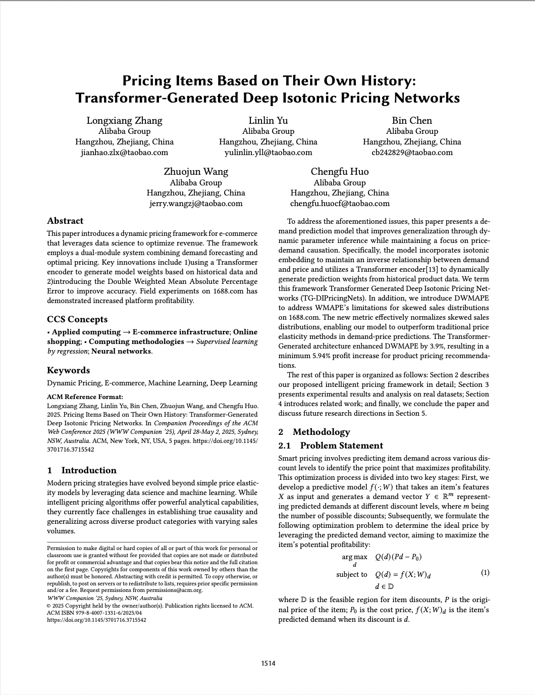
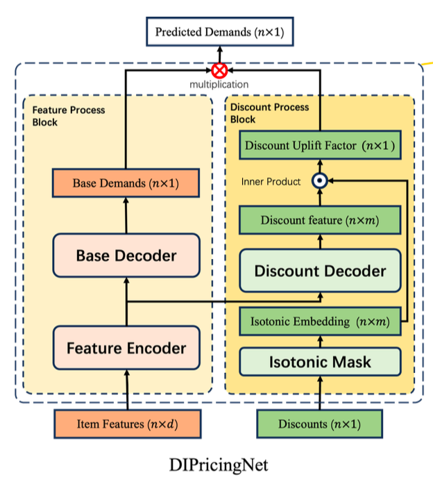
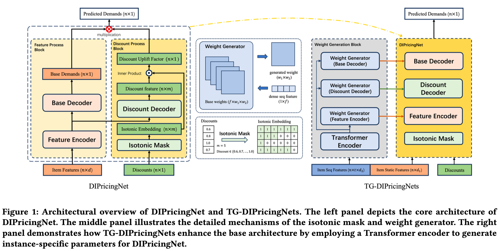
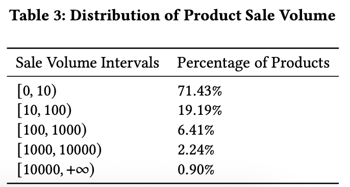
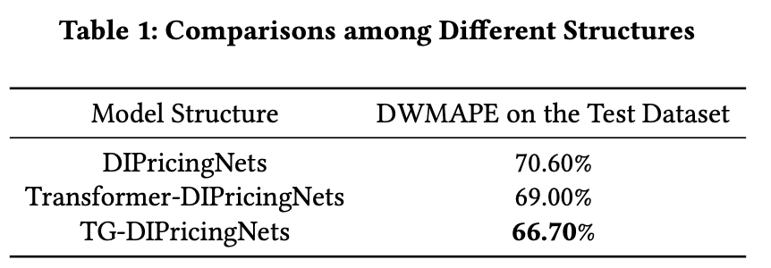
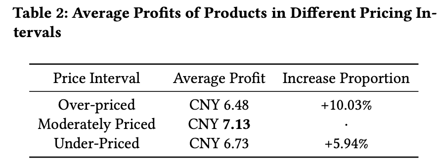
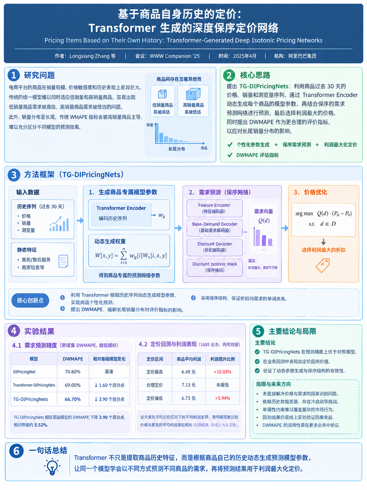

**速览1**:
阿里巴巴团队提出了一种面向电商动态定价的需求预测框架。利用商品历史数据，通过 Transformer 实现商品级个性化需求建模，提出DWMAPE 指标，预测商品在不同折扣水平下的需求，并据此寻找利润最优的定价方案。

**速览2**:
基于1688平台数据评测，新框架的DWMAPE相对基线下降 3.90 个百分点，在真实场景数据回测中，模型建议价格对应的业务分组平均利润最高。

## 01 论文信息

**标题**：Pricing Items Based on Their Own History: Transformer-Generated Deep Isotonic Pricing Networks（基于自身历史的商品定价与Transformer生成的深度保序定价网络）

**作者**：Longxiang Zhang、Linlin Yu、Bin Chen、Zhuojun Wang、Chengfu Huo

**期刊/会议**：ACM Web Conference 2025 Companion（WWW Companion ’25）

**发表时间**：2025年5月

**链接**：https://doi.org/10.1145/3701716.3715542

## 02 核心问题
给定商品的历史销售数据和商品属性，如何准确预测商品在不同折扣下的销量，并利用预测结果寻找利润最优的价格？

## 03 核心要点
1. Transformer生成商品专属模型权重。Transformer读取商品过去30天的价格、销量和页面浏览量，生成动态权重，用来构造该商品的需求预测网络，使需求模型能够根据商品自身的历史表现进行个性化预测。

2. 用单调结构约束价格-需求关系。在其他条件相同的情况下，价格降低通常不应导致预测需求降低。若模型输出的需求曲线违背这一单调性规律，后续优化器可能会基于不合理的预测寻找最优价格。本文通过 Isotonic Embedding（单调嵌入） 结构约束需求预测，使折扣增加、成交价格降低时，预测需求保持单调不减。

3. 改进极度偏斜销量分布下的评价指标。不同商品的价格、销量规模、历史价格变化及消费者响应存在很大差异。当少数商品贡献了绝大部分销量时，传统 WMAPE 可能难以区分不同模型的整体预测能力。本文提出 DWMAPE，先按实际销量区间分组计算 WMAPE，再按各组商品数量加权汇总，避免高销量商品过度主导总体评价。

## 04 研究动机
现代定价策略虽已不再局限于简单的价格弹性模型，但仍难以识别真正的因果关系，且难以在销量规模各异、特征不同的商品类别之间实现有效的泛化。

作者认为，单纯将历史序列编码后与静态特征拼接，虽然能够利用历史信息，但序列特征与静态特征在模型参数更新时仍然存在相对独立的路径。通过动态生成权重，二者能够共同影响损失函数对模型参数的梯度更新。

论文所研究的平台具有明显的销量长尾特征。超过 90% 的商品日销量低于 100 件，但少数商品的销量远高于大多数商品。论文希望通过 DWMAPE 更好地反映模型在不同销量层级商品上的预测表现。

## 05 方法思路
### 问题定义：将定价拆分为预测和优化
论文将智能定价分成两个阶段。

第一阶段，预测商品在各个折扣水平下的需求，
$$\hat Q(d)=f(X;W)_d$$
其中：
- $X$：商品相关输入特征。
- $W$：需求模型参数。
- $d$：候选折扣水平。
- $\hat Q(d)$：商品在折扣 $d$ 下的预测需求。

第二阶段，在可行折扣集合 $D$ 中，最大化预测利润：
$$\max_{d\in D}\hat Q(d)(P_d-P_0)$$
其中，$P_d$ 为折扣对应的销售价格，$P_0$ 为商品成本价。

完整的问题定义如下：
$$
\begin{aligned}
\underset{d}{\arg\max} \quad & Q(d)(Pd - P_0) \\
\text{subject to} \quad & Q(d) = f(X; W)_d \\
& d \in \mathbb{D}
\end{aligned}
$$

### 基础模型：DIPricingNet

DIPricingNet 是本文的基础需求预测架构，包含四个核心模块。Feature Encoder使用三层神经网络，将原始商品特征转换为稠密特征向量。Base-Demand Decoder输出非负标量，表示不打折情况下的基础需求。Discount Decoder输出长度为 $m$ 的非负向量，每个元素对应一个候选折扣水平，表示相应的潜在需求增量。**Discount Isotonic Mask根据折扣水平生成二值向量，随着折扣增加，掩码中 1 的数量增加，从结构上确保预测需求单调不减**。可以将其需求计算机制简化理解为：
$$\hat Q(d)=B(X)\left[1+\sum_{j=1}^{m}a_j(X)M_j(d)\right]$$
其中，$B(X)$ 表示基础需求，$a_j(X)$ 表示非负折扣增量权重，$M_j(d)$ 表示对应折扣的单调掩码。

### 核心创新：Transformer 生成商品专属的模型权重

论文在附录中比较了三种结构，其区别在于特征交互发生的位置。1）直接线性映射：两类特征对应的权重更新路径相互独立。 2）Transformer 编码后拼接：序列特征得到增强，但静态特征与序列特征的线性映射权重更新仍相对独立。 3）Transformer 生成权重：序列信息决定静态特征如何被下游网络处理，两类特征共同影响生成模块的梯度更新。

**TG-DIPricingNets 的优势不只是利用历史数据，而是让历史数据决定下游模型如何解释当前商品的静态属性。**

Transformer Encoder 将历史序列映射为一个稠密向量：
$$w_g=T(X_{\mathrm{seq}};W_T)$$
然后，利用该向量对基础权重矩阵进行加权组合：
$$W[x,y]=\sum_{i=1}^{n}w_g[i]W_o[i,x,y]$$
其中：
- $w_g$：由当前商品历史序列生成的权重表示。
- $W_o$：用于生成模型参数的基础权重矩阵集合。
- $W$：为当前商品动态生成的下游网络参数。
最后，使用生成的参数处理商品静态特征：
$$\hat Y=D(X_{\mathrm{static}};W)$$

### DWMAPE：解决销量长尾下的评价问题
传统的Weighted Mean Absolute Percentage Error (WMAPE)定义为：

$$\text{WMAPE} = \frac{\sum_{t=1}^{n} |A_t - F_t|}{\sum_{i=1}^{n}A_t}\times 100\%$$

其中，$A_t$为实际销量，$F_t$为预测销量。
由于分母与实际总销量有关，高销量商品对总体指标的影响通常更大。对于销量高度偏斜的平台，这可能掩盖模型在大量低销量商品上的预测差异。文中给出不同销量区间的商品数占比，约70%的商品销量在10件以下，而销量100件以上的商品仅占10%。

为了更公平地评估模型在不同销量层级上的表现，文中提出了Dynamic Weighted Mean Absolute Percentage Error (DWMAPE)。DWMAPE 首先将商品按实际销量区间分组，然后计算每个区间内的 WMAPE，最后按区间内商品数的比例加权汇总。

$$\text{DWMAPE} = \sum_{i=1}^{t}(\text{WMAPE}\cdot\frac{cnt(item_i)}{sum\_cnt})$$

## 06 结果分析
论文的实验分为两部分：需求预测精度实验和真实业务场景下的定价效果回测分析。第一个实验关注模型能否准确预测销量；第二个实验关注模型生成的定价建议是否具有潜在的利润提升价值。

### 模型需求预测精度评估
作者从 1688 平台清洗了 385 万条持续销售商品的销售记录，其中 350 万条用于训练，35 万条用于测试。

样本特征包含两类：1）历史序列特征：使用一个 $30 \times 3$ 的矩阵表示每条商品销售记录发生前 30 天的每日价格、销量和商品页面浏览量。2）静态特征：包括商品是否支持相关售前、售后服务的指标，以及商家的基本信息。

为了证明 TG-DIPricingNets 在商品销量预测方面具有更高的准确性，作者还在相同的数据集上训练了另外两个模型。第一个模型是作为基准模型的 DIPricingNet。第二个模型是 Transform-DIPricingNets，该模型使用 Transformer 将商品的历史序列特征编码为一个特征向量，然后将该向量与 DIPricingNet 中使用的静态特征相结合，从而生成销量预测结果。

由于销量分布存在偏态，WMAPE 的区分能力有限，作者设计了 DWMAPE 指标，并在测试集上使用 DWMAPE 评估各模型的表现，效果如下：引入 Transformer 编码历史序列后，DWMAPE 从 70.60% 降至 69.00%。进一步让 Transformer 生成下游网络权重后，DWMAPE 降至 66.70%。**TG-DIPricingNets 相较基础模型下降 3.90 个百分点。**

### 模型实际业务场景效果回测
作者使用 1688 自营业务两周的销售数据进行回测，利用过去 30 天的历史特征和每日静态特征，针对每件商品在 131 个折扣水平（0.7–2.0） 下分别预测销量，随后根据公式（1）计算最优定价。（关于折扣水平的解释，比如discount level为0.7，意味着商品打七折。）

根据商品的实际折扣与模型建议折扣之间的差异，将商品分为三组：1）定价偏高（Over-priced）：建议折扣比实际折扣低 0.05 以上。2）定价适中（Moderately priced）：建议折扣与实际折扣的差值绝对值小于 0.05。3）定价偏低（Under-priced）：建议折扣比实际折扣高出 0.05 以上。

评估结果表明，**与模型建议的定价策略更加接近的订单，其平均利润更高**，具体结果如下：

## 07 局限与展望
论文没有给出一个系统、完整的局限性章节，因此以下部分属于审慎的研究评价，而非作者逐条陈述的结论。

**历史相关性不等于价格因果效应**。历史价格并不一定是随机产生的。例如，商家可能在需求旺盛时涨价，在需求低迷时打折。因此，历史数据中观察到的价格与销量关系，可能混合了价格效应、需求变化、促销策略以及其他未观测因素。Transformer 能够学习复杂的历史模式，但模型结构本身并不能保证识别真实的价格因果效应。

**线上收益仍需进一步验证**。与线上随机实验相比，模型建议能否稳定带来增量利润。

## 论文摘要
本文提出一种在电子商务领域通过数据科学优化收入的动态定价框架,该框架将需求预测和价格优化分为两个阶段。核心创新点包括：1）基于历史数据使用Transformer编码器生成模型权重 2）提出更加适应业务场景的DWMAPE作为评价指标。在1688平台实际验证可提高平台利润。

## 图文速览

阿里巴巴团队提出了一种面向电商动态定价的需求预测框架。利用商品历史数据，通过 Transformer 实现商品级个性化需求建模，提出DWMAPE 指标，预测商品在不同折扣水平下的需求，并据此寻找利润最优的定价方案。

基于1688平台数据评测，新框架的DWMAPE相对基线下降 3.90 个百分点，在真实场景数据回测中，模型建议价格对应的业务分组平均利润最高。