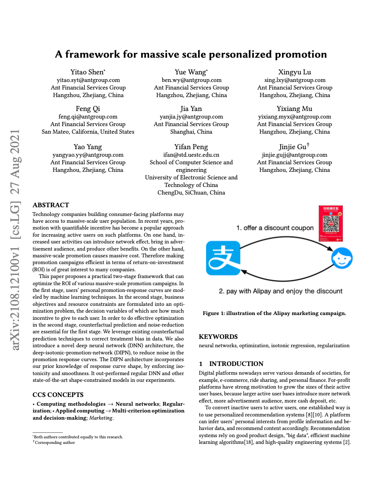
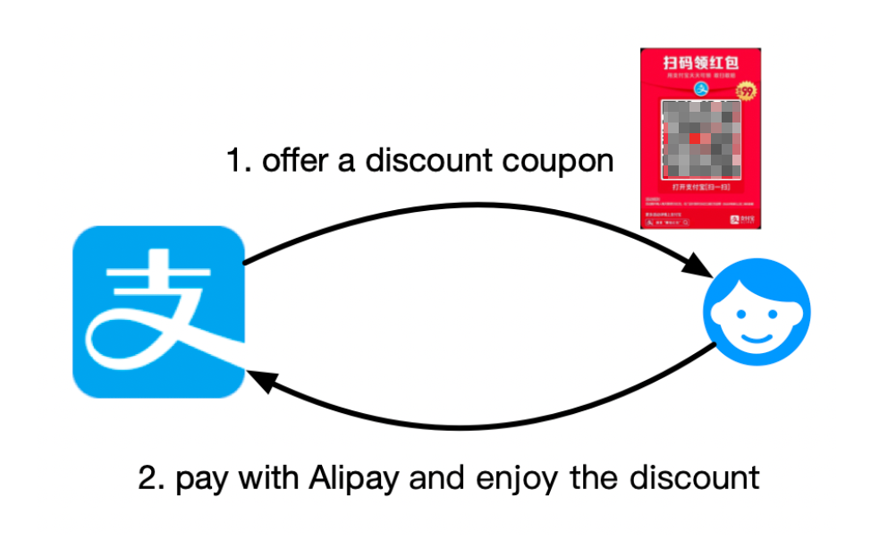
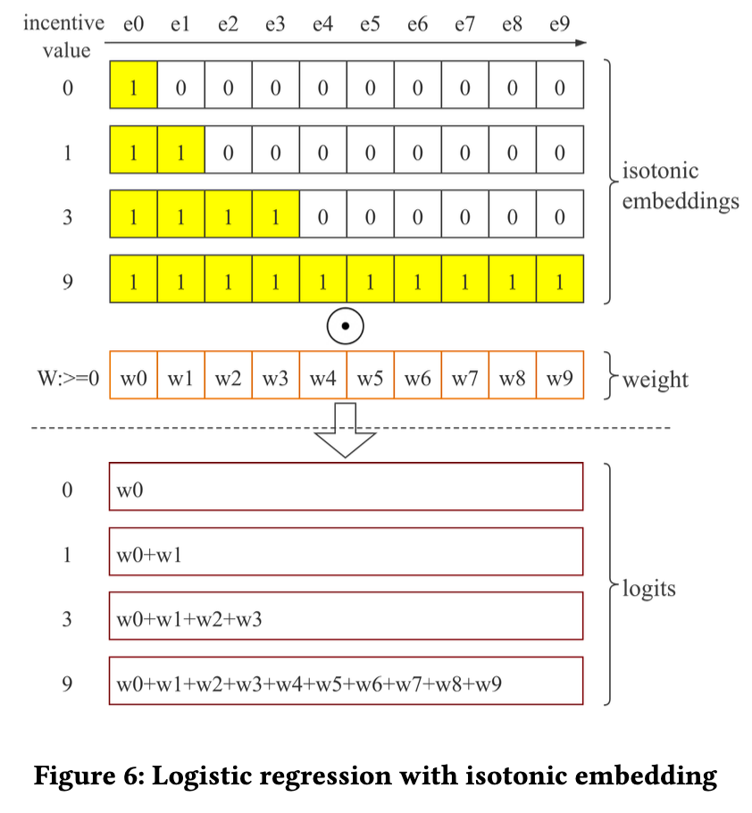
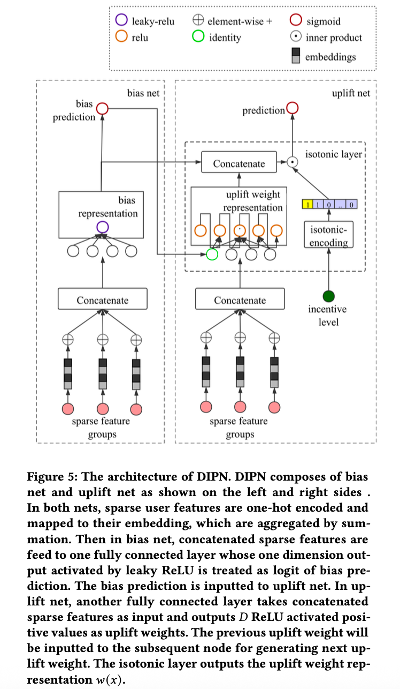
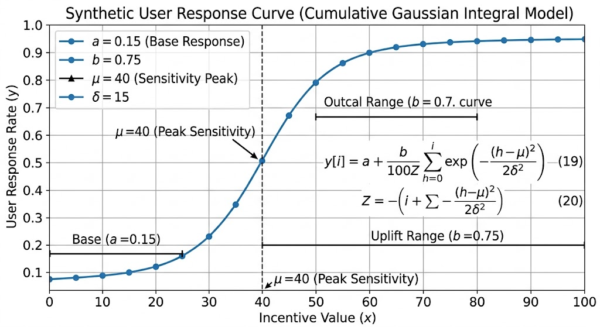
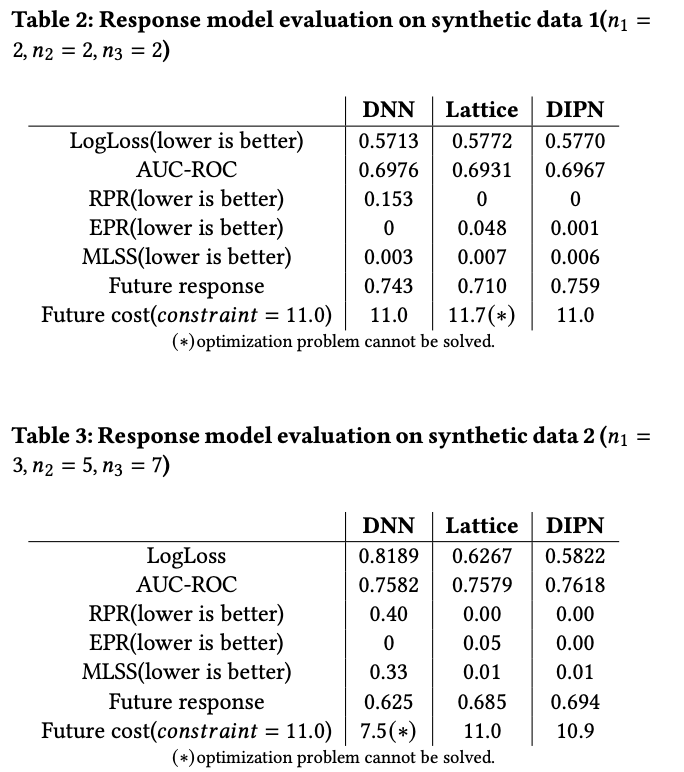
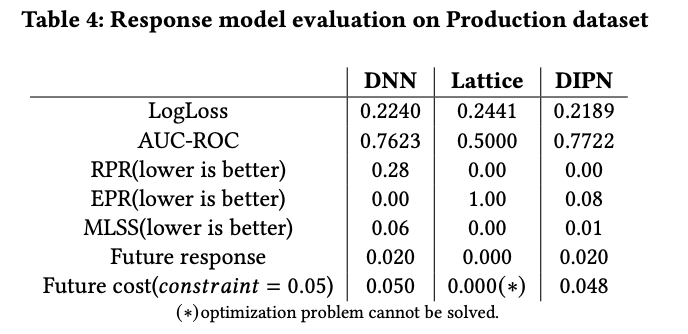
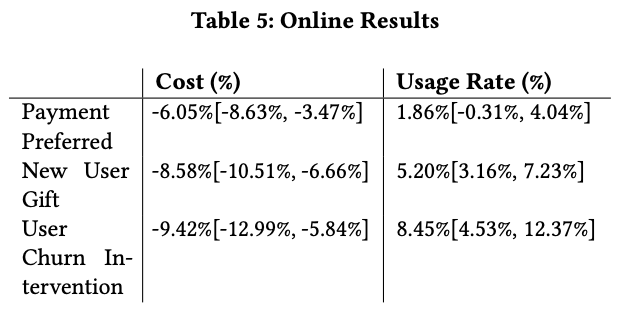

**速览1**：蚂蚁团队提出一个由个性化促销响应预测和线性规划优化组成的两阶段框架，并设计 DIPN，通过单调性约束与平滑正则化，学习用户对不同促销激励的响应曲线。

**速览2**：在合成数据实验中，DIPN 整体取得了较好的响应预测与营销决策结果；在支付宝花呗的三项线上营销实验中，相比普通 DNN，DIPN 能够降低激励成本，在不损失用户参与度的前提下，实现至少6.05%的预算节约。

## 01 论文信息
**标题**：A framework for massive scale personalized promotion / 大规模个性化促销框架
**作者**：Yitao Shen、Yue Wang、Xingyu Lu等
**发表时间**：2021 年 8 月
**链接**：https://arxiv.org/abs/2108.12100

## 02 核心问题

互联网平台在有限营销预算下，如何为大规模用户群体分配个性化促销激励，以最大化未来用户响应。以支付宝线下支付营销为背景，平台需要为每个用户，决定优惠券或红包的激励金额，使尽可能多的用户完成目标行为，同时控制总激励成本。

该问题包含两个相互关联的子问题。第一，如何准确预测不同用户，在不同激励水平下的响应概率。第二，如何将这些预测结果，转化为满足预算约束的个性化激励分配方案。

因此，论文的核心不是单独提升响应预测准确率，而是建立一套从响应曲线建模、反事实预测到约束优化决策的完整方法，并通过线上实验验证最终的营销业务效果。

## 03 核心要点
论文将连续或复杂的激励决策空间，离散化为有限个激励档位，并引入用户—档位分配变量，使原问题转化为线性规划（LP）。对于新到达用户，则利用拉格朗日对偶变量，将全局预算约束转化为单用户决策规则。

提出 Deep-Isotonic-Promotion-Network（DIPN），通过保序嵌入、非负的个性化 uplift 权重和独立的偏置网络与增量响应网络，保证预测响应随激励水平单调不减，并通过平滑损失抑制相邻激励水平间不合理的剧烈变化。

采用预测与优化解耦的两阶段框架。第一阶段针对用户特征和促销激励水平，预测用户的响应结果；第二阶段将预测结果作为优化问题的已知系数，在预算约束下求解各用户的激励分配方案。

## 04 研究动机
**大规模促销的成本高，必须提高营销预算的使用效率**。对于拥有大量用户的平台，优惠券、红包等激励能够促进用户活跃、支付和服务使用，但也会产生巨额成本。平台需要在既定预算下分配激励，而不是简单地向所有用户提供相同金额的优惠。

**传统响应预测容易受到样本稀疏和噪声的影响**。即使总体数据规模很大，某些用户群体与特定激励水平的组合仍可能缺乏足够样本。特别是在促销活动刚开始时，模型可用于训练的数据有限，难以可靠估计完整响应曲线。

**历史数据中的相关性不等于激励的因果效应**。在非随机营销活动中，激励金额可能与用户特征及活跃程度相关。例如，某些活跃用户可能更容易获得较低优惠，而不活跃用户可能被分配更高优惠。如果模型直接拟合观测到的激励金额与响应之间的关系，就可能错误地认为增加激励不会提升响应。

**需要兼顾全局预算优化与在线决策的可扩展性**。面对大规模用户群体，直接求解包含复杂非线性响应函数的优化问题，可能难以满足大规模生产系统计算需求。

## 05 方法思路
论文提出的两阶段框架可以概括为以下流程。

第一阶段：针对每个用户 \(i\)，根据用户特征 \(x_i\) 和激励水平 \(c_i\)，预测其响应期望 \(f(x_i,c_i)\)。如果业务目标是二分类事件，例如用户是否完成支付，那么模型输出可以解释为预测响应概率。

第二阶段：将每个用户在各激励档位上的预测响应作为优化系数，在总预算或其他资源约束下，选择各用户应获得的激励水平。

### 建立用户个性化响应模型
论文先将用户响应预测函数定义为：
\[
f(x_i,c_i)
\]

其中：
- \(x_i\)：用户 \(i\) 的特征向量。
- \(c_i\)：分配给用户 \(i\) 的激励金额。
- \(f(x_i,c_i)\)：用户在给定特征和激励水平下的响应预测值。
当响应标签是二分类变量时，\(f(x_i,c_i)\) 可以表示用户完成目标行为的预测概率。

接着给出连续激励决策的基本形式：在总预算不超过 \(B\) 的情况下，最大化所有用户的预测响应总和。

\[
\begin{aligned}
\max_{\{c_i\}} \quad
& \sum_i f(x_i,c_i) \\
\text{s.t.}\quad
& \sum_i c_i \le B
\end{aligned}
\tag{1}
\]

再将可选激励金额离散化为 \(D\) 个档位：
\[
\{d_j\mid j=0,1,\ldots,D-1\}
\]

定义决策变量 \(z_{ij}\)，表示用户 \(i\) 选择激励档位 \(d_j\) 的分配权重或概率。每个用户的分配权重之和为 1：
\[
\sum_j z_{ij}=1,\qquad 0\le z_{ij}\le 1
\]

在这一表示下，用户的预期响应，由不同档位的预测响应按照分配权重加权得到。
\[
\begin{aligned}
\max_{\{z_{ij}\}} \quad
& \sum_i\sum_j f(x_i,d_j)z_{ij}\\
\text{s.t.}\quad
& \sum_i\sum_j d_jz_{ij}\le B\\
& \sum_j z_{ij}=1,\quad \forall i\\
& z_{ij}\in[0,1],\quad \forall i,j
\end{aligned}
\tag{2}
\]

当新用户持续到达时，平台可能无法等待积累足够多的新用户后再统一求解全局优化问题。论文提出，可以在短时间窗口内求解历史用户群体对应的优化问题，并在用户群体相对稳定时复用最优对偶变量。

最后，对于单一预算约束，设拉格朗日乘子为 \(\lambda\)，则用户级决策可以写为：
\[
\max_{\{z_{ij}\}}
\sum_j\left[f(x_i,d_j)-\lambda d_j\right]z_{ij}
\]

满足：
\[
\sum_j z_{ij}=1,\qquad z_{ij}\in[0,1]
\]

另外，在理想的随机实验中，不同激励水平可以在可比的用户群体中随机分配，从而帮助识别激励对响应的影响。但实际业务中的历史数据往往来自非随机分配机制。论文采用逆倾向得分（Inverse Propensity Score，IPS）对观测样本进行加权，以校正处理偏差。

### DIPN：深度保序促销网络
**保序嵌入（Isotonic Embedding）的处理**。假设激励空间被离散为 \(D\) 个档位，分别为 \(d_0,d_1,\ldots,d_{D-1}\)。对于输入激励水平 \(c\)，论文构造一个长度为 \(D\) 的二进制向量 \(e(c)\)，其中小于或等于当前激励水平的档位对应 1，其余档位对应 0。

如果将该嵌入输入带有非负权重约束的逻辑回归模型，则可以保证预测响应随激励水平单调不减。
\[
f(c)=
\sigma\left(\sum_j w_j e_j(c)+b\right),
\qquad w_j\ge 0
\tag{10}
\]

其中，\(\sigma(\cdot)\) 为 Sigmoid 函数，\(b\) 为偏置项。

**个性化 uplift 权重**。论文进一步将上述权重扩展为用户特征的函数 \(w_j(x)\)，由神经网络预测每个用户在不同激励档位上的增量响应权重。

在二分类场景下，DIPN 的预测函数为：
\[
f(x,c)=
\sigma\left(\sum_j w_j(x)e_j(c)+b(x)\right)
\tag{12}
\]

其中：
- \(b(x)\) 表示用户在最低激励水平下的基准响应倾向。
- \(w_j(x)\) 表示与激励档位相关的个性化增量权重。
- \(e_j(c)\) 表示激励水平的保序嵌入。

可通过一阶泰勒展开进行数学合理性证明，针对相邻的两个激励档位 $d_j$ 和 $d_{j+1}$，利用一阶泰勒展开对 sigmoid 函数 $g$ 进行近似：$$f(d_{j+1}) - f(d_j) = g(z_{j+1}) - g(z_j) \approx g'(z_j)(z_{j+1} - z_j) = g'(z_j)w_{j+1}$

假设在局部区域内，如果 sigmoid 的导数 $g'(z_j)$ 可以被视为常数，那么提升权重 $w_{j+1}$ 就直接与 $f(d_j)$ 处的提升值成正比。

**平滑正则化处理**。仅保证单调性仍然不够。单调曲线可能在相邻激励档位之间出现不合理的陡峭变化，从而使优化器偏好某些预测值异常高的档位。

为此，论文引入平滑损失，约束相邻 uplift 权重之间的差异。其定义为：
\[
L_{\text{smooth}}(w)
=
\frac{1}{D}
\sum_j
\frac{(w_{j+1}-w_j)^2}{w_{j+1}w_j}
\tag{16}
\]

该损失通过相邻权重的相对差异来衡量局部变化，并对较大的相邻权重差异施加惩罚。

整体损失函数为：
\[
L=
\frac{1}{M}\sum_i
L_{\text{logloss}}\big(f(x_i,c_i),y_i\big)
+\alpha L_{\text{smooth}}\big(w(x_i)\big)
\tag{14}
\]

其中，\(M\) 是训练样本数量，第一项衡量响应预测误差，第二项是平滑正则项，\(\alpha\) 控制两者之间的权衡。使用二分类交叉熵作为 LogLoss：
\[
\begin{aligned}
L_{\text{logloss}}(f,y)
={}&-y\log f\\
&-(1-y)\log(1-f)
\end{aligned}
\tag{15}
\]

### 两阶段训练策略

论文将 DIPN 的训练分为两个阶段，以提高训练稳定性。

第一阶段：Bias Net Learning Phase（BLP）。 仅使用最低激励水平的样本训练偏置网络，学习用户在最低激励下的基准响应。

第二阶段：Uplift Net Learning Phase（ULP）。 固定偏置网络参数，使用全部样本训练 uplift 网络，学习不同激励水平带来的增量响应。输入用户的稀疏特征，以及接收来自偏置网络（Bias Net）的预测结果。输出 $D$ 个正值（即$w_1(x), w_2(x), \dots, w_D(x)$）。每一个输出值 $w_j(x)$ 都代表：当激励从上一个档位提升到第 $j$ 个档位时，给这个特定用户带来的转化概率增量。

论文还逐步降低平滑损失的权重 \(\alpha\)，使模型在训练初期更重视平滑性，而后逐步让数据拟合项发挥更大作用。

原文给出的衰减规则为：
\[
\alpha=
\max\left(
\alpha_l,\,
\alpha_u-\gamma\cdot\text{global\_step}
\right)
\tag{17}
\]

其中，\(\alpha_u\) 是初始上界，\(\alpha_l\) 是最终下界，\(\gamma\) 控制衰减速度。

## 06 结果分析
### 实验设计与评价指标
论文比较了三种响应建模方法：DNN：普通深度神经网络，作为基线模型。Deep Lattice Network：通过格点网络等结构表达形状约束。DIPN：论文提出的深度保序促销网络。

论文采用以下指标评价模型：
**LogLoss**：衡量概率预测与实际标签之间的拟合程度，越低越好。
**AUC-ROC**：衡量模型区分正负样本的排序能力，越高越好。
**Reverse Pair Rate（RPR）**：衡量预测响应违反单调性约束的程度，越低越好。具体来说，对于同一用户，如果更高激励水平的预测响应反而低于更低激励水平，就构成一个反向配对。
**Equal Pair Rate（EPR）**： 衡量不同激励水平对应相同预测响应的配对比例。论文将较低的 EPR 视为单调性表现较好的一个指标，因为它可以反映模型是否能够区分不同激励档位。
**Max Local Slope Standard Deviation（MLSS）**： 衡量局部响应曲线斜率的波动程度，越低通常表示曲线越平滑。
**Future Response**： 将训练得到的策略应用于新的用户群体后，评估其平均响应表现，越高越好。
**Future Cost**： 将策略应用于留出用户群体后，评估其激励成本是否超过预算约束。

### 合成数据实验

**基于高斯核积分的用户响应曲线**：由三个独热编码分类变量组成（类别数分别为 $n_1, n_2, n_3$），总共产生 $n_1 n_2 n_3$ 种不同的特征组合。针对每种组合随机生成四个参数：$a \sim U(0,1)$（基础响应）、$b = 1-a$（敏感幅度）、$\mu \sim U(-50,150)$（敏感中心）以及 $\delta \sim U(0,50)$（敏感宽度）。通过高斯核积分生成激励 $x \in [0, 100]$ 下的期望响应曲线 $y = f(x)$

$$y = a + b \int_{0}^{x} \exp\left(-\frac{(t-\mu)^2}{2\delta^2}\right) dt, \quad x \in [0, 100]$$

**模拟噪声与稀疏**：为每个特征组合等概率随机生成 $1 \sim 1000$ 个数据点（$z$），并为每个数据点随机分配 $1 \sim 100$ 的促销激励 $p$。根据期望响应 $y = f(p)$ 以概率 $y$ 随机生成 0/1 的二分类标签。

**数据集划分**：总共生成 2,0000 个数据点，划分为 5,000 个训练样本、5,000 个验证样本和 10,000 个测试样本。

**合成数据表现**：在不同维度的合成数据集（$n_1=2, n_2=2, n_3=2$ 以及 $n_1=2, n_2=5, n_3=7$）测试中，DIPN 均展现出最高的未来响应率和最低的未来成本。

### 真实生产数据实验
DIPN 在真实生产数据上能够改善概率预测质量，并在不降低该实验中报告的 Future Response 的情况下，将成本控制在预算以内。

### 支付宝线上A/B测试
论文将所提出的方案部署到支付宝花呗营销活动中，并使用线上 A/B 测试评估 DIPN 相对于 DNN 基线的效果。三项活动分别为默认支付方式推广、新用户激活和用户流失干预。花呗线上约3亿用户，DIPN 模型在每项实验中使用了 30% 的流量。

在论文测试的三类花呗营销场景中，DIPN 相比 DNN 基线能够降低激励成本，并在保持用户参与度的同时改善预算使用效率，实现至少6.05%的预算节约。

## 07 局限与展望
论文在结论中明确提出了两个主要的扩展方向。

**扩展因果推断方法**。当前框架采用 IPS 处理历史数据中的处理偏差，未来可以结合其他因果推断技术，例如因果嵌入（Causal Embeddings）和工具变量方法（Instrumental Variables），以适应不同的数据采集机制和因果建模需求。

**扩展优化问题的业务约束形式**。优化模型可以根据具体业务要求调整，只要相应计算复杂度能够得到处理。这意味着框架，不仅能够优化单一预算约束下的总用户响应，也可以扩展到多种资源约束、平均成本约束以及新用户的在线决策。

## 论文摘要
开发面向消费者平台的科技公司通常拥有庞大的用户群体，近年来，通过提供可量化的激励措施来开展推广活动，已成为增加此类平台活跃用户的一种流行方法。一方面，用户活跃度的提升可以产生网络效应、带来广告受众并创造其他收益；另一方面，大规模的推广也会带来巨大的成本。因此，提升推广活动在投资回报率（ROI）方面的效率，是许多公司高度关注的问题。

本文提出了一种实用的两阶段框架，能够优化各种大规模推广活动的投资回报率。在第一阶段，利用机器学习技术对用户的个人推广响应曲线进行建模。在第二阶段，将业务目标和资源约束表述为一个优化问题，其决策变量为给予每个用户的激励额度。为了在第二阶段进行有效的优化，反事实预测和降噪对第一阶段至关重要。我们利用现有的反事实预测技术来纠正数据中的处理偏差。同时，我们引入了一种新颖的深度神经网络（DNN）架构——深度保序推广网络（DIPN），以降低推广响应曲线中的噪声。DIPN 架构通过强制实施保序性（单调性）和平滑性，融入了我们对响应曲线形状的先验知识。该架构的表现优于常规 DNN 以及其他最先进的形状约束模型。

