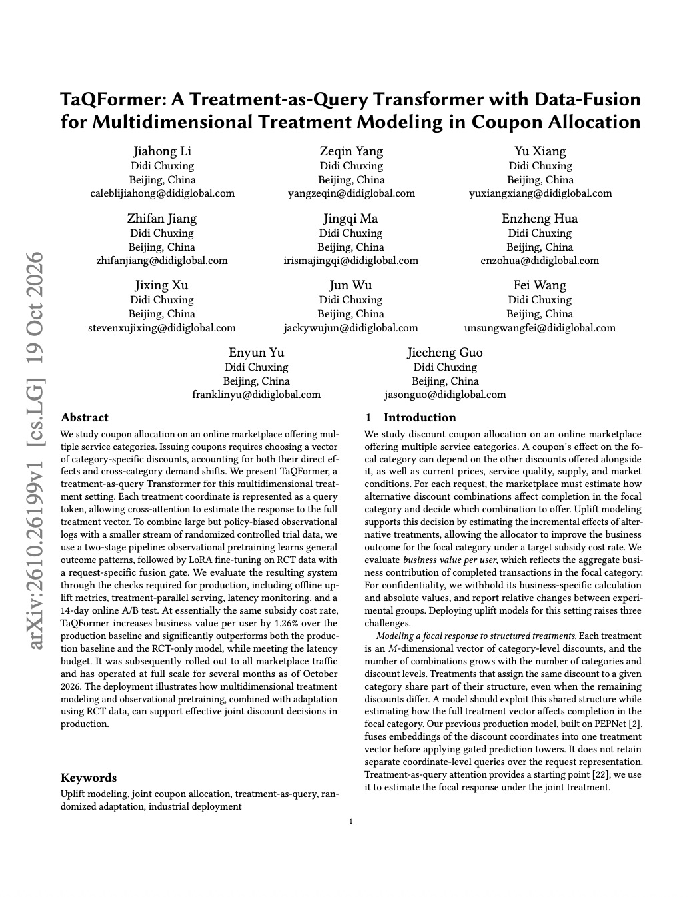

**速览1**:（一句话概括做了什么，比如xxx团队做了什么）
**速览2**:（一句话概括结果怎么样）

## 01 论文信息
**标题**：TaQFormer: A Treatment-as-Query Transformer with Data-Fusion for Multidimensional Treatment Modeling in Coupon Allocation / TaQFormer：面向优惠券分配中多维干预建模的 Treatment-as-Query Transformer 与数据融合

**作者**：Jiahong Li、Zeqin Yang 等

**发表时间**：2026 年 10 月

**链接**：https://doi.org/10.48550/arXiv.2610.26199

## 02 核心问题
在同时提供多个服务品类的在线市场中，如何为每个用户请求联合选择多个品类的优惠力度，从而提升目标品类的业务价值，同时控制整体补贴成本。

## 03 核心要点

## 04 研究动机
**多品类优惠券存在结构化的联合干预问题**。论文研究的优惠券不是一个简单的二元处理变量，而是由多个服务品类的折扣力度构成的向量。某个品类的折扣效果可能取决于其他品类同时提供的折扣。当品类数量与可选折扣档位增加时，可能的优惠组合数量会迅速增长。

**观测数据与随机试验数据各有不足**。观测数据规模大、覆盖请求广，但历史策略决定了优惠方案的分配方式，导致请求与动作组合之间可能存在选择偏差。RCT 数据通过随机分配优惠方案提供更可靠的处理比较，但试验数据规模相对较小，而且只能覆盖试验中实际随机化的请求和动作范围。

**Transformer 必须满足工业部署约束**。模型不仅需要提高预测质量，还要在较高 QPS 下完成所有候选优惠方案的评分，并满足严格的延迟预算。

## 05 方法思路

## 06 结果分析

## 07 局限与展望

## 论文摘要
我们研究一个提供多个服务品类的在线市场中的优惠券分配问题。发放优惠券需要选择一个由各品类折扣构成的向量，同时考虑优惠券的直接影响以及跨品类的需求转移。

我们提出 TaQFormer，一种面向多维干预场景的 Treatment-as-Query Transformer。模型将每个处理维度表示为一个 Query Token，通过交叉注意力估计完整处理向量对应的响应。

为了结合规模庞大但受到策略偏差影响的观测日志，与规模较小的随机对照试验数据，我们采用两阶段训练流程：首先利用观测数据预训练以学习通用的结果模式，然后使用 RCT 数据通过 LoRA 进行微调，并引入面向具体请求的融合门控机制。

我们通过生产部署所需的多项检查评估该系统，包括离线 Uplift 指标、处理方案并行推理、延迟监控以及为期 14 天的线上 A/B 测试。

在基本相同的补贴成本率下，TaQFormer 相较生产基线将人均业务价值提高了 1.26%，并且显著优于生产基线和仅使用 RCT 训练的模型，同时满足延迟预算。截至 2026 年 10 月，该系统已推广至全部市场流量，并全规模运行数月。

## 图文速览 

