**速览1**: 滴滴团队提出 TaQFormer，一种将多维优惠方案作为 Query 的 Transformer 模型，通过观测数据预训练与随机试验数据适配，解决多品类联合优惠券分配中的效果预测问题。

**速览2**: 在相同补贴成本率下，该模型使人均业务价值较生产基线提升 1.26%，在 500 QPS 压测下 P99 延迟为 21 ms，并已全量上线。

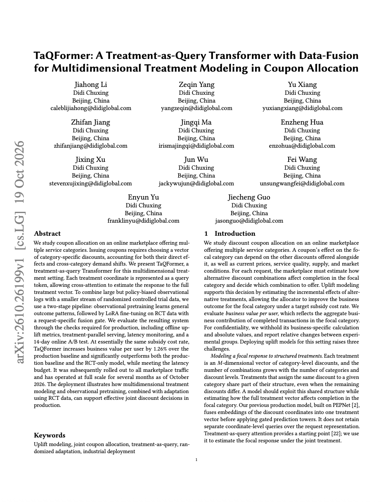

## 01 论文信息

**标题**：TaQFormer: A Treatment-as-Query Transformer with Data-Fusion for Multidimensional Treatment Modeling in Coupon Allocation / TaQFormer：面向优惠券分配中多维干预建模的 Treatment-as-Query Transformer 与数据融合

**作者**：Jiahong Li、Zeqin Yang 等

**发表时间**：2026 年 10 月

**链接**：https://doi.org/10.48550/arXiv.2610.26199

## 02 核心问题

在同时提供多个服务品类的在线市场中，如何为每个用户请求联合选择多个品类的优惠力度，从而提升目标品类的业务价值，同时控制整体补贴成本。

## 03 核心要点

**将多维优惠方案拆分成独立的 Treatment Tokens**。TaQFormer 的核心架构创新是 Treatment-as-Query：每个品类的优惠力度都有独立的 Treatment Token，这些 Token 作为 Query，通过交叉注意力从用户请求的特征表示中提取与当前优惠方案相关的信息。

**通过 OBS 预训练与 RCT 适配融合两类数据**。论文采用两阶段训练流程。第一阶段使用大规模观测数据（OBS）进行预训练，学习用户请求特征与优惠响应之间的一般规律。第二阶段使用 RCT 数据进行适配，同时保留冻结的 OBS 模型作为参考分支，并利用 LoRA 对部分编码器参数进行低秩适配，再通过请求级 Fusion Gate 融合两个分支的预测结果。

**通过并行推理满足生产要求**。对于同一个用户请求，不同优惠组合共享相同的请求特征表示。模型只需编码一次请求，再批量计算所有可行优惠方案的响应。在论文的实验设置中，模型需要评估 33 种可行的联合优惠方案。通过 Treatment-parallel Serving，TaQFormer 将两阶段模型的 P99 延迟从 34 ms 降至 21 ms。

## 04 研究动机

**多品类优惠券存在结构化的联合干预问题**。论文研究的优惠券不是一个简单的二元处理变量，而是由多个服务品类的折扣力度构成的向量。某个品类的折扣效果可能取决于其他品类同时提供的折扣。当品类数量与可选折扣档位增加时，可能的优惠组合数量会迅速增长。

**观测数据与随机试验数据各有不足**。观测数据规模大、覆盖请求广，但历史策略决定了优惠方案的分配方式，导致请求与动作组合之间可能存在选择偏差。RCT 数据通过随机分配优惠方案提供更可靠的处理比较，但试验数据规模相对较小，而且只能覆盖试验中实际随机化的请求和动作范围。

**Transformer 必须满足工业部署约束**。模型不仅需要提高预测质量，还要在较高 QPS 下完成所有候选优惠方案的评分，并满足严格的延迟预算。

## 05 方法思路

### 问题定义：联合优惠券分配

论文考虑一个同时提供 $M$ 个服务品类的在线市场。对于每个用户请求，系统需要决定各个品类的折扣力度。比如一个打车请求过来，系统需要给专车、优选、快车这三个品类分配折扣力度。定义如下：

$$
a=(a_1,\ldots,a_M)\in\prod_{m\in M}D_m
$$

$$
D=\{d_k=d_{\min}+(k-1)\Delta:
k=1,\ldots,K\},\quad \Delta>0
$$

其中：

- $a_m$ 表示品类 $m$ 的折扣深度。
- $D_m$ 是该品类允许使用的折扣集合。
- $d_{\min}$ 是最小折扣深度。
- $\Delta$ 是相邻档位的间隔。
- $K$ 是档位数量。

文中设定所有可行方案都必须满足以下业务规则：品类按照基础价格从高到低排列时，价格较高的品类必须获得更浅的折扣。例如，一个合法的折扣组合为：专车折5%、优选折10%、快车折15%

$$
\mathcal A=
\left\{
a\in\prod_{m\in M}D_m:
a_{m+1}-a_m\geq\Delta,\
m=1,\ldots,M-1
\right\}
$$

论文还定义了参考方案 $a_0$，即满足约束的最浅折扣方案。后续的增量效果预测以此为基准。

### 因果目标：预测每种优惠方案下的成交概率

论文将目标定义为：对每个可行优惠方案，预测一次符合条件的曝光，最终是否在归因窗口内，产生目标品类的完成交易。

潜在结果与条件平均处理效应：

$$
\tau(x;a,a_0)
=
\mathbb E[Y(a)-Y(a_0)\mid X=x]
$$

$$
\mu(x,a)=\mathbb E[Y(a)\mid X=x]
$$

$$
\tau(x;a,a_0)=\mu(x,a)-\mu(x,a_0)
$$

其中：

- $X$ 是决策时能够获取的请求特征。
- $Y(a)$ 是用户请求在优惠方案 $a$ 下的潜在成交结果，取值为 0 或 1。
- $\mu(x,a)$ 是请求特征为 $x$ 时，在方案 $a$ 下的条件期望成交结果。
- $\tau(x;a,a_0)$ 表示方案 $a$ 相对于参考方案 $a_0$ 的条件平均处理效应。

模型的主要输出是成交概率估计 $\hat y(x,a)$，而不是直接输出上述处理效应。通过比较候选方案与参考方案的响应预测，可以得到增量效果估计。

### 补贴成本约束下的分配优化

$$
\max_{b\in\mathcal B}
\sum_{i\in\mathcal I}
\sum_{a\in\mathcal A}
b_{ia}\hat r_{ia}
$$

$$
\text{s.t.}\quad
\sum_{i\in\mathcal I}
\sum_{a\in\mathcal A}
b_{ia}(c_{ia}-\rho)\hat r_{ia}
\leq 0
$$

其中：

- $\mathcal I$ 是所有待分配的请求集合。
- $\mathcal A$ 是可行优惠方案集合。
- $b_{ia}$ 是二元分配变量，表示请求 $i$ 是否选择方案 $a$。
- $\mathcal B$ 是满足每个请求只能选择一个方案的分配矩阵集合。
- $\hat r_{ia}$ 是请求 $i$ 在方案 $a$ 下的预期业务价值。
- $c_{ia}$ 是单位业务价值对应的补贴成本率。
- $\rho$ 是目标补贴成本率。

拉格朗日松弛后的线上决策规则：

$$
a_i^\star
=
\arg\max_{a\in\mathcal A}
\hat r_{ia}
\left[1-\lambda(c_{ia}-\rho)\right]
$$

该公式将原本涉及全体请求的预算约束问题，转化为可以逐请求计算的评分问题。其中，$\lambda$ 是非负的拉格朗日乘子，用于调节业务价值和补贴成本之间的权衡。论文通过历史流量校准该参数，使实际补贴成本率接近目标值。

### TaQFormer 的整体架构

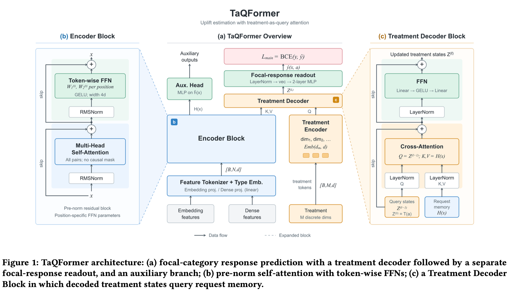

TaQFormer 采用双路径架构（Two-path Architecture），将请求特征建模与优惠方案建模分开处理：一条是 **Treatment-independent Request Path**，负责把用户请求中的多种异质特征编码成统一的请求表示；另一条是 **Treatment-dependent Treatment Path**，负责将不同服务品类的折扣方案编码成多个 Treatment Token，再通过交叉注意力从请求表示中提取与当前优惠方案相关的信息，最终预测用户在该优惠方案下完成目标服务的概率。两条路径的输出在预测层汇合，形成针对一个请求、一个优惠方案的标量预测结果。

从数据维度看，架构的核心变化可以概括为：

$$
\underbrace{x}_{\text{请求原始特征}}
\rightarrow
\underbrace{X(x)\in\mathbb R^{N\times d}}_{\text{请求特征 Token}}
\rightarrow
\underbrace{H(x)\in\mathbb R^{N\times d}}_{\text{请求表示}}
$$

与此同时，针对某一个优惠方案：

$$
\underbrace{a\in\mathbb R^M}_{\text{多维折扣方案}}
\rightarrow
\underbrace{T(a)\in\mathbb R^{M\times d}}_{\text{Treatment Token}}
\rightarrow
\underbrace{Z^{(L)}\in\mathbb R^{M\times d}}_{\text{解码后的 Treatment 表示}}
\rightarrow
\underbrace{\hat y(x,a)\in\mathbb R}_{\text{响应概率}}
$$

其中，$N$ 表示请求特征 Token 的数量，$M$ 表示 Treatment 的维度，即参与联合建模的服务品类数量，$d$ 表示 Transformer 的隐藏维度。

### Feature Tokenizer：请求特征 Token 化

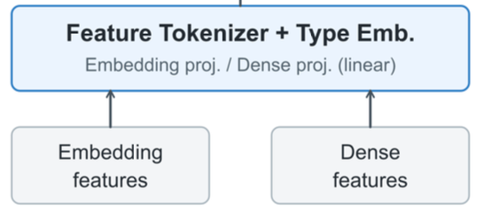

请求 $x$ 包含多种类型的特征，例如标量特征、类别特征嵌入，以及预训练得到的结构化向量。不同类型的特征原本具有不同的数据形式和维度，不能直接作为统一的 Transformer 输入。

因此，TaQFormer 首先通过 Feature Tokenizer，将不同类型的特征映射到统一的隐藏维度 $d$，并为每个特征分配一个 Token。同一输入类型内部采用共享投影，不同特征字段按照固定顺序排列。

### Encoder：请求特征交互与编码

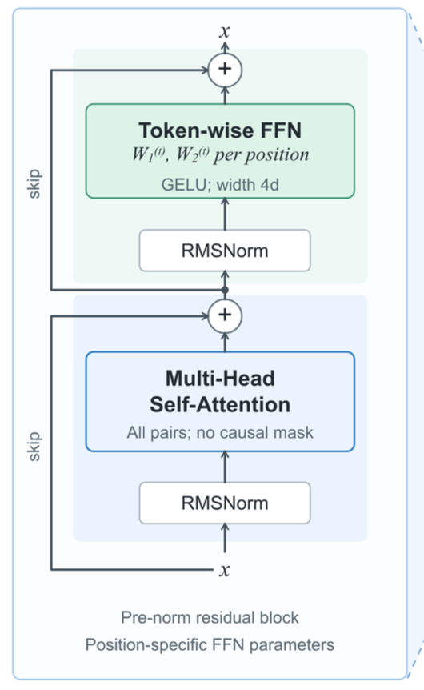

Tokenizer 输出的 Token 序列进入 Transformer Encoder，通过多个 Encoder Block 建模请求内部不同特征之间的交互，最终形成请求表示 $H(x)$。论文中的 Encoder Block 采用 Pre-RMSNorm 结构，每个 Block 主要包含两个部分。

**第一部分：Multi-Head Self-Attention** 输入的 $N$ 个 Token 通过多头自注意力机制进行特征交互。每个 Token 都可以关注其他 Token，并根据注意力权重聚合相关特征的信息。经过这一过程，每个 Token 的表示不再只包含自身特征信息，还融合了其他请求特征的上下文信息。

**第二部分：Token-wise FFN** 自注意力之后，进入前馈网络 FFN，进一步进行特征表示变换。每个 Token 位置拥有独立的 FFN 参数，而不是所有 Token 共用同一个 FFN。原因是论文认为，每个 Token 对应固定的语义字段，不同字段具有不同的语义。如果使用共享 FFN，就相当于让不同语义的字段使用相同的变换参数；使用独立 FFN，则可以针对每个字段学习自己的特征变换方式。

### Treatment Encoder：优惠方案 Token 化

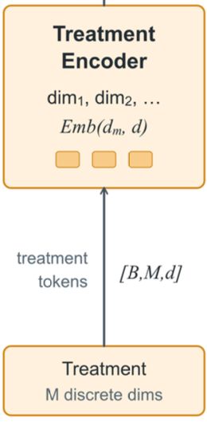

论文研究的是多服务品类联合优惠分配。一个 Treatment 不再是单一优惠力度，而是由多个服务品类的折扣坐标共同组成。假设有 $M$ 个服务品类，一个优惠方案表示为：

$$
a=(a_1,a_2,\ldots,a_M)
$$

其中 $a_j$ 表示第 $j$ 个服务品类对应的折扣。

aQFormer 并没有将所有折扣直接拼接成一个向量，而是为每个折扣坐标分别建立 Embedding：

$$
e_j:D_j\rightarrow\mathbb R^d
$$

也就是说，第 $j$ 个品类的折扣 $a_j$，会通过对应的 Embedding 表映射成一个 $d$ 维向量。

然后，将所有折扣坐标的 Embedding 组合起来：

$$
T(a)=[e_1(a_1),\ldots,e_M(a_M)]
\in\mathbb R^{M\times d}
$$

这里的维度变化是：

$$
M\text{ 个折扣值}
\rightarrow
M\text{ 个 }d\text{ 维 Token}
\rightarrow
M\times d
$$

### Treatment Decoder：Treatment 与请求特征交互

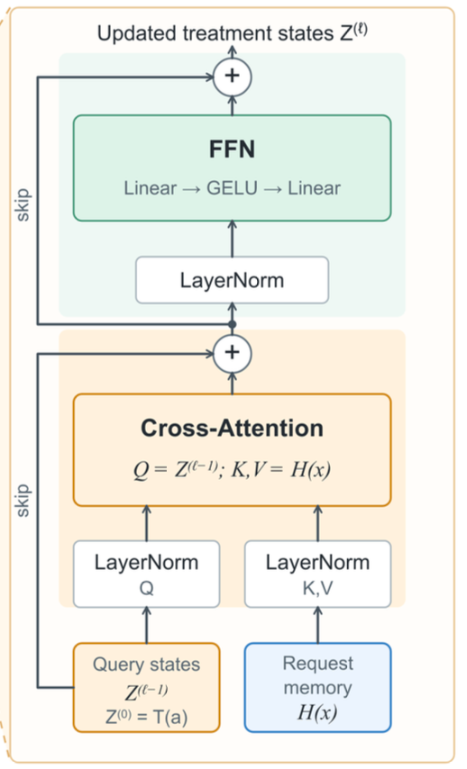

前面 Encoder 得到的是请求表示 $H(x)$，它只描述用户请求本身；Treatment Encoder 得到的是优惠方案表示 $T(a)$，它只描述当前优惠方案。但模型真正需要解决的问题是：**给定某个用户请求和某个多品类优惠方案，预测用户在该优惠方案下完成目标服务的概率**。

因此，需要让 Treatment Token 主动从请求表示中，提取与当前优惠方案相关的信息。论文采用多个 Treatment Decoder Block，每个 Block 包含 Cross-Attention 和 FFN 两部分。

**第一部分：Cross-Attention**

与前面的 Self-Attention 不同，这里使用的是交叉注意力机制。具体来说：Query 来自当前优惠方案的 Treatment Token。Key 和 Value 来自前面 Encoder 输出的请求表示。

论文给出了每个注意力头的注意力权重：

$$
P_h^{(\ell)}(x,a)
=
\operatorname{softmax}
\left(
\frac{
Q_h^{(\ell)}
(K_h^{(\ell)})^\top
}{
\sqrt{d_h}
}
\right)
\in\mathbb R^{M\times N}
$$

其中：

- $M$：Treatment Token 数量。
- $N$：请求特征 Token 数量。
- $d_h$：每个注意力头的维度。
- $Q_h^{(\ell)}$：由 Treatment Token 投影得到的 Query。
- $K_h^{(\ell)}$：由请求特征投影得到的 Key。

这里体现了 Treatment-as-Query 的核心思想：不是让用户请求去查询优惠方案，而是让优惠方案中的每个折扣坐标，主动查询用户请求。

Cross-Attention 完成后，模型通过残差连接更新 Treatment 表示：

$$
\widetilde Z^{(\ell)}
=
Z^{(\ell-1)}
+
\operatorname{CA}^{(\ell)}
\left(
\operatorname{LayerNorm}(Z^{(\ell-1)}),
\operatorname{LayerNorm}(H(x))
\right)
$$

**第二部分：FFN 进一步变换 Treatment 表示**

Cross-Attention 后，模型使用 FFN 进一步处理更新后的 Treatment Token：

$$
Z^{(\ell)}
=
\widetilde Z^{(\ell)}
+
\operatorname{FFN}^{(\ell)}
\left(
\operatorname{LayerNorm}(\widetilde Z^{(\ell)})
\right)
$$

FFN 主要负责对交叉注意力得到的表示进行非线性变换，同样通过残差连接保留原有信息。此时，每个 Treatment Token 不再只是原始折扣 Embedding，而是已经融合了当前用户请求信息的、具有 Treatment 条件的表示。

### Focal-response Readout：联合预测目标品类响应

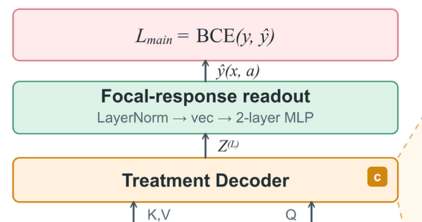

经过 Treatment Decoder 后，模型已经得到了所有折扣坐标对应的上下文表示。但最终需要预测的是一个具体的结果：**用户在当前联合优惠方案下，是否会完成目标服务**。

首先，通过 LayerNorm 对输出进行归一化，然后将所有 Treatment Token 展平：

$$
\operatorname{vec}
\left(
\operatorname{LayerNorm}(Z^{(L)})
\right)
\in\mathbb R^{Md}
$$

这里发生了一次重要的维度变化：

$$
M\times d
\rightarrow
Md
$$

例如，论文实验中 $M=2,d=64$，那么：

$$
2\times64
\rightarrow
128
$$

即两个 Treatment Token 被展平为一个128维向量。随后，输入两层 GELU MLP，输出一个标量 Logit：

$$
s(x,a)
=
f\left(
\operatorname{vec}
\left(
\operatorname{LayerNorm}(Z^{(L)})
\right)
\right)
$$

再经过 Sigmoid 转换为预测概率：

$$
\hat y(x,a)=\sigma(s(x,a))
$$

最终输出：

$$
\hat y(x,a)\in\mathbb R
$$

它表示用户在请求 $x$ 和优惠方案 $a$ 下，完成目标服务的预测概率。

这里为什么要把所有 Treatment Token 展平后联合预测，而不是每个品类单独预测？

论文给出的设计意图是：联合 Readout 可以同时读取全部 $M$ 个折扣坐标的解码表示。因此，目标品类的响应不仅取决于自身折扣，还可以受到其他品类折扣的影响。这对于多品类优惠分配非常重要，因为不同品类的优惠可能存在相互影响，不能简单地将各个品类的响应视为完全独立。

### OBS + RCT 两阶段训练

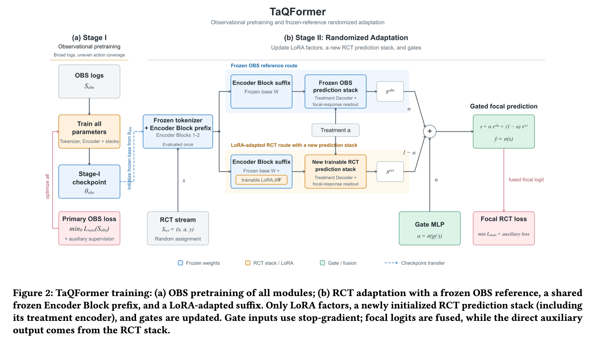

前面介绍的是 TaQFormer 的基础预测架构。完整模型还包含 OBS 预训练和 RCT 适配两个阶段。

**Stage I：OBS 预训练**

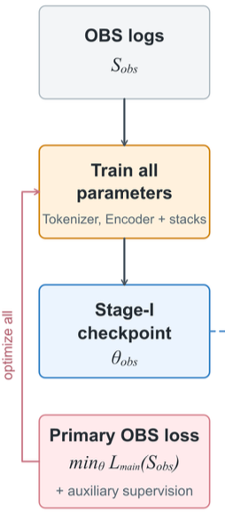

这阶段使用 OBS 数据训练完整模型，经过训练，模型学到请求特征表示和 Treatment 条件下的响应预测能力。此阶段完成后，模型参数作为第二阶段的 OBS 参考模型。

**Stage II：RCT 适配**

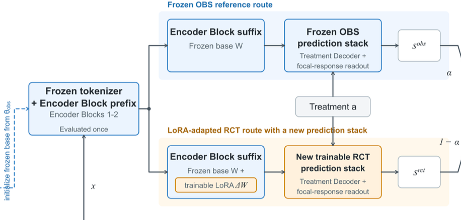

论文将 Encoder 分成共享前缀（Shared Prefix）和适配后缀（Adapted Suffix）：前 $L-L_a$ 个 Encoder Block 作为共享前缀，只计算一次。最后 $L_a$ 个 Encoder Block 分别运行 OBS 冻结路径和 RCT 适配路径。

可以理解为：在 OBS 预训练模型迁移到 RCT 数据进行适配时，不是把整个 Encoder 都重新训练，而是将 Encoder 前面一部分层冻结共享，后面一部分层通过 LoRA 进行适配。

接下来，两条路径分别使用各自的 Treatment Encoder 和 Prediction Stack：OBS 路径输出参考 Logit：$s^{obs}(x,a)$。RCT 路径输出适配后的 Logit：$s^{rct}(x,a)$。

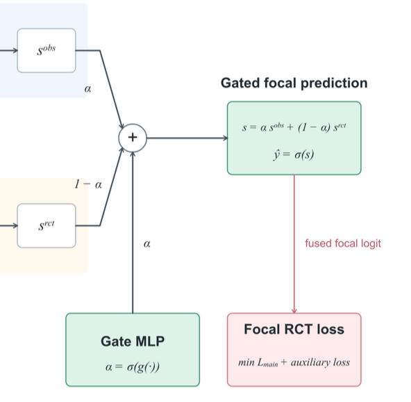

由于 OBS 和 RCT 数据的生成机制不同，两条路径对不同请求和优惠方案的预测误差可能不同。因此，论文设计了一个实例级 Gate，根据当前请求和 Treatment 的信息，动态融合两条路径的预测结果。

Gate计算融合权重的公式：

$$
\alpha(x,a)=\sigma\left(g\left(\operatorname{sg}
\left(\bar H^{rct}(x),T^{rct}(a),s^{obs}(x,a),s^{rct}(x,a),
|s^{obs}(x,a)-s^{rct}(x,a)|\right)\right)\right).
$$

其中：

- $\bar H^{rct}(x)$：RCT 路径得到的请求特征汇总表示。
- $T^{rct}(a)$：RCT 路径中的 Treatment 表示。
- $s^{obs}(x,a)$：OBS 路径输出的预测 Logit。
- $s^{rct}(x,a)$：RCT 路径输出的预测 Logit。
- $|s^{obs}-s^{rct}|$：两条路径预测 Logit 的绝对差值。
- $g(\cdot)$：表示 Gate 网络，将上述输入特征映射为一个标量。
- $\operatorname{sg}(\cdot)$：表示 Stop-Gradient（停止梯度传播）。

Gate 融合两条路径的预测结果公式：

$$
s(x,a)=\alpha s^{obs}(x,a)
+(1-\alpha)s^{rct}(x,a),
$$

$$
\hat y(x,a)=\sigma(s(x,a)).
$$

其中：

- $\alpha$：OBS 路径的融合权重。
- $1-\alpha$：RCT 路径的融合权重。
- $s^{obs}$：OBS 路径输出的 Logit。
- $s^{rct}$：RCT 路径输出的 Logit。
- $s(x,a)$：融合后的 Logit。
- $\hat y(x,a)$：经过 Sigmoid 转换后的最终预测概率。

## 06 结果分析

### 实验设置

离线实验使用 Qini、AUC 和 PCOC 三项指标。Qini 衡量增量效果排序质量；AUC 衡量成交预测的区分能力；PCOC 衡量预测成交总量与实际成交总量的比例，越接近 1 表示整体校准越好。

实验配置包括 34.5M 参数的部署模型、4 个 Encoder Block、2 个 Treatment Decoder Block、64 维隐藏表示、4 个注意力头，以及 RCT 阶段的 LoRA 秩 16、缩放系数 16。OBS 数据达到数千万条，RCT 数据达到数百万条。

### 整体效果和消融实验

在相同 RCT 训练数据与测试集下，TaQFormer 的单阶段版本与 PEPNet、EFIN、TransTEE 等方法进行了比较。结果如下：TaQFormer的各项指标优于生产基线与相关模型。

下表中也展示了消融实验的效果，结果表明 Encoder 和 Treatment Decoder 均有贡献。将 Encoder 替换为 Flat MLP 后，Qini 和 AUC 均下降，整体校准也变差。将 Treatment Decoder 替换为 PEPNet 风格的融合优惠向量与门控预测塔后，Qini 下降至 0.2536。另外，Treatment-as-Query Decoder 可以搭配 Wukong 和 UniMixer 等不同 Encoder，说明其并不依赖特定的请求编码器架构。

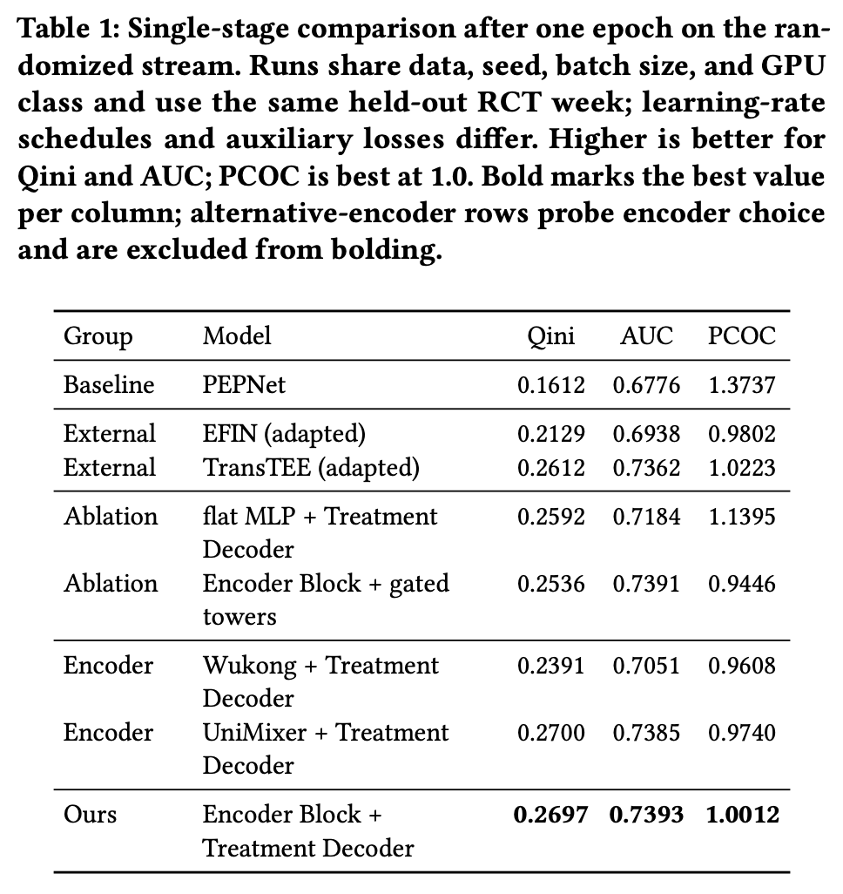

### 不同模型容量的效果

论文测试了从 2.6M 到 136M 参数的多个模型配置。

深度实验中，随着模型深度增加，AUC 从 L1 配置的 0.7392 上升至 L4 配置的 0.7412，Qini 在 L4 达到 0.2737，但 L3 的 Qini 曾下降至 0.2665。

宽度实验中，128 维、136M 参数的模型虽然降低了主任务 BCE，但 Qini 只有 0.2653，低于 32 维、9M 参数模型的 0.2666。

这表明：成交概率预测更准确，不必然意味着优惠券增量效果排序更准确。

最终，作者选择 34.5M 参数的部署配置，主要考虑其预测质量、模型容量和线上服务成本之间的综合权衡。

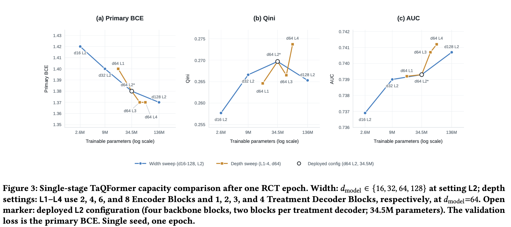

### 两阶段训练评估

主要发现有三点。

第一，OBS 数据并非越多越好。单独使用 OBS 的 Qini 只有 0.2548；简单混合 OBS 和 RCT 后，Qini 也低于 RCT-only 模型。这说明增加数据量并不自动改善增量效果排序。

第二，常规的 OBS 预训练后全量微调虽然提高了 AUC，但 Qini 仍略低于 RCT-only 模型，说明传统迁移学习未必能充分利用 OBS 数据。

第三，LoRA 与 Fusion Gate 的组合取得了这些训练策略中最高的 Qini 和 AUC。相较于常规的 OBS 预训练后全量微调，Qini 从 0.2673 提高至 0.2706，AUC 从 0.7421 提高至 0.7454。

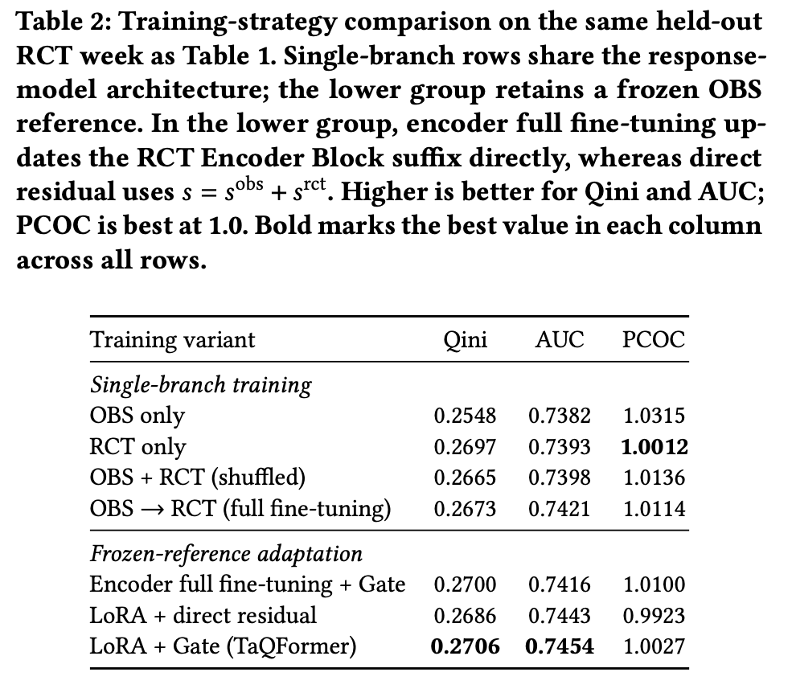

### 在线推理效率

在 NVIDIA RTX 6000D、批量大小 256、500 QPS 的 10 分钟压测中，论文得到以下结果：两阶段 TaQFormer模型，并行推理 P99为21ms，降低约 38% ；RCT-only 模型，并行推理 P99为18ms，降低约 38% 。

### 线上A/B测试

论文进行了为期 14 天的线上 A/B 测试。每个用户根据用户 ID 的哈希结果固定进入一个实验组，三个实验组均使用相同的下游分配器与补贴成本目标。

生产基线的人均业务价值指数被设为 100。RCT-only 模型将其提升至 101.08，而两阶段 TaQFormer 将其提升至 101.26。两阶段模型相较生产基线提升 1.26%，相较 RCT-only 模型也有额外收益。论文报告，使用 CUPED 调整的双样本 t 检验后，相关比较均达到 $p<0.05$。同时，三个实验组的补贴成本率分别为 20.43%、20.45% 和 20.42%，差异很小。

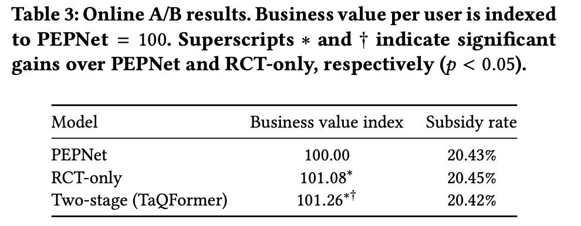

## 07 局限与展望

论文目前的系统，是在两个服务类别的场景下进行建模和线上验证，未来计划将其扩展到七个以上的服务类别。随着可行动作空间（action space）的增长，这种扩展将需要对干预覆盖度（treatment coverage）、候选动作选择（candidate-action selection）以及线上服务效率（serving efficiency）进行进一步评估。

## 论文摘要

我们研究一个提供多个服务品类的在线市场中的优惠券分配问题。发放优惠券需要选择一个由各品类折扣构成的向量，同时考虑优惠券的直接影响以及跨品类的需求转移。

我们提出 TaQFormer，一种面向多维干预场景的 Treatment-as-Query Transformer。模型将每个处理维度表示为一个 Query Token，通过交叉注意力估计完整处理向量对应的响应。

为了结合规模庞大但受到策略偏差影响的观测日志，与规模较小的随机对照试验数据，我们采用两阶段训练流程：首先利用观测数据预训练以学习通用的结果模式，然后使用 RCT 数据通过 LoRA 进行微调，并引入面向具体请求的融合门控机制。

我们通过生产部署所需的多项检查评估该系统，包括离线 Uplift 指标、处理方案并行推理、延迟监控以及为期 14 天的线上 A/B 测试。

在基本相同的补贴成本率下，TaQFormer 相较生产基线将人均业务价值提高了 1.26%，并且显著优于生产基线和仅使用 RCT 训练的模型，同时满足延迟预算。截至 2026 年 10 月，该系统已推广至全部市场流量，并全规模运行数月。

## 图文速览

滴滴团队提出了 TaQFormer，解决多品类服务场景中如何联合决定优惠券折扣力度的问题。它不仅要预测某个优惠能带来多少成交，还需要考虑不同品类优惠同时出现时的相互影响。

方法上，模型把每个品类的折扣分别变成一个 Query，通过交叉注意力读取用户请求的相关特征，再联合预测目标品类的成交概率。训练时先使用大规模观测数据学习通用规律，再用 RCT 数据配合 LoRA 和 Fusion Gate 进行适配。

实验结果显示，在相同补贴成本率下，人均业务价值比生产基线提高 1.26%；线上 500 QPS 压测的 P99 延迟为 21 ms，模型已全量上线。

通俗地说，这项工作的重点是：先学会不同优惠组合可能带来什么结果，再用随机试验数据校正判断，最后让分配系统在预算不变的情况下，尽可能把优惠发得更有效。

封面图

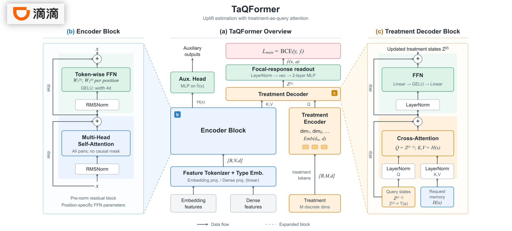
