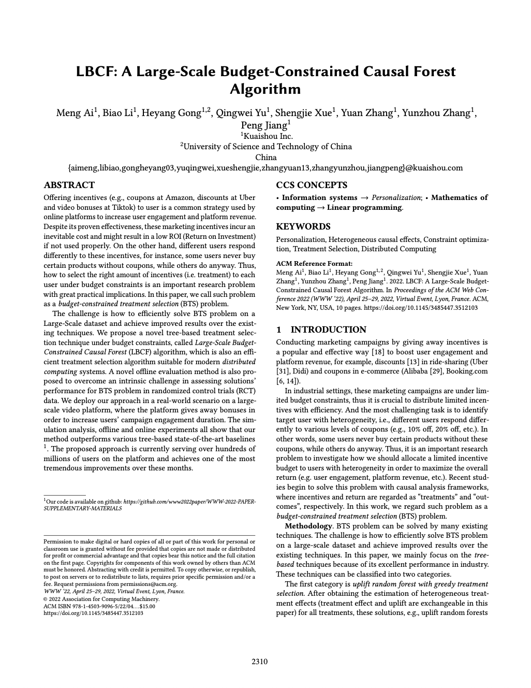
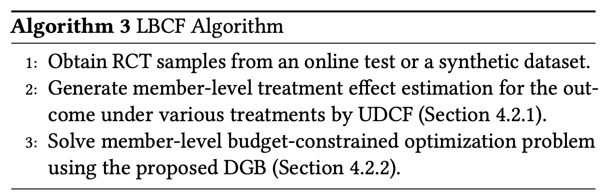
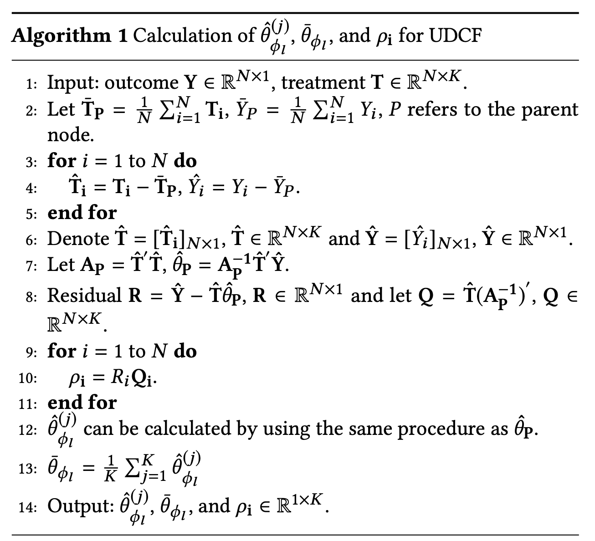
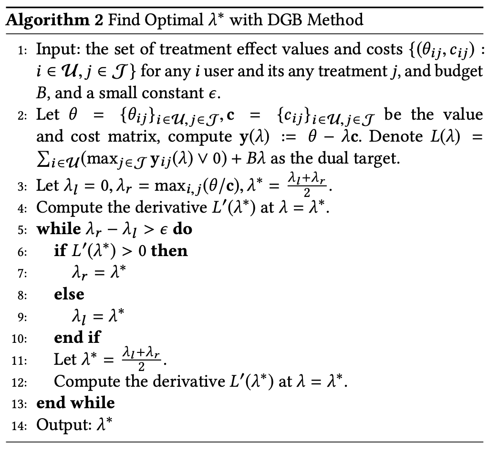
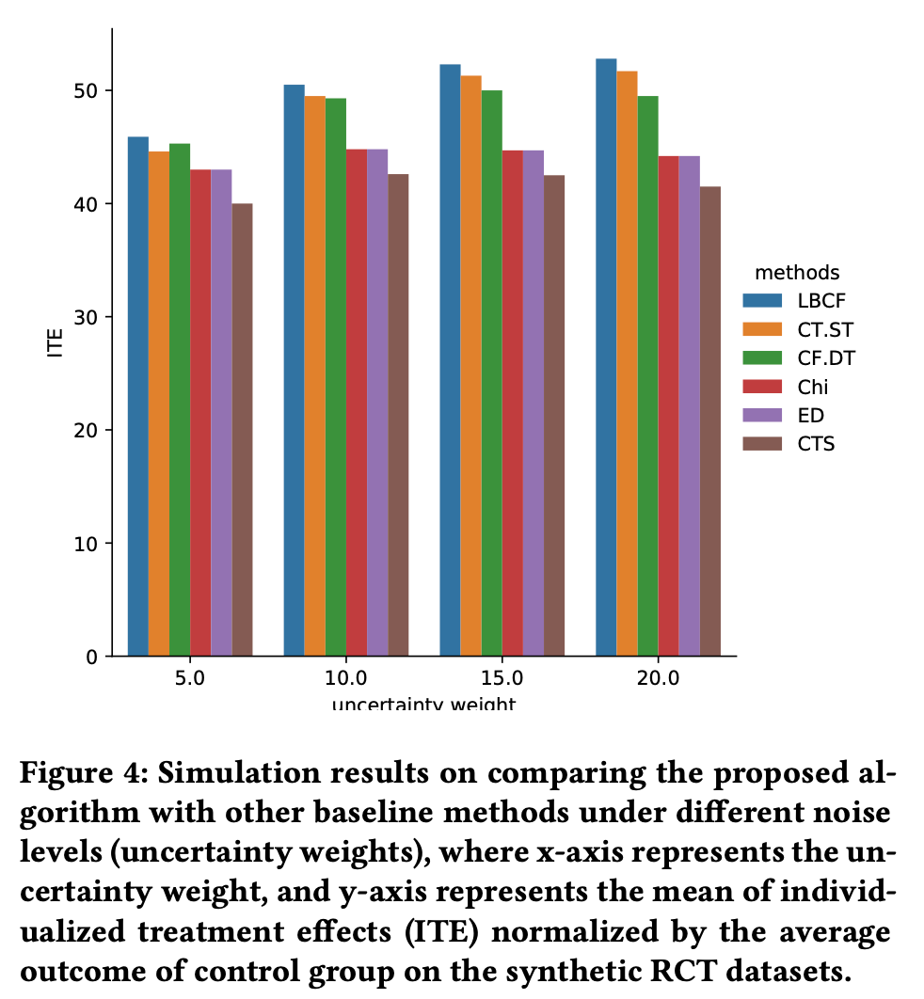
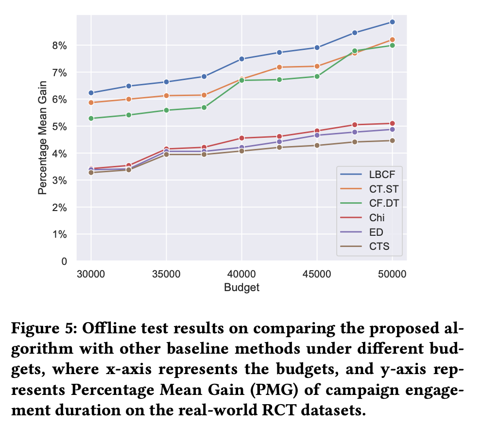
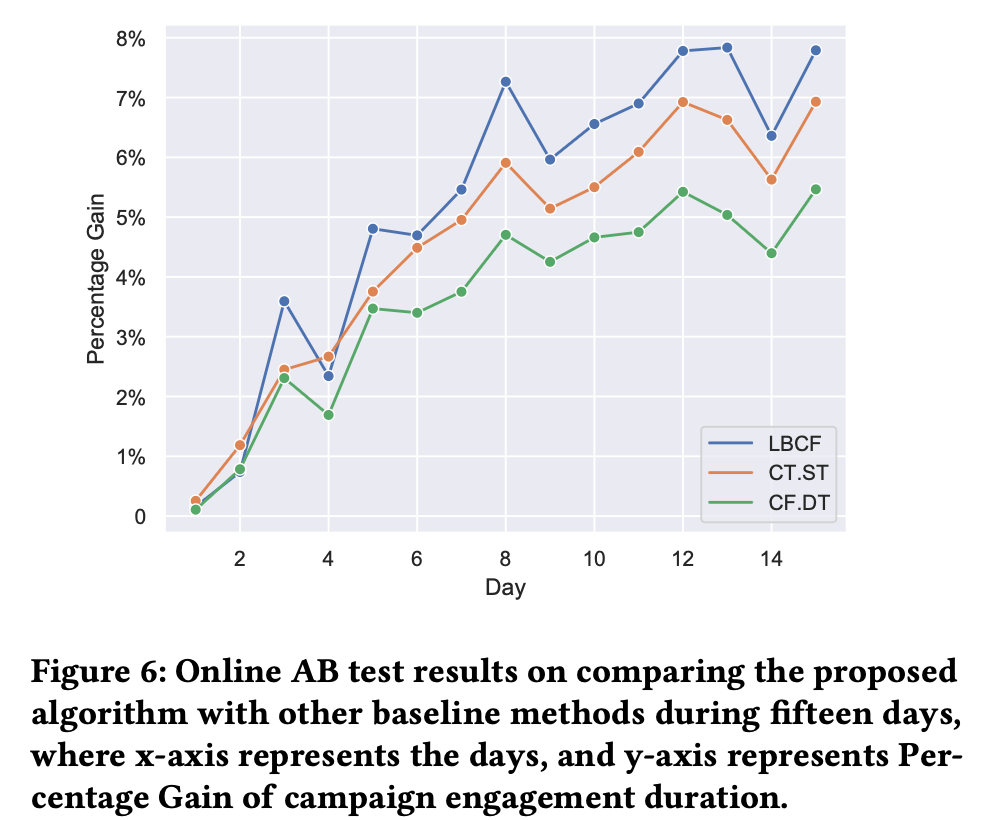
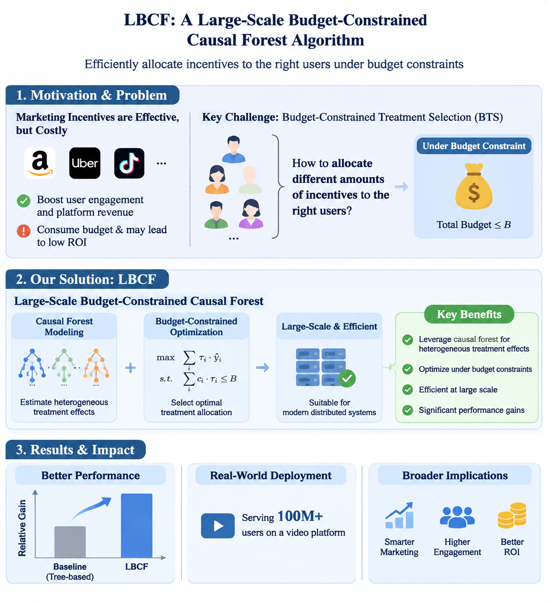
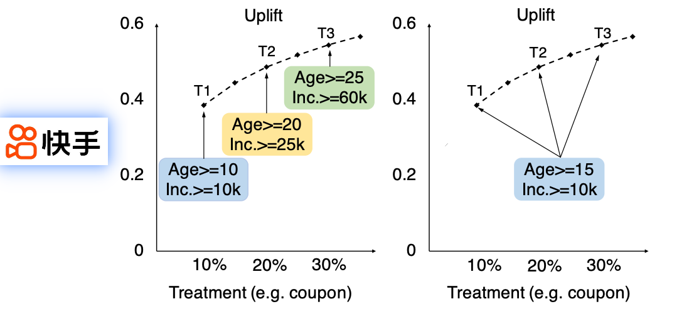

**速览1**：快手团队提出了 LBCF 算法，将多 Treatment 因果森林与预算约束优化结合，实现大规模用户激励策略的个性化分配。

**速览2**：在仿真、离线和在线实验中，LBCF 均优于对比方法；在线实验最后一天的活动参与时长提升达到 7.79%，且算法已服务于数亿用户。论文中附上代码仓库：https://github.com/www2022paper/WWW-2022-PAPER-SUPPLEMENTARY-MATERIALS

## 01 论文信息

**标题**：LBCF: A Large-Scale Budget-Constrained Causal Forest Algorithm / LBCF：一种大规模预算约束因果森林算法

**作者**：Meng Ai、Biao Li 等

**期刊/会议**：WWW

**发表时间**：2022年4月

**链接**：https://doi.org/10.1145/3485447.3512103

## 02 核心问题

论文研究的是预算约束下的 Treatment Selection（Budget-Constrained Treatment Selection，BTS）问题：在总预算有限的条件下，如何估计每个用户对不同激励方案的因果响应，并为每个用户选择合适的激励力度，使整体 Treatment Effect 最大化，同时满足预算约束。

## 03 核心要点

**提出统一的多 Treatment 因果森林 UDCF**。通过统一的树结构同时处理多个 Treatment，使不同激励水平的因果效应具有可比性。UDCF 不仅考虑不同叶节点之间的 Treatment Effect 异质性，还考虑同一个叶节点内部不同 Treatment 之间的效应差异。前者帮助模型区分不同用户群体，后者帮助模型识别同一用户群体对不同激励力度的响应差异。

**将预算约束问题转化为多选背包问题并提出DGB解法**。将用户级激励分配转化为 Multiple-Choice Knapsack Problem（MCKP），在每个用户最多接受一种激励、总激励成本不超过预算的条件下，最大化整体因果收益。利用 Lagrangian Dual 的凸性，提出 DGB 算法，通过二分搜索求解最优拉格朗日乘子，将全局预算约束优化分解为用户级独立决策。

**提出 Percentage Mean Gain（PMG）离线评估指标**。传统 AUUC、Qini 等指标在多 Treatment、预算约束场景中存在不足，提出 PMG，通过 RCT 数据中的重叠样本估计目标策略下的整体平均收益，支持在相同用户集合上评估不同策略。

## 04 研究动机

**传统 Greedy Treatment Selection 无法保证预算最优**。通常采用贪心策略，先为每个用户选择 Treatment Effect 最大或 ROI 最高的激励方案，再按照 ROI 从高到低排序，依次分配激励，直到预算耗尽。但这种策略只关注单个用户的 ROI 排名，没有充分考虑不同用户的激励成本与收益组合，因此不一定能获得全局最优解。

**多个 Binary Causal Forest 存在特征空间不一致问题**。针对每个 Treatment 分别训练一个 Binary Causal Forest（BCF），每个模型估计一个 Treatment 相对于 Control 的因果效应。一方面，增加了模型训练和线上服务的计算成本；另一方面，不同 BCF 的树结构和分裂规则相互独立，同一个用户可能落入不同模型中不同的叶节点。

**传统 MCKP 优化算法难以适应大规模分布式计算**。例如分支定界、Tabu Search 和贪心算法，并不是专门针对现代分布式计算框架设计的。当用户规模达到数亿、决策变量达到数十亿时，传统优化方法难以满足线上系统的计算和部署要求。

**多 Treatment 场景缺少合适的离线策略评估方法**。在 RCT 中，每个用户只能观察到实际分配 Treatment 对应的结果，而无法同时观察其接受其他 Treatment 时的反事实结果。因此，离线评估一个新的激励分配策略时，需要解决反事实结果缺失的问题。

## 05 方法思路

### 问题定义

论文采用 Potential Outcomes Framework（潜在结果框架）定义问题。首先定义三个核心变量：

- $X$：用户特征向量。
- $T$：Treatment，代表激励方案，包含 $K$ 个互斥的 Treatment，分别记为 $1,\ldots,K$，其中 $T=0$ 表示 Control Group。
- $Y$：用户响应结果，论文假设结果越大越好。

论文使用以下公式定义用户在 Treatment $j$ 下的条件平均处理效应 CATE：

$$
\theta_{ij}(x_i)=
E[Y_i(T_i=j)-Y_i(T_i=0)|X_i=x_i]
$$

其中：

- $i$：用户索引。
- $j$：Treatment 索引。
- $Y_i(T_i=j)$：用户 $i$ 接受 Treatment $j$ 时的潜在结果。
- $Y_i(T_i=0)$：用户 $i$ 不接受激励时的潜在结果。
- $X_i=x_i$：在用户特征相同的条件下进行比较。
- $\theta_{ij}(x_i)$：用户 $i$ 接受 Treatment $j$ 相对于 Control 的条件平均因果效应。

### LBCF 整体算法流程

论文 Algorithm 3 将整个算法总结为三个步骤：

1. 从线上 RCT 或合成数据中获取实验样本。
2. 使用 UDCF 估计用户在不同 Treatment 下的个体化处理效应。
3. 使用 DGB 求解用户级预算约束优化问题，得到最终 Treatment Selection Policy。

因此，LBCF 并不是一个单独的因果模型，而是一套完整的激励决策框架：

**RCT 数据 → UDCF 因果效应估计 → MCKP 预算约束优化 → DGB 求解 → 用户级 Treatment 分配**。

同时，PMG 负责对不同策略进行离线评估。

### UDCF：统一判别式因果森林

UDCF(Unified Discriminative Causal Forest) 是在 Binary Causal Forest 基础上改进的统一多 Treatment 因果森林，具有两个核心特征：

- Unified： 所有 Treatment 在同一棵因果森林中进行分裂，使用统一的树结构。
- Discriminative： 同时区分不同节点之间，以及同一个节点内部不同 Treatment 之间的因果效应差异。

论文通过 Inter Split 和 Intra Split 两种分裂准则实现上述目标。

**Inter Split：最大化节点间异质性**。论文定义的分裂准则如下。核心思想是：寻找一种用户划分方式，使两个子节点在各个 Treatment 上的伪结果（Pseudo Outcome）尽可能不同。

$$
\widetilde{\Delta}_{inter}(\phi_1,\phi_2)
=
\sum_{l=1}^{2}
\frac{1}{|\{i:x_i\in\phi_l\}|}
\sum_{j=1}^{K}
\left(
\sum_{\{i:x_i\in\phi_l\}}\rho_{ij}
\right)^2
$$

其中：

- $\phi_1,\phi_2$：一次分裂产生的两个子节点。
- $l$：子节点索引。
- $K$：Treatment 数量。
- $\rho_{ij}$：用户 $i$ 在 Treatment $j$ 下的伪结果（Pseudo Outcome），由后续的算法计算出。
- $|\{i:x_i\in\phi_l\}|$：子节点 $\phi_l$ 中包含的用户数量。

把同一个子节点内所有用户在 Treatment $j$ 下的伪结果加起来，反映这个子节点在该 Treatment 上的整体贡献方向和程度。平方使正向和负向的贡献都能体现为较大的数值，同时避免正负贡献在最终评分中直接抵消。除以用户数量对节点规模进行归一化；对所有 Treatment 求和，则综合考虑不同 Treatment 的伪结果贡献。最终，Inter Split 倾向于把伪结果模式相似的用户，划分到同一个子节点，让不同子节点之间形成更明显的差异。

**Intra Split：最大化节点内异质性**。仅仅区分不同用户群体还不够。假设一个叶节点中的用户对 Treatment 1 和 Treatment 2 的响应存在明显差异。如果模型只关注不同叶节点之间的差异，就可能忽略同一叶节点内不同 Treatment 的效应差异。而预算约束优化阶段需要比较同一个用户在不同 Treatment 下的效应，因此还必须保留这种节点内异质性。Intra Split定义如下：

$$
\widetilde{\Delta}_{intra}(\phi_1,\phi_2)
=
\sum_{l=1}^{2}
\sum_{j=1}^{K}
\left(
\hat{\theta}_{\phi_l}^{(j)}
-
\bar{\theta}_{\phi_l}
\right)^2
$$

其中：

- $\hat{\theta}_{\phi_l}^{(j)}$：子节点 $\phi_l$ 中 Treatment $j$ 的估计处理效应。
- $\bar{\theta}_{\phi_l}$：子节点 $\phi_l$ 中所有 Treatment 的平均处理效应。
- $K$：Treatment 数量。

公式衡量的是每个子节点内，各 Treatment 的估计效应与该节点平均处理效应之间的差异。差异越大，说明该节点内部不同 Treatment 的效应异质性越明显。

**两阶段分裂策略**。直接对所有可能的分裂点计算 Intra Split，计算成本较高，考虑到计算效率进行两阶段分裂。第一阶段：Inter Split 筛选候选分裂点，先根据 Inter Split 公式计算分裂收益，从中选出排名靠前的 $m$ 个候选分裂点。第二阶段：Intra Split 选择最终分裂点，对第一阶段筛选出的 $m$ 个候选分裂点，根据 Intra Split 公式计算节点内异质性，最终选择得分最高的分裂点。

**UDCF 的 Treatment Effect 估计**。UDCF 的树结构构建完成后，论文采用加权最小二乘回归估计 Treatment Effect。权重由目标用户与其他样本之间的相似性决定。计算过程如下：

首先，在父节点 $P$ 内计算 Treatment 和 Outcome 的均值，并进行中心化：

$$
\hat T_i=T_i-\bar T_P
$$

$$
\hat Y_i=Y_i-\bar Y_P
$$

其中，$\bar T_P$ 和 $\bar Y_P$ 分别为父节点中 Treatment 和 Outcome 的均值。

随后计算：

$$
A_P=\hat T'\hat T
$$

$$
\hat\theta_P=A_P^{-1}\hat T'\hat Y
$$

其中：

- $A_P$：中心化 Treatment 矩阵的交叉乘积矩阵，反映了不同 Treatment 分配变量，在当前父节点中的自身变化和相互关系。
- $\hat\theta_P$：父节点的 Treatment Effect 估计结果。是多元线性回归在没有截距项、变量已经中心化时，最小二乘估计的标准解。

接着计算残差：

$$
R=\hat Y-\hat T\hat\theta_P
$$

以及：

$$
Q=\hat T(A_P^{-1})'
$$

其中，$Q$ 可以理解为，将中心化后的 Treatment 矩阵 $\hat T$ 经过 $A_P^{-1}$ 变换，得到一个用于计算用户级伪结果（pseudo-outcome）的权重矩阵。

最后计算用户级伪结果：

$$
\rho_i=R_iQ_i
$$

其中，$R_i$ 是标量，$Q_i$ 是一个包含 $K$ 个元素的行向量，因此相乘后得到一个 $K$ 维向量。$\rho_{ij}$ 就是用户 $i$ 在第 $j$ 种 Treatment 上的伪结果。$\rho_i$ 将用户的残差信息映射到不同 Treatment 维度，为后续评估节点分裂提供依据。

整个过程可以概括为：先用父节点的最小二乘回归估计整体 Treatment 效应，再计算每个用户的回归残差，通过 $Q$ 将残差信息转换为不同 Treatment 维度上的伪结果，最后利用这些伪结果寻找能够区分不同 Treatment 响应人群的树分裂点。

### Budget-Constrained Optimization：预算约束优化

**MCKP 问题建模**。预算约束优化目标定义为：

$$
\max_z
\sum_{i=1}^{N}\sum_{j=1}^{K}
\theta_{ij}z_{ij}
$$

$$
\text{s.t.}\quad
\sum_{j=1}^{K}z_{ij}\leq 1,
\quad i=1,\ldots,N
$$

$$
\sum_{i=1}^{N}\sum_{j=1}^{K}
c_{ij}z_{ij}\leq B
$$

$$
z_{ij}\in\{0,1\},
\quad i=1,\ldots,N;\ j=1,\ldots,K
$$

其中：

- $N$：用户数量。
- $K$：Treatment 数量。
- $\theta_{ij}$：用户 $i$ 接受 Treatment $j$ 的因果效应。
- $c_{ij}$：用户 $i$ 接受 Treatment $j$ 的成本。
- $B$：总预算。
- $z_{ij}$：用户 Treatment 分配变量。

**Lagrangian Dual：拉格朗日对偶转换** 前述建模的问题本质上是一个大规模整数规划问题，直接求解很难满足数亿用户的线上计算需求。因此，论文利用 Lagrangian Dual 将原始预算约束优化问题转化为一个关于拉格朗日乘子 $\lambda$ 的一维优化问题。

$$
L(\lambda)=
\sum_{i=1}^{N}
\max\left(
0,\max_{1\leq j\leq K}
(\theta_{ij}-\lambda c_{ij})
\right)
+\lambda B
$$

其中：

- $\theta_{ij}$：Treatment 带来的因果收益。
- $c_{ij}$：Treatment 的成本。
- $\lambda$：单位预算的影子价格。

公式中的最大值操作表示：对于每个用户，选择调整收益最高的 Treatment；如果所有 Treatment 的调整收益都不大于0，则不发放激励。

**确定拉格朗日乘子的搜索区间**。论文证明最优拉格朗日乘子区间如下，这个区间为后续二分搜索提供了明确的搜索范围。

$$
\lambda^*
\in
\left[
0,
\max_{i,j}\frac{\theta_{ij}}{c_{ij}}
\right]
$$

**DGB：Dual Gradient Bisection**。得到最优乘子的搜索区间后，论文提出 DGB 算法对最优乘子 $\lambda^*$进行二分查找，计算过程如下。

**根据最优乘子生成 Treatment Selection Policy**。得到最优 $\lambda^*$ 后，就可以独立地为每个用户选择 Treatment。最优 Treatment 选择策略如下，公式表示：如果用户所有 Treatment 的调整收益都不大于0，则不发放任何激励。否则，选择调整收益最大的 Treatment。

$$
j^*=
\begin{cases}
0,
&
\max_{1\leq j\leq K}
(\theta_{ij}-\lambda^*c_{ij})\leq0
\\[6pt]
\displaystyle
\arg\max_{1\leq j\leq K}
(\theta_{ij}-\lambda^*c_{ij}),
&
\max_{1\leq j\leq K}
(\theta_{ij}-\lambda^*c_{ij})>0
\end{cases}
$$

这里有一个重要的理解：DGB 并不是为每个用户单独寻找最优预算，而是通过全局最优拉格朗日乘子，将预算约束转化为统一的成本惩罚，再让每个用户独立选择最优 Treatment。这正是 LBCF 能够将大规模用户级优化拆解为多个独立子问题的关键。

### 大规模分布式计算

论文指出，LBCF 的大规模能力主要来自两个部分。

**UDCF 部分**：UDCF 本质上是一个随机森林模型，可以利用现代分布式计算系统并行训练。同时，UDCF 只需要一个统一模型，就可以共同处理多个 Treatment 组的数据，不需要针对每个 Treatment 单独维护一套模型。

**DGB 部分**：对于给定的 $\lambda$，每个用户的调整收益计算相互独立。因此，计算 $L'(\lambda)$ 时，可以将用户划分到多个计算节点并行执行，再汇总计算结果。论文给出的 DGB 时间复杂度为：$O(N\times K)$。

### PMG：Percentage Mean Gain 离线评估

**传统评估指标的问题**。论文指出，AUUC、Qini Curve 等传统指标，通常按照预测的最大 Treatment Effect 对用户进行排序。但在预算约束场景下，策略不一定会给每个用户分配其 Treatment Effect 最大的方案，还要考虑成本的影响。另一个方法是 Expected Outcome，它只使用 RCT Treatment 与 Policy Treatment 一致的样本进行评估，而不是完整的RCT用户群体；而且不同策略使用的重叠样本规模不同，进而影响不同策略之间的比较。

**PMG 的计算过程**。PMG 不再按照用户的最大预测 Treatment Effect 对所有用户排序，而是直接评价待评估策略实际选择的 Treatment。论文定义了两个集合：

- $A(j)$：Policy Subset，即策略最终选择 Treatment $j$ 的所有用户。
- $S(j)$：Overlapping Subset，即 RCT 随机实验中实际接受 Treatment $j$，同时策略也选择 Treatment $j$ 的用户。

PMG 利用 $S(j)$ 中用户的实际结果，估计 $A(j)$ 中所有用户接受 Treatment $j$ 时的平均结果，再按照该 Policy Subset 在全部用户中的占比进行加权，最后衡量目标策略相对于 Control Group 的平均结果提升比例。论文给出的公式为：

$$
\bar y^{(j)}
=
\frac{\sum_{i\in S(j)}y_i}{|S(j)|}
$$

$$
PMG=
\frac{
\frac{1}{N}
\sum_{j=0}^{K}|A(j)|\bar y^{(j)}
-\hat\mu_0
}{
\hat\mu_0
}
$$

其中：

- $N$：RCT 中的总样本数。
- $A(j)$：策略选择 Treatment $j$ 的用户集合。
- $|A(j)|$：策略选择 Treatment $j$ 的用户数量。
- $\bar y^{(j)}$：重叠集合 $S(j)$ 中，实际接受 Treatment $j$ 的用户的平均结果。
- $\hat\mu_0$：RCT Control 组的平均结果。

## 06 结果分析

### 仿真实验

**实验设置**。论文沿用 Tu et al. 的合成数据生成方法，构建了包含以下特征的数据集：

- 样本数量：80,000。
- Treatment 数量：3种。
- 目标：在预算约束下最大化 Treatment Effect。
- 噪声控制：通过 Uncertainty Weight 超参数控制不同噪声水平。

**评价指标**。仿真实验沿用 Tu et al. 的归一化 ITE 指标。该指标衡量的是预算约束下，策略获得的平均个体化处理效应相对于 Control Group 平均结果的比例。

$$
\tau_{syn}=
\frac{
\frac{1}{N}
\sum_{i=1}^{N}
\sum_{j=1}^{K}
(Y_i(T_i=j)-Y_i(T_i=0))z_{ij}
}{
\mu_0
}
$$

其中：

- $N$：样本数量。
- $K$：Treatment 数量。
- $Y_i(T_i=j)$：用户接受 Treatment $j$ 时的潜在结果。
- $Y_i(T_i=0)$：用户接受 Control 时的潜在结果。
- $z_{ij}$：Treatment 分配变量。
- $\mu_0$：Control Group 的平均结果。

**对比方法**。论文对比了五种基线方法：

- CausalML：CTS、ED、Chi。
- Tu et al.：CT.ST、CF.DT。
- 本文方法：LBCF。

**实验结果**。结果如下图所示，在不同 Uncertainty Weight 下，LBCF 均取得了最高的归一化 ITE。这说明在不同噪声水平下，LBCF 都能够较好地识别用户的 Treatment Effect 异质性，并通过预算约束优化获得更好的激励分配结果。

### 真实业务离线实验

**实验背景**。实验来自快手视频平台。论文将线上0.1%的流量分配给 RCT 实验，实验持续两周。实验组向用户发放不同数量的奖励积分，Control Group 不发放奖励。最终获得超过10万条 App Visit 实例，数据包括：

- 用户特征：App 访问行为、地区、历史统计等。
- Treatment：不同奖励积分水平。
- Outcome：用户活动参与时长（Campaign Engagement Duration）。

**实验评价**。使用 PMG 评估不同算法在不同预算条件下的表现。论文测试了多个预算配置，预算范围为30,000至50,000。

**实验结果**。结果如下图所示。LBCF 在所有预算配置下均取得最高的 PMG。这说明在不同预算条件下，LBCF 均能够获得更好的活动参与时长提升效果。

### 线上 A/B 实验

**实验设置**。线上实验在同一个大型视频平台进行，持续超过15天。所有实验组均满足相同预算约束，Control Group 不发放奖励。

**实验结果**。在实验开始的前几天之后，LBCF持续保持较高的提升效果，最终活动参与时长提升 7.79%，比 CT.ST 高0.92个百分点，比 CF.DT 高2.48个百分点。论文指出，LBCF 已经部署在快手线上视频平台，目前服务于数亿用户。

## 07 局限与展望

**SUTVA 假设不能完全满足**。论文在 Discussion 中明确指出，SUTVA 的第一个方面，即不同实验单元之间的独立性，在实际业务中并不能严格成立。**Treatment 需要满足离散和固定激励水平**。在本文中treatment 是离散的激励方案，并且保证每个 Treatment 对应相同的激励金额，因此满足这一条件。**预算优化没有考虑用户体验等其他约束**。论文目前主要关注：最大化整体 Treatment Effect；满足总预算约束；每个用户最多接受一种 Treatment。但在真实业务中，激励分配还可能涉及用户体验、激励疲劳、长期留存等约束。

## 论文摘要

向用户提供激励措施（例如 Amazon 的优惠券、Uber 的折扣以及 TikTok 的视频奖励）是在线平台提高用户参与度和平台收入的常见策略。尽管这些激励措施已经被证明有效，但它们不可避免地会产生成本。如果使用不当，可能导致较低的投资回报率（ROI）。另一方面，不同用户对激励措施的响应存在差异。例如，有些用户即使有优惠券也不会购买某些商品，而另一些用户即使没有优惠券也会购买。因此，如何在预算约束下为每个用户选择合适的激励力度，是一个具有重要实际意义的研究问题。本文将这一问题称为预算约束下的 Treatment Selection（BTS）问题。该问题面临的挑战是，如何在大规模数据集上高效解决 BTS 问题，并取得优于现有技术的效果。为此，本文提出了一种新颖的预算约束树模型 Treatment Selection 方法，称为大规模预算约束因果森林算法（Large-Scale Budget-Constrained Causal Forest，LBCF）。该算法也是一种适用于现代分布式计算系统的高效 Treatment Selection 算法。此外，本文提出了一种新的离线评估方法，以解决使用随机对照试验（RCT）数据评估 BTS 问题方案时存在的固有挑战。本文将所提出的方法部署在一个真实的大规模视频平台场景中。在该场景下，平台通过发放奖励来提高用户的活动参与时长。仿真分析、离线实验和线上实验均表明，本文的方法优于多种基于树模型的先进基线方法。目前，所提出的方法已经服务于平台数亿用户，并在实际应用中取得了显著的效果提升。

## 图文速览

快手团队在 WWW 2022 上发表了一篇论文，研究如何在有限营销预算下，把优惠券和活动奖励分配给真正需要激励的用户。

他们把问题拆成两步：第一步用 UDCF 因果森林预测每个用户对不同激励方案的增量响应；第二步把分配问题转化为多选背包问题，通过 DGB 算法找到预算约束下的最优方案。

实验发现，无论是仿真数据、真实业务离线数据，还是线上 A/B 实验，LBCF 都优于对比方法。线上最后一天，活动参与时长提升达到7.79%，目前已经服务数亿用户。

简单来说，这篇论文解决的不是给谁发更多优惠券，而是如何把有限的营销预算花在最值得激励的用户身上。先通过因果推断判断激励有没有用，再通过优化算法决定钱应该怎么花。

竖版概览图

