**速览1**：腾讯与香港城市大学等团队提出了 RERUM（Rankability-Enhanced Revenue Uplift Modeling）框架，通过零膨胀对数正态分布建模、响应排序损失和整体增益排序损失，提升连续收入场景下 Uplift 模型的预测与排序能力。

**速览2**：在三个离线数据集和腾讯Fit线上金融营销场景中，RERUM 均取得了较好的效果，线上三个营销活动的 Revenue LIFT@2 分别提升 9.20%、37.24% 和 15.43%，平均提升 20.61%。文中附上代码仓库：https://github.com/BokwaiHo/revenue_uplift

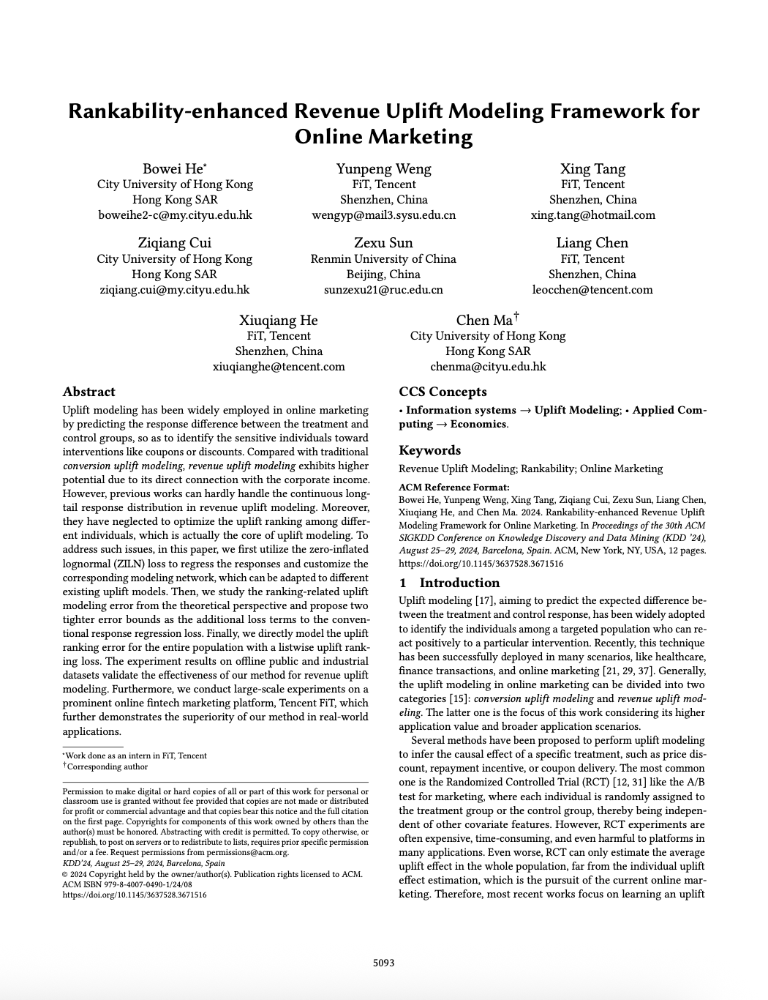

## 01 论文信息

**标题**：Rankability-enhanced Revenue Uplift Modeling Framework for Online Marketing/面向在线营销的排序增强型收入增益建模框架

**作者**：Bowei He、Yunpeng Weng 等

**期刊/会议**：KDD

**发表时间**：2024年8月

**链接**：https://doi.org/10.1145/3637528.3671516

## 02 核心问题

论文研究的是在线营销场景下的 Revenue Uplift Modeling（收入增益建模）问题。现有 Uplift Modeling 研究主要集中在 Conversion Uplift Modeling，即预测用户是否发生转化，响应变量通常是 0/1 二分类变量。然而，在实际商业场景中，企业不仅关心用户是否转化，更关心用户能够带来多少收入。

## 03 核心要点

**从 Conversion Uplift 转向 Revenue Uplift**。传统 Uplift Modeling 主要预测用户是否会发生转化，而本文直接将用户产生的收入作为响应变量。相比二分类转化预测，连续收入响应能够更直接地衡量营销活动的商业收益，但也带来了更复杂的分布建模问题。

**使用 ZILN Loss 解决收入长尾问题**。将收入响应拆分成两个部分：是否产生收入：通过交叉熵损失预测用户的付费概率。产生收入后的具体金额：通过对数正态分布建模付费用户的收入金额。

**引入 Listwise Uplift Ranking Loss**。论文进一步将整个目标用户群体看作一个排序列表，直接优化用户之间的 Uplift 排序关系，而不是仅仅优化单个用户或者用户对。

**框架具备较好的可扩展性**。RERUM 并不是一个完全独立的新型 Uplift Backbone，而是一个可以适配不同现有 Uplift 模型的增强框架。论文将其与 TAR、CFR 和 DragonNet 等模型结合，验证了该方法的通用性。

## 04 研究动机

**传统 Uplift Modeling 更关注转化，而不是收入**。在线营销通常需要考虑营销投入与实际收入之间的关系，论文选择收入作为响应变量，希望直接识别营销干预能够带来更高收入增量的用户。

**真实业务中的收入分布具有明显的长尾特征**。论文以腾讯 FiT 金融营销场景为例，发现用户收入响应存在明显的零膨胀和长尾现象。这种数据分布使得传统 MSE 损失容易受到极端值影响。在模型训练过程中，高收入用户可能对损失函数产生更大的影响，导致模型忽略低收入用户之间的预测差异。

**Uplift 排序比单纯的数值预测更加重要**。论文强调，Uplift Modeling 的最终目的并不是精确预测每个用户的 Uplift 数值，而是识别真正对营销干预敏感的用户。即使某些整体预测误差指标表现不错，也可能无法正确识别高价值营销用户，应该将 Uplift 排序能力作为一个独立的优化目标。

## 05 方法思路

### 问题定义

论文采用 Neyman-Rubin Potential Outcome Framework（潜在结果框架）描述收入增益问题。

首先，定义观测样本集合：

$$
D=\{(x_i,t_i,y_i)\}_{i=1}^{n}
$$

其中：

- $x_i$：用户的协变量特征。
- $t_i$：用户接受的营销干预，$t_i=1$ 表示用户接受营销干预，$t_i=0$ 表示用户属于对照组。
- $y_i$：用户实际产生的收入响应。
- $n$：样本数量。

用户的 Uplift 定义为：

$$
\tau_i=y_{i1}-y_{i0}
$$

其中：

- $y_{i1}$：用户接受干预时的潜在收入。
- $y_{i0}$：用户不接受干预时的潜在收入。

真实业务中同一个用户只能观测到其中一种潜在结果，因此无法直接获得单个用户的真实 Uplift。论文进一步采用 Conditional Average Treatment Effect（CATE）作为统计意义上的 Uplift 估计：

$$
\tau(x_i)=
E[Y_i|X_i=x_i,T_i=1]
-
E[Y_i|X_i=x_i,T_i=0]
$$

其中：

- 第一项表示具有特征 $x_i$ 的用户在接受干预情况下的期望收入。
- 第二项表示具有相同特征的用户在不接受干预情况下的期望收入。

### RERUM 整体框架

下图展示了RERUM的整体模型架构，主要由表示学习模块、Treatment Response Module、Control Response Module以及两个排序学习模块组成。首先，模型将用户特征 $X$ 输入表示学习模块，得到用户特征表示；随后，Treatment Response Module和Control Response Module分别预测用户在接受营销干预和未接受营销干预时的收入分布参数，即正收入概率 $p$、对数正态分布参数 $\mu$ 和 $\sigma$，并通过ZILN Loss学习收入响应。与此同时，模型引入Response Ranking Learning，分别从组内和组间两个角度约束收入响应的排序关系，并通过Listwise Uplift Ranking进一步优化用户之间的增量收入排序。最终，模型联合优化收入分布预测、响应排序和Uplift排序三个目标，使模型不仅能够预测用户收入，还能更准确地识别和排序营销干预带来的增量收入。

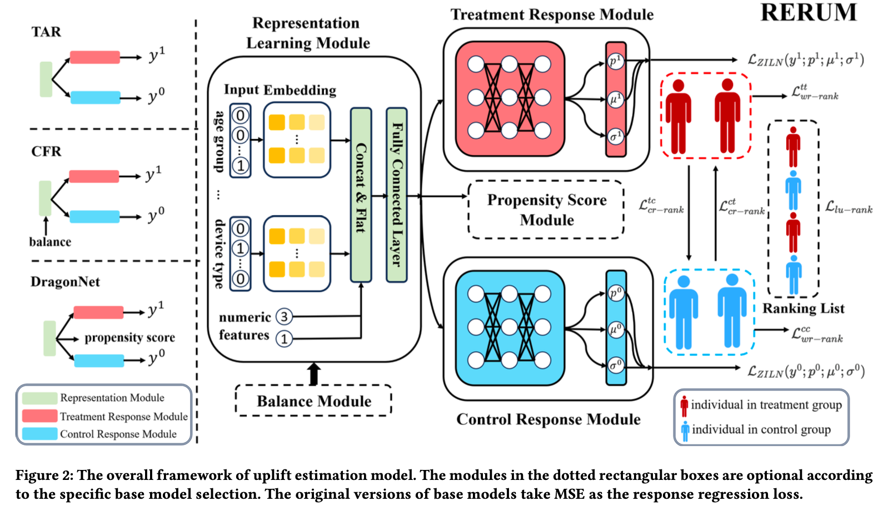

### ZILN Loss：收入响应建模

论文对真实收入分布进行了分析，结果如下图，发现具有两个明显特征：1）收入响应中存在大量零值。2）对非零收入进行对数变换后，其分布大致符合正态分布。

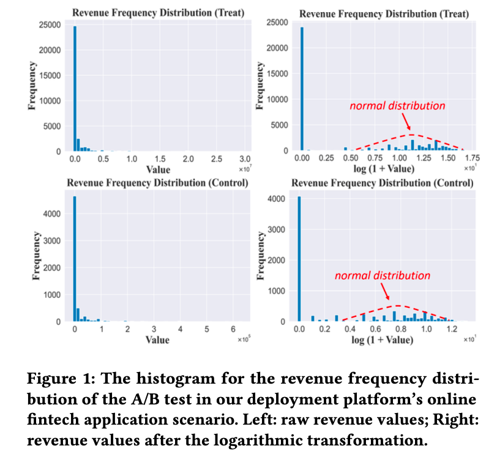

因此，论文采用 **Zero-Inflated Lognormal Loss**。其核心思想是将收入预测拆分为两个任务：1）预测用户是否付费。2）预测付费用户的收入金额。文中给出的损失函数公式为：

$$
\begin{aligned}
L_{ZILN}(y;p;\mu;\sigma)
&=L_{purchasing\ propensity}
+L_{payer\ expense}\\
&=L_{CrossEntropy}
(\mathbb{1}(y>0);p)\\
&\quad+\mathbb{1}(y>0)
L_{Lognormal}(y;\mu;\sigma)
\end{aligned}
$$

$$
\begin{aligned}
L_{CrossEntropy}
&(\mathbb{1}(y>0);p)\\
=&-\mathbb{1}(y=0)\log(1-p)\\
&-\mathbb{1}(y>0)\log p
\end{aligned}
$$

$$
L_{Lognormal}(y;\mu;\sigma)
=
\log(y\sigma\sqrt{2\pi})
+
\frac{(\log y-\mu)^2}{2\sigma^2}
$$

其中：

- $y$：用户实际收入。
- $p$：用户产生正收入的预测概率。
- $\mu$：对数收入分布的均值参数。
- $\sigma$：对数收入分布的标准差参数。
- $\mathbb{1}(y>0)$：指示函数，当收入大于零时为 1，否则为 0。

上述公式中使用指示函数表达，我们这里将 ZILN Loss 改写成按照实际收入是否为零进行分段定义，更容易理解些。

$$
L_{ZILN}(y;p;\mu;\sigma)=
\begin{cases}
-\log(1-p), & y=0\\[6pt]
-\log p+
\log(y\sigma\sqrt{2\pi})
+\dfrac{(\log y-\mu)^2}{2\sigma^2},
& y>0
\end{cases}
$$

**情况一：用户没有产生收入（$y=0$）**

$$
L_{ZILN}=-\log(1-p)
$$

此时只计算购买倾向损失，模型预测用户产生正收入的概率为 $p$，实际用户没有产生收入，因此希望模型预测较低的 $p$，当 $p$ 越接近 0 时，损失越小。

**情况二：用户产生了正收入（$y>0$）**

$$
\begin{aligned}
L_{ZILN}
=&-\log p\\
&+\log(y\sigma\sqrt{2\pi})\\
&+\frac{(\log y-\mu)^2}{2\sigma^2}
\end{aligned}
$$

此时同时计算两部分损失：

- $-\log p$：购买倾向损失，希望模型预测较高的正收入概率。
- $\log(y\sigma\sqrt{2\pi})+\frac{(\log y-\mu)^2}{2\sigma^2}$：对数正态损失，用于拟合用户实际产生的正收入金额。

### Uplift Modeling Error Analysis：Uplift 排序误差分析

这是论文比较重要的理论创新。作者认为，传统的响应回归损失，并不能很好地约束用户之间的 Uplift **排序**误差。因此，论文从**两个用户之间的 Uplift 差异**出发，推导其误差上界。

首先，考虑两个用户 $i$ 和 $j$。论文分别定义预测 Uplift 差异和真实 Uplift 差异。将用户之间的 Uplift 差异，转换成**处理组响应差异**与**对照组响应差异**的组合。

$$
\begin{aligned}
\hat\tau_i-\hat\tau_j
&=(\hat y_{i1}-\hat y_{i0})
-(\hat y_{j1}-\hat y_{j0})\\
&=(\hat y_{i1}-\hat y_{j1})
-(\hat y_{i0}-\hat y_{j0})
\end{aligned}
$$

$$
\begin{aligned}
\tau_i-\tau_j
&=(y_{i1}-y_{i0})
-(y_{j1}-y_{j0})\\
&=(y_{i1}-y_{j1})
-(y_{i0}-y_{j0})
\end{aligned}
$$

其中：

- $\hat y_i^1$、$\hat y_i^0$：模型预测的用户 $i$ 在 Treatment 和 Control 下的响应。
- $y_i^1$、$y_i^0$：用户 $i$ 在 Treatment 和 Control 下的真实潜在响应。
- $\hat\tau_i$、$\tau_i$：用户 $i$ 的预测 Uplift 和真实 Uplift。

Uplift 距离预测误差为：

$$
\begin{aligned}
&\left|
(\hat\tau_i-\hat\tau_j)-(\tau_i-\tau_j)
\right|\\
&=
\left|
(\hat y_i^1-\hat y_j^1)
-(y_i^1-y_j^1)
-(\hat y_i^0-\hat y_j^0)
+(y_i^0-y_j^0)
\right|
\end{aligned}
$$

组内响应差异对应的误差上界如下，对应文中公式7。

$$
\begin{aligned}
&\left|
(\hat\tau_i-\hat\tau_j)-(\tau_i-\tau_j)
\right|\\
&\leq
\left|
(\hat y_i^1-\hat y_j^1)
-(y_i^1-y_j^1)
\right|\\
&\quad+
\left|
(\hat y_i^0-\hat y_j^0)
-(y_i^0-y_j^0)
\right|.
\end{aligned}
$$

跨组响应差异对应的误差上界如下，对应文中公式9。

$$
\begin{aligned}
&|(\hat\tau_i-\hat\tau_j)
-(\tau_i-\tau_j)|\\
\leq&
|(\hat y_{i1}-y_{j0})
-(y_{i1}-\hat y_{j0})|\\
&+
|(\hat y_{i0}-y_{j1})
-(y_{i0}-\hat y_{j1})|
\end{aligned}
$$

分别对公式7和9再展开，结果如下。可证明：传统 MSE 对应的响应预测误差上界，比上述两个针对排序关系推导的误差上界，更加宽松。换句话说，仅仅让每个用户的收入预测值接近真实收入，并不能充分保证用户之间的 Uplift 排序正确。因此，作者将两个更严格的误差上界分别转化为响应排序损失。

$$
\begin{aligned}
&|(\hat\tau_i-\hat\tau_j)
-(\tau_i-\tau_j)|\\
\leq&
|\hat y_{i1}-y_{i1}|
+|\hat y_{j1}-y_{j1}|\\
&+|\hat y_{i0}-y_{i0}|
+|\hat y_{j0}-y_{j0}|
\end{aligned}
$$

$$
\begin{aligned}
&|(\hat\tau_i-\hat\tau_j)
-(\tau_i-\tau_j)|\\
\leq&
|\hat y_{i1}-y_{i1}|
+|\hat y_{j0}-y_{j0}|\\
&+|\hat y_{i0}-y_{i0}|
+|\hat y_{j1}-y_{j1}|
\end{aligned}
$$

### Response Ranking Learning：响应排序学习

**组内响应排序损失**。首先，作者考虑同一个组内不同用户之间的响应排序关系。

$$
L_{wr-rank}^{tt/cc}(i,j)=
\begin{cases}
0,&
(\hat y_i^{1/0}-\hat y_j^{1/0})
(y_i^{1/0}-y_j^{1/0})\geq0\\
\left[
(\hat y_i^{1/0}-\hat y_j^{1/0})
-(y_i^{1/0}-y_j^{1/0})
\right]^2,
&\text{otherwise}
\end{cases}
$$

这里的 $1/0$ 分别代表处理组和对照组。公式的含义是：如果预测响应的排序与真实响应排序一致，则不产生额外排序损失。如果预测排序与真实排序不一致，则根据预测响应差异与真实响应差异之间的偏差进行惩罚。例如，在处理组中：如果用户 A 的真实收入高于用户 B，那么模型也应该预测 A 的收入高于 B。如果模型预测反了，就需要产生排序损失。

将处理组和对照组的组内排序损失加起来，形成整体组内响应排序损失。

$$
\begin{aligned}
L_{wr-rank}
=&\sum_{i,j\leq |D_t|}
L_{wr-rank}^{tt}(i,j)\\
&+\sum_{i,j\leq |D_c|}
L_{wr-rank}^{cc}(i,j)
\end{aligned}
$$

其中：

- $D_t$：处理组样本集合。
- $D_c$：对照组样本集合。

**跨组响应排序损失**。仅仅保证处理组内部、对照组内部的排序正确还不够。因为 Uplift 本身是处理组响应和对照组响应之间的差异，因此还需要考虑跨组响应之间的排序关系。构造跨组排序损失如下：

$$
L_{cr-rank}^{tc/ct}(i,j)=
\begin{cases}
0,&
(\hat y_i^{1/0}-y_j^{0/1})
(y_i^{1/0}-\hat y_j^{0/1})\geq0\\
\left[
(\hat y_i^{1/0}-y_j^{0/1})
-(y_i^{1/0}-\hat y_j^{0/1})
\right]^2,
&\text{otherwise}
\end{cases}
$$

其中，$tc$ 和 $ct$ 分别表示处理组与对照组之间两个方向的跨组响应关系。然后，将两个方向的跨组排序损失加起来：

$$
\begin{aligned}
L_{cr-rank}
=&\sum_{i\leq |D_t|,j\leq |D_c|}
L_{cr-rank}^{tc}(i,j)\\
&+\sum_{i\leq |D_c|,j\leq |D_t|}
L_{cr-rank}^{ct}(i,j)
\end{aligned}
$$

**最终响应排序损失**。将组内排序损失与跨组排序损失结合如下：

$$
L_{r-rank}=L_{wr-rank}+L_{cr-rank}
$$

需要注意，论文在实际训练时并没有遍历所有用户对，而是分别从处理组和对照组中随机采样一定数量的用户，以降低计算开销。

### Uplift Ranking Learning：增益排序学习

这是 RERUM 的另一个核心模块，也是与普通响应回归和响应排序学习最重要的区别。前面的模块主要优化收入预测以及处理组、对照组之间的响应排序。但论文进一步认为，最终需要优化的是**整个用户群体的 Uplift 排序**。因此，作者借鉴 Learning to Rank 中的 Listwise 方法，直接对整体用户列表进行排序优化。

**Uplift Top One Probability** 首先，论文将用户的排序看作一个随机过程，且要求排序得分函数具有单调递增性质，即真实 Uplift 越高，排序得分也越高。定义用户 $X$ 排在整个用户列表第一位的概率如下：

$$
p_{\tau}(X)=
\frac{e^{s(\tau(X))}}
{\sum_{X}e^{s(\tau(X))}}
$$

其中：

- $\tau(X)$：用户的真实 Uplift。
- $s(\cdot)$：基于 Uplift 值的排序得分函数。
- $p_{\tau}(X)$：用户排在第一位的概率。

**Listwise Uplift Ranking Loss** 接下来，论文利用交叉熵衡量真实 Uplift 排序分布与预测 Uplift 排序分布之间的差异。

$$
L_{lu-rank}
=
-E_X
\left[
p_{\tau}(X)
\ln(p_{\hat\tau}(X))
\right]
$$

其中：

- $p_{\tau}(X)$：根据真实 Uplift 得到的排序概率。
- $p_{\hat\tau}(X)$：根据模型预测 Uplift 得到的排序概率。

**Listwise Loss 的优化推导**。普通 Pointwise 方法关注单个用户的预测误差，Pairwise 方法关注两个用户之间的排序关系，而本文采用的 Listwise 方法直接考虑整个用户列表的排序分布。综合前述两个公式可得：

$$
\begin{aligned}
L_{lu-rank}
=&-E_X
\sum_X
\frac{e^{s(\tau(X))}}
{\sum_X e^{s(\tau(X))}}\\
&\cdot
\ln
\left(
\frac{e^{\hat s(\hat\tau(X))}}
{\sum_Xe^{\hat s(\hat\tau(X))}}
\right)
\end{aligned}
$$

随后，论文进行具体的排序函数选择，真实 Uplift 使用对数函数，预测 Uplift 直接使用预测值，如下：

$$
s(\tau(X))=\ln(\tau(x))
$$

$$
\hat s(\hat\tau(X))=\hat\tau(x)
$$

由此可得：

$$
L_{lu-rank}
=
-E_X
\sum_X
\frac{\tau(X)}
{\sum_X\tau(X)}
\ln
\left(
\frac{e^{\hat\tau(X)}}
{\sum_Xe^{\hat\tau(X)}}
\right)
$$

接下来，将真实 Uplift 替换为处理组和对照组的潜在收入差异，可得：

$$
\begin{aligned}
L_{lu-rank}
=&-\left(
E_X
Y^1(X)
\ln\frac{e^{\hat\tau(X)}}{\sum_Xe^{\hat\tau(X)}}\right.\\
&\left.-
E_X
Y^0(X)
\ln\frac{e^{\hat\tau(X)}}{\sum_Xe^{\hat\tau(X)}}
\right)
\end{aligned}
$$

其中，$Y^1(X)$ 和 $Y^0(X)$ 分别表示处理状态和对照状态下的潜在收入。在 RCT 实验设置下，处理组与对照组的协变量分布相同，因此可以进一步使用实际观测数据近似计算。

$$
\begin{aligned}
L_{lu-rank}
=-\Bigg(
&\frac{1}{|D_t|}
\sum_{x^t\in D_t}
y^t(x^t)
\ln
\frac{e^{\hat\tau(x^t)}}
{\sum_{x\in D}e^{\hat\tau(x)}}\\
-&\frac{1}{|D_c|}
\sum_{x^c\in D_c}
y^c(x^c)
\ln
\frac{e^{\hat\tau(x^c)}}
{\sum_{x\in D}e^{\hat\tau(x)}}
\Bigg)
\end{aligned}
$$

其中：第一部分使用处理组样本计算。第二部分使用对照组样本计算。两部分的差异用于优化整体 Uplift 排序。在实际训练中，论文使用 Batch 内样本计算该损失，因此不需要每次都遍历整个用户群体。

### Overall Training Objective：整体训练目标

前面介绍了三个核心模块：ZILN Loss：收入响应建模。Response Ranking Loss：响应排序学习。Listwise Uplift Ranking Loss：整体 Uplift 排序学习。最终将三个部分结合起来，同时优化收入响应预测和 Uplift 排序能力，整体的损失函数如下：

$$
\boxed{
L_{overall}
=
L_{ZILN}
+
L_{r-rank}
+
L_{lu-rank}
+
\lambda\|\theta\|_2^2
}
$$

其中：

- $L_{ZILN}$：收入响应回归损失。
- $L_{r-rank}$：组内与跨组响应排序损失。
- $L_{lu-rank}$：整体 Uplift 排序损失。
- $\lambda\|\theta\|_2^2$：L2 正则化项。
- $\theta$：模型参数。

**训练流程**。RERUM的迭代训练过程如下。

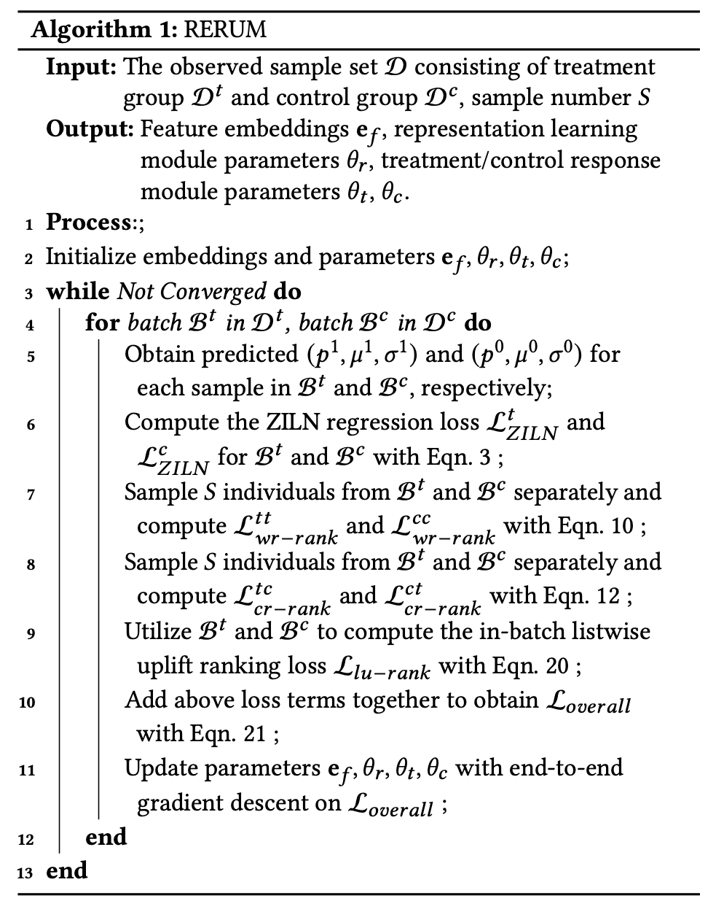

首先，初始化用户特征嵌入以及Treatment和Control两个响应模块的模型参数；在每轮迭代中，分别从Treatment组和Control组采样用户批次，输入模型得到两组用户的收入分布预测参数，并计算对应的ZILN Loss。

随后，从两个批次中进一步采样用户，分别构建组内和组间用户对，计算Within-group Response Ranking Loss与Cross-group Response Ranking Loss，并将二者合并得到Response Ranking Loss；同时，利用当前批次的用户预测结果计算Listwise Uplift Ranking Loss。

最后，将ZILN Loss、Response Ranking Loss、Listwise Uplift Ranking Loss以及L2正则化项组合为整体优化目标，通过梯度反向传播更新模型参数，重复上述过程直至模型收敛。

值得注意的是，该训练过程并不需要直接观测每个用户的真实Uplift标签，而是利用Treatment组和Control组的收入响应及其排序关系来学习用户的增量收入排序。

## 06 结果分析

### 实验数据集

论文使用三个离线数据集。数据集按照 60%、10%、30% 的比例划分训练集、验证集和测试集。

**Hillstrom-Men** 来源于邮件营销活动数据集 Hillstrom，包含约 64,000 名消费者。选择男性邮件营销组作为处理组，未收到邮件的用户作为对照组，使用用户在邮件发送后两周内的消费金额（Spend）作为响应变量。

**Hillstrom-Women** 同样来自 Hillstrom 数据集。使用女性邮件营销组作为处理组，未收到邮件的用户作为对照组。响应变量仍然是用户后续两周内的实际消费金额。

**Product** 来自腾讯 FiT 的线上互金营销场景。用户规模超过 500 万，特征数量超过 1800 个，大部分特征为类别型特征。响应变量为用户购买基金的实际金额，Treatment 为激励优惠券。

### Baseline和评价指标

论文选取了多个经典 Uplift Modeling 方法作为 Baseline：Causal Forest, S-Learner, T-Learner, Transformed
Response (TR), TAR, CFR, StableCFR, CITE, DragonNet

论文使用AUUC、AUQC、KRCC、LIFT@h作为评价指标，并在附录C中给出具体的计算公式。

### 整体实验效果

论文给出了不同模型在三个数据集上的实验结果如下图。RERUM 与不同基础模型结合后，在大多数数据集和评价指标上都取得了明显改善。RERUM（DragonNet）在 Hillstrom-Men 和 Hillstrom-Women 上表现较好，尤其是 LIFT@30 指标。在 Product 数据集上，RERUM（CFR-Wass）和 RERUM（CFR-MMD）取得了更好的 AUUC、AUQC 和 LIFT@30 表现。不同 Backbone 之间并不是某一个模型在所有数据集和指标上都占据优势，RERUM（DragonNet）的 LIFT@30 在三个数据集上的平均提升幅度达到 21.98%。

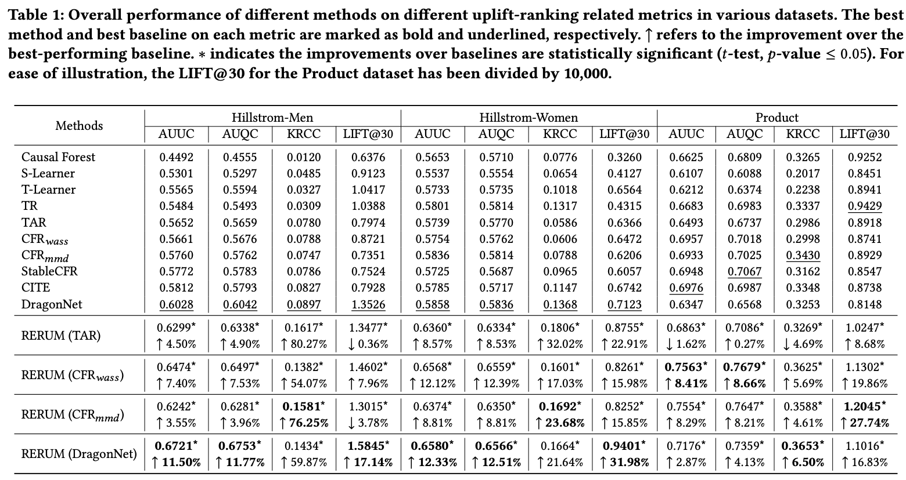

### 消融实验

论文通过逐步加入三个模块，验证各个模块对模型性能的贡献。三个模块分别是：UR：Uplift Ranking Learning。RR：Response Ranking Learning。ZILN：收入响应分布建模。可以观察到，不同baseline在不同数据集上随着UR、RR、ZILN的不断加入，四项指标大致呈现出上升趋势。

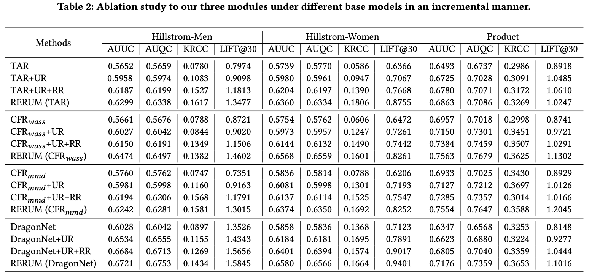

### 超参数敏感性分析

论文主要分析了两个超参数：Batch Size $B$：影响 Listwise Uplift Ranking Loss 的估计。Sample Number $S$：影响响应排序损失的计算。在 RERUM（CFR-MMD）和 RERUM（DragonNet）上进行了实验，结果如下图。

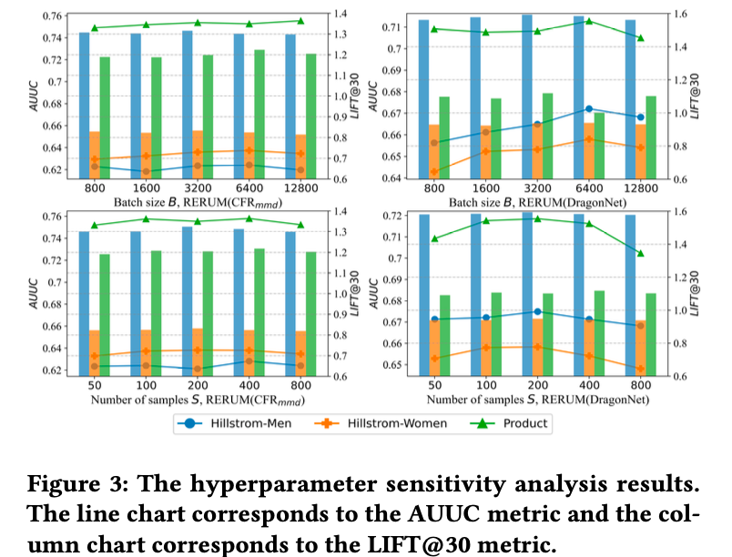

结论是RERUM 对超参数选择具有一定鲁棒性。两种模型在不同超参数设置下，AUUC 和 LIFT@30 整体表现相对稳定。RERUM（DragonNet）的性能波动略大于 RERUM（CFR-MMD）。

### 收入响应回归实验

论文进一步研究三个模块对收入响应预测精度的影响。采用 MAPE（Mean Absolute Percentage Error）作为评价指标，结果如下图所示。

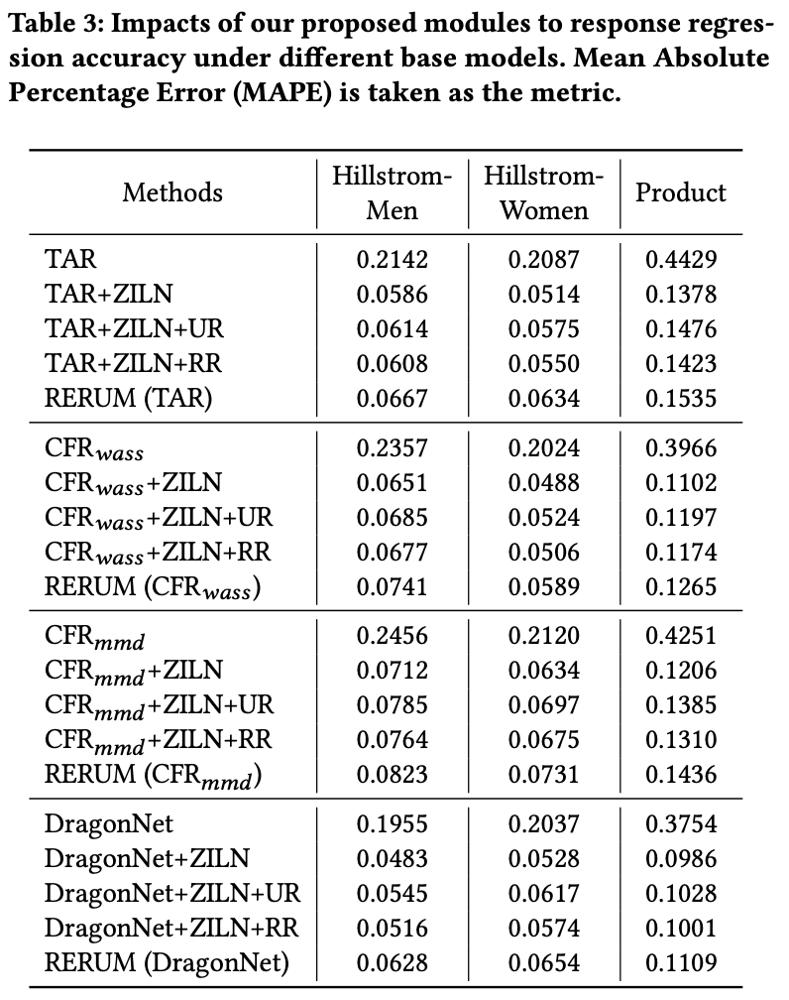

可以发现：ZILN 对收入响应回归精度的改善非常明显。但同时也能发现，UR 和 RR 模块加入后，MAPE 相比单独使用 ZILN 会有所上升。这是因为 UR 和 RR 的主要优化目标是 Uplift 排序，而不是收入响应回归精度。论文认为，只要能够改善最终 Uplift 排序能力，适当牺牲部分响应回归精度是可以接受的。

### 线上部署实验

实验场景来自腾讯 FiT 的基金销售业务，Treatment为通知红点（Notification Redpoint），Response为基金销售收入，用户规模约 4 亿。目标用户为模型预测 Uplift 排名前 2% 的用户。

实验过程如下图所示，先使用模型对约 4 亿用户进行 Uplift 排序，选取排名前 2% 的用户，将这些用户随机划分为处理组和对照组；在一个月的观察周期内，计算处理组和对照组的平均销售收入差异，使用 Revenue LIFT@2 衡量模型的排序能力。

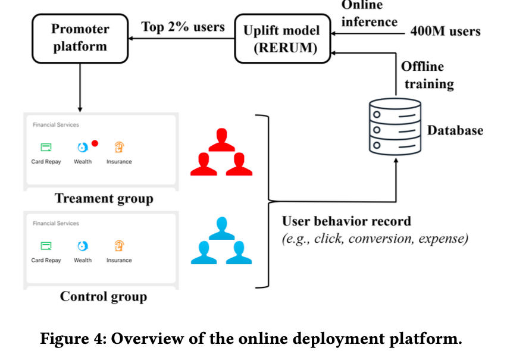

上实验进行了三次营销活动，结果如下图所示，三个营销活动的收入 LIFT@2 均有明显提升。

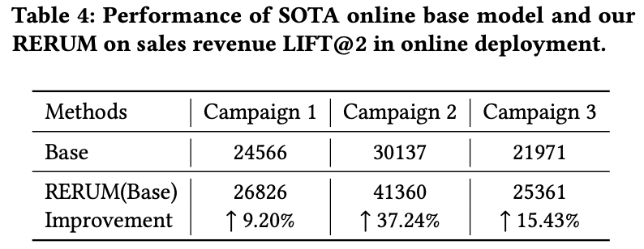

## 07 局限与展望

**多 Treatment 场景下的 Revenue Uplift Modeling**。本文主要研究二元 Treatment 场景，即用户接受或者不接受某种营销干预。但实际商业营销中，往往存在多个干预策略，例如不同优惠力度、不同优惠券面额以及不同营销触达方式。未来需要研究如何将 RERUM 扩展到多个 Treatment 的场景。

**跨领域场景应用（Cross-domain Scenarios）**。未来将进一步研究 Revenue Uplift Modeling 在不同领域之间的应用。例如，不同业务场景下的收入响应分布、用户行为和营销干预可能存在差异，需要研究模型在跨领域场景中的适用性。

## 论文摘要

Uplift Modeling 已经广泛应用于在线营销，通过预测处理组和对照组之间的响应差异，识别对优惠券或折扣等干预措施敏感的用户。相比传统的转化增益建模，收入增益建模与企业收入具有更加直接的联系，因此具有更高的应用潜力。

然而，之前的研究很难处理收入增益建模中连续且具有长尾特征的响应分布。此外，现有研究忽略了不同用户之间的 Uplift 排序优化，而这实际上是 Uplift Modeling 的核心问题。

为了解决上述问题，本文首先使用零膨胀对数正态分布（Zero-Inflated Lognormal，ZILN）损失函数进行响应回归，并设计了相应的建模网络，使其能够适配不同的现有 Uplift 模型。随后，本文从理论角度研究 Uplift 排序相关的建模误差，并提出两个更加严格的误差上界，将其作为额外的损失项加入传统响应回归损失中。最后，本文针对整个目标用户群体直接建模 Uplift 排序误差，提出了一种 Listwise Uplift Ranking Loss。

在公开数据集和工业数据集上的实验结果验证了本文方法在收入增益建模方面的有效性。此外，本文还在腾讯 FiT 这一大型在线金融科技营销平台上开展了大规模实验，进一步证明了该方法在真实业务应用中的优势。

## 图文速览

腾讯 FiT 与香港城市大学等团队提出了 RERUM，一种专门解决在线营销收入增益排序问题的模型框架。它希望解决一个实际问题：如何从海量用户中找到那些真正能够因为营销干预而增加消费金额的人。

方法上，RERUM 主要做了三件事：首先，使用 ZILN 损失处理大量零收入和少量高收入的长尾分布；其次，通过组内和跨组响应排序损失，让用户之间的收入排序更加准确；最后，使用 Listwise Loss，直接优化整个用户群体的 Uplift 排序。

实验结果表明，RERUM 在三个离线数据集上取得了较好的排序效果。在腾讯 FiT 约 4 亿用户的真实金融营销场景中，三个线上活动的 Revenue LIFT@2 分别提升 9.20%、37.24% 和 15.43%，平均提升 20.61%。

简单来说，传统模型不仅要预测用户能花多少钱，还要判断谁更值得营销。RERUM 的核心思路就是：既要把收入预测得更合理，也要把真正能带来收入增量的用户排在前面。这样才能让营销资源更加精准地投入到高价值用户身上。

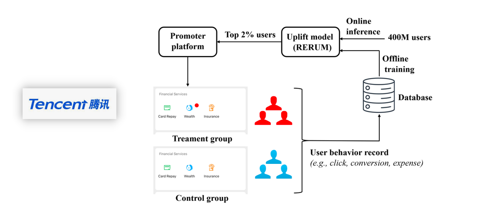

