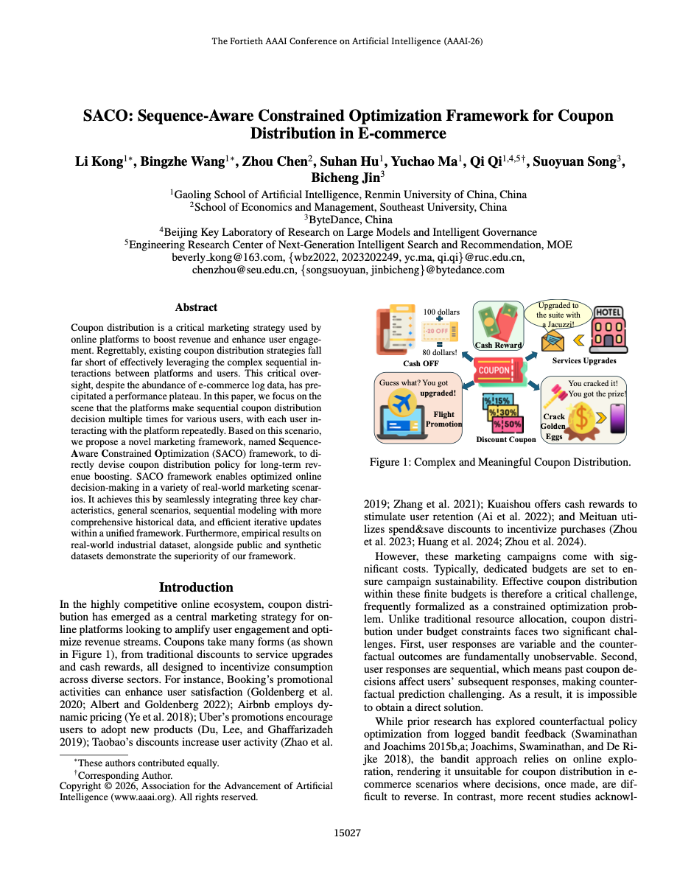
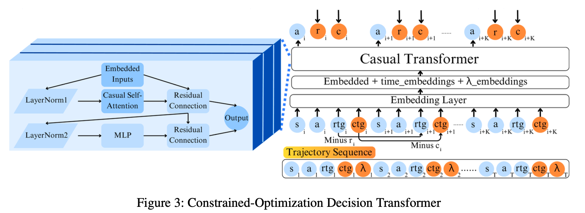
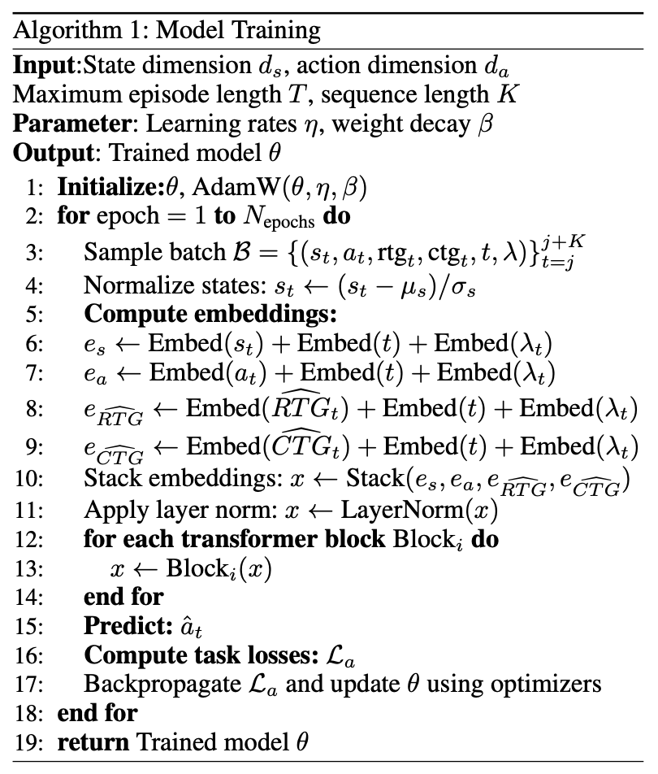
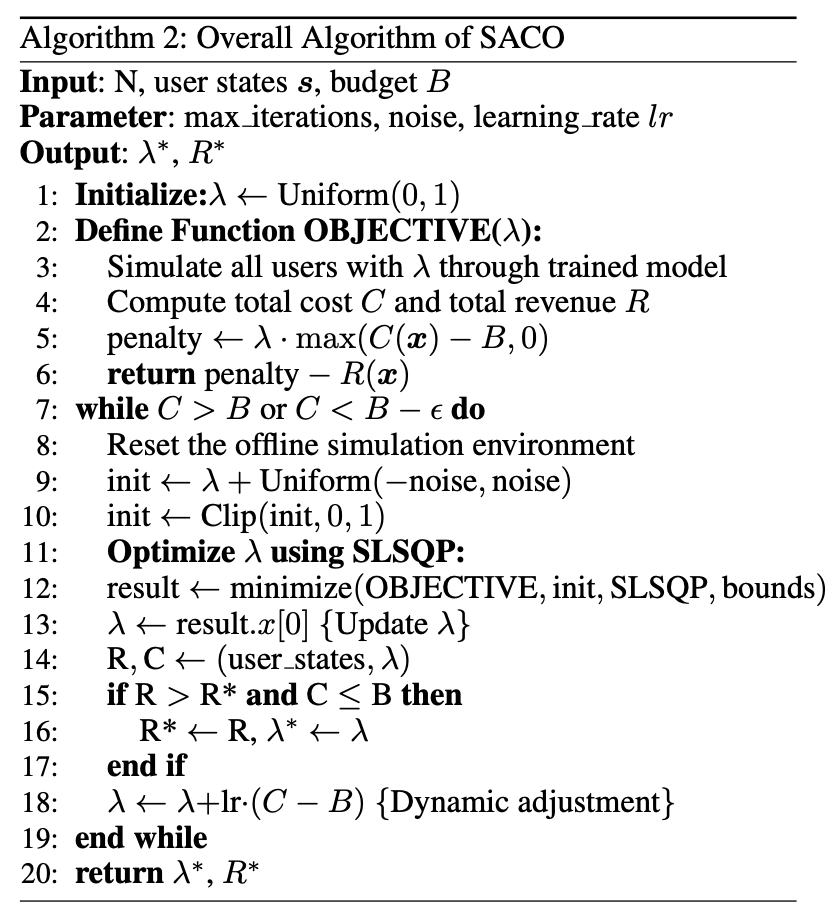
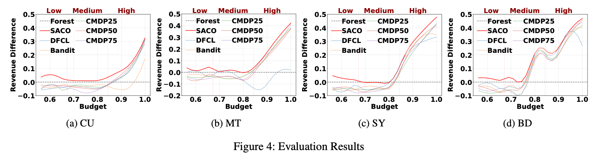
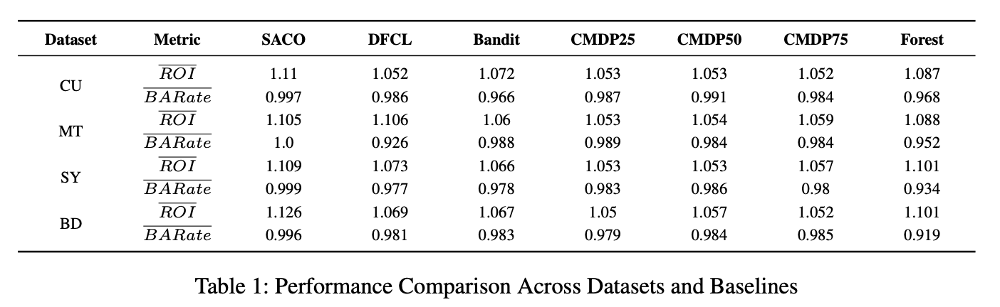
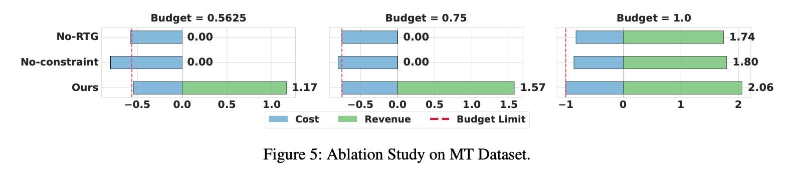
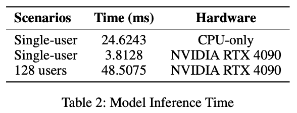
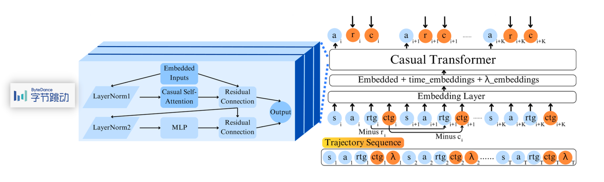

**速览1**：字节跳动与中国人民大学、东南大学的研究团队提出 SACO 框架，通过引入预算条件的 Decision Transformer，利用用户历史优惠券交互轨迹学习序列化发券策略，实现多用户、多轮次场景下的长期营销收入优化。

**速览2**：在四类数据集上，SACO 相比现有基线平均提升收入 3.60%，并在 ROI 和预算利用率方面整体表现更优。

## 01 论文信息

**标题**：SACO: Sequence-Aware Constrained Optimization Framework for Coupon Distribution in E-commerce / SACO：面向电商优惠券分发的序列感知约束优化框架

**作者**：Li Kong、Bingzhe Wang 等

**期刊/会议**：AAAI

**发表时间**：2026年3月

**链接**：https://doi.org/10.1609/aaai.v40i17.38525

## 02 核心问题

论文研究的是电商平台在有限营销预算下，如何为用户进行多轮次、序列化的优惠券分发决策，从而最大化长期营销收入。

现有优惠券分发方法通常将每次用户交互视为独立决策，即根据用户当前状态预测其对不同优惠券的响应，再通过优化算法决定发券策略。但在真实电商场景中，同一个用户可能多次访问平台，平台也会多次向其发放优惠券。用户之前收到的优惠券会改变其后续消费行为及对优惠券的响应，因此当前决策不仅取决于用户当前状态，也取决于历史优惠券发放记录。

## 03 核心要点

**从单轮次优惠券分发转向多轮次序列化决策**。传统优惠券分发研究，通常以单次用户交互为决策单位，只考虑当前用户状态和当前优惠券处理方案。SACO 将同一个用户在多个时间点与平台之间的交互，组织成完整的行为轨迹，通过历史状态、历史优惠券决策以及历史响应信息学习用户的动态变化，从而更充分地利用电商平台积累的历史日志数据。

**使用 Decision Transformer 实现端到端策略学习**。SACO 将优惠券分发问题转化为自回归序列预测任务，采用因果 Transformer 建模历史状态、动作、未来回报目标和未来成本目标之间的关系。

**通过拉格朗日乘子将预算约束转化为模型输入**。论文引入拉格朗日乘子 $\lambda$，将预算约束融入策略学习过程。不同的 $\lambda$ 对应不同的预算约束强度，模型根据 $\lambda$ 学习不同的优惠券分发策略。这样，在训练阶段只需要训练一个模型，就可以在推理阶段通过调整 $\lambda$ 适配不同的预算水平。

**通过离线轨迹模拟和迭代优化实现策略更新**。由于线上直接进行策略探索存在成本和业务风险，论文利用历史日志构建离线轨迹数据，并通过离线模拟环境评估不同策略产生的收入和成本。随后利用 SLSQP 优化拉格朗日乘子，并通过多轮扰动和动态调整寻找满足预算约束的较优策略。

## 04 研究动机

**传统两阶段方法存在预测与优化目标不一致的问题**。这种解耦方式存在误差累积问题，而且预测模型的优化目标与最终营销决策目标并不完全一致。

**现有研究没有充分利用用户历史交互中的序列依赖**。现有两阶段方法、Decision Focused Learning（DFL）以及部分强化学习方法，虽然已经研究了优惠券分发中的反事实策略优化问题，但大多聚焦于单轮次用户交互。

**真实电商场景不适合依赖大规模线上探索**。基于日志反馈的 Bandit 方法，通常需要通过线上探索获取不同动作的反馈。然而，错误的探索决策可能造成真实营销预算损失。论文希望利用历史电商日志构建序列化训练数据，通过离线训练和策略模拟完成优化，降低对线上探索的依赖。

## 05 方法思路

### 问题定义

论文将优惠券分发问题定义为**具有多个 Treatment 的预算分配问题**。假设平台有 $N$ 个用户，每个用户在有限时间范围内最多与平台交互 $T$ 次，平台提供 $K$ 种优惠券。建模如下：

$$
\max \sum_{i\in[N],t\in[T],k\in[K]}r_{itk}x_{itk}
$$

$$
\sum_{i\in[N],t\in[T],k\in[K]}
c_{itk}x_{itk}\leq B
$$

$$
0\leq x_{itk}\leq1,
\quad
\forall i\in[N],t\in[T],k\in[K]
$$

其中：

- $i$：用户索引。
- $t$：交互轮次。
- $k$：优惠券类型。
- $x_{itk}$：平台在第 $t$ 轮是否向用户 $i$ 发放优惠券 $k$。
- $r_{itk}$：发放优惠券 $k$ 后产生的收入。
- $c_{itk}$：发放优惠券 $k$ 对应的补贴成本。
- $B$：整个营销周期内的总预算。

上述三个公式共同构成了论文的在线预算约束优化问题。$x_{itk}=1$ 表示发放对应优惠券，取值范围为 0 到 1，论文采用的是线性松弛形式，而不是直接将所有决策变量限制为 0 或 1。

为了处理预算约束，论文引入拉格朗日乘子 $\lambda$，将原始约束优化问题转换为**对偶优化问题**。

$$
\min_{\lambda\geq0}
\max_{0\leq x_{itk}\leq1}
L(x,\lambda)
$$

$$
=
\min_{\lambda\geq0}
\max_{0\leq x_{itk}\leq1}
\left(R(x)-\lambda(C(x)-B)\right)
$$

其中：

- $R(x)$：整体优惠券分发策略产生的总收入。
- $C(x)$：整体优惠券分发策略产生的总补贴成本。
- $B$：总营销预算。
- $\lambda$：预算约束对应的拉格朗日乘子。

该公式将原来的预算约束，转化为收入与预算超额惩罚之间的权衡，当 $\lambda$ 较大时，模型对预算超支更加敏感；当 $\lambda$ 较小时，模型对收入的追求相对更强。

在论文所述的线性规划及强对偶条件下，给定最优拉格朗日乘子 $\lambda^*$ 后，策略优化可以转化为最大化收入，减去乘子加权成本。这里乘子加权预算被省略，因为当外层优化已经固定一个 $\lambda^*$ 时，预算 $B$ 是已知常数，因此这一项不会影响内层不同策略之间的排序。

$$
\max_{0\leq x_{itk}\leq1}
\left(R(x)-\lambda^*C(x)\right)
$$

### 数据处理：用户行为轨迹构建

确定优化目标后，SACO 将单个用户的多轮次交互转化为序列化轨迹数据。论文使用六元组描述序列决策问题：

$$
\langle S,A,P,R,C,\gamma\rangle
$$

其中：

- $S$：状态空间，描述用户上下文，包括用户特征等信息。
- $A$：动作空间，描述优惠券分发策略。
- $P$：状态转移函数，描述用户在执行当前优惠券分发动作后，如何转移到下一轮状态。
- $R$：奖励空间，描述优惠券分发产生的平台收入。
- $C$：成本空间，描述优惠券分发产生的营销预算支出。
- $\gamma$：未来奖励的折扣因子，论文设置为 $\gamma=1$。

状态定义：

$$
s_t=(s_{1t},\ldots,s_{it},\ldots,s_{Nt})
$$

动作定义：

$$
a_t=(x_{1t1},\ldots,x_{Nt1},\ldots,x_{itk},
\ldots,x_{NtK})
$$

奖励定义：

$$
r_t=\sum_{i\in[N]}r_{it}
$$

$$
r_{it}=\sum_{k\in[K]}r_{itk}
$$

成本定义：

$$
c_t=\sum_{i\in[N]}c_{it}
$$

$$
c_{it}=\sum_{k\in[K]}c_{itk}
$$

**RTG 和 CTG 的构建**。论文借鉴 Decision Transformer 中的 Return-to-Go 思想，构建两个序列目标：

$$
RTG_{it}=\sum_{t'=t}^{T}\gamma r_{it'}
$$

$$
CTG_{it}=\sum_{t'=t}^{T}c_{it'}
$$

其中：

- RTG（Return-to-Go）：从当前交互轮次开始，直到后续轨迹结束，用户未来累计产生的收入。由于论文设置 $\gamma=1$，RTG 实际上是未来各轮收入的直接累加。
- CTG（Cost-to-Go）：从当前交互轮次开始，直到后续轨迹结束，用户未来累计产生的成本。

最后，按照 user-id 聚合，并按照时间顺序排序，形成每个用户的完整行为轨迹：

$$
\begin{aligned}
\tau_i=[
&(s_{i0},a_{i0},CTG_{i0},RTG_{i0},\lambda_i),\\
&\ldots,\\
&(s_{it},a_{it},CTG_{it},RTG_{it},\lambda_i),\\
&\ldots,\\
&(s_{iT},a_{iT},CTG_{iT},RTG_{iT},\lambda_i)
]
\end{aligned}
$$

为了增强模型对不同预算约束水平的泛化能力，论文对每条轨迹随机采样 10 次 $\lambda$，将训练数据规模扩展为原来的 10 倍。

### 整体架构

在构建好用户轨迹后，论文对 Decision Transformer 进行改造，使其能够同时理解用户历史行为和预算约束。

原始 Decision Transformer 主要使用：

- RTG：未来累计奖励。
- State：用户状态。
- Action：历史动作。

SACO 则在此基础上引入：

- CTG：Cost-to-Go，未来累计成本。
- $\lambda$：拉格朗日乘子，用于表达预算约束的强度。

也就是说，SACO 的模型需要同时理解三个方面：

1. 历史信息：用户过去的状态和优惠券领取行为。
2. 长期目标：希望获得多少未来收入（RTG）。
3. 预算约束：未来成本目标（CTG）以及当前成本价格（$\lambda$）。

Decision Transformer 知识补充，参考2021年发表在 NeurIPS 的论文《Decision Transformer: Reinforcement Learning via Sequence Modeling》

### 训练流程

**模型输入设计**。论文将四类信息作为 Transformer 的输入：

- 状态 $s_t$：当前用户上下文。
- 动作 $a_t$：历史优惠券分发动作。
- RTG：未来收入目标。
- CTG：未来成本目标。

此外，还将时间步 $t$ 和拉格朗日乘子 $\lambda$ 融入各类输入的 Embedding，模型不只是学习用户状态、动作和收益成本目标本身，还会将时间信息以及预算约束信息共同编码。

$$
e_s=Embed(s_t)+Embed(t)+Embed(\lambda_t)
$$

$$
e_a=Embed(a_t)+Embed(t)+Embed(\lambda_t)
$$

$$
e_{RTG}=Embed(RTG_t)+Embed(t)+Embed(\lambda_t)
$$

$$
e_{CTG}=Embed(CTG_t)+Embed(t)+Embed(\lambda_t)
$$

**序列输入与 Transformer 处理**。论文将四类 Embedding 进行堆叠：

$$
x=Stack(e_s,e_a,e_{RTG},e_{CTG})
$$

然后进行 Layer Normalization，再依次输入多个 Causal Transformer Block。因果 Transformer 通过自回归注意力机制，使当前决策能够利用历史序列信息，同时避免直接访问未来的序列信息。模型最终预测当前轮次的动作，即优惠券分发策略。

**动作预测损失**。论文使用交叉熵损失训练动作预测模型：

$$
L^a(\theta)=
-\frac{1}{NT}
\sum_{i=1}^{N}
\sum_{t=1}^{T}
\sum_{j=1}^{K}
y_{itj}\log
\left(p_\theta(a_{it}=j'|s_{it})\right)
$$

其中：

- $\theta$：模型参数。
- $N$：用户数量。
- $T$：交互轮次。
- $K$：优惠券动作类别数量。
- $y_{itj}$：动作标签的指示变量。
- $p_\theta(a_{it}=j'|s_{it})$：模型预测用户在当前状态下采取动作 $j'$ 的概率。

**训练目标**。Algorithm1 中，模型学习的不是单纯的“用户会不会转化”，而是：在给定收益目标、成本目标和预算约束强度的情况下，应该采取什么样的优惠券动作。而且模型训练时会对历史轨迹采样不同的 $\lambda$，让同一个模型学习不同约束强度下的决策行为。

### 整体策略优化

完成模型训练后，SACO 需要找到最优的拉格朗日乘子 $\lambda^*$，使模型在预算约束下实现尽可能高的收入。论文使用 SLSQP（Sequential Least Squares Programming）优化算法完成这一过程。Algorithm 2 的优化目标为：

$$
\lambda\cdot(C(x)-B)-R(x)
$$

其中：

- $\lambda$：当前拉格朗日乘子。
- $C(x)$：当前策略产生的总成本。
- $B$：预算上限。
- $R(x)$：当前策略产生的总收入。

Algorithm 2 的整体优化流程可以分为以下步骤：

1. 初始化 $\lambda$，从 0 到 1 的均匀分布中随机采样。
2. 将当前 $\lambda$ 输入已经训练好的 SACO 模型。
3. 在离线模拟环境中，模拟所有用户的多轮次优惠券分发过程。
4. 计算所有用户产生的总收入 $R$ 和总成本 $C$。
5. 根据当前成本和预算计算惩罚项。
6. 使用 SLSQP 优化 $\lambda$。
7. 为下一轮优化加入随机扰动，避免陷入局部最优。
8. 根据当前成本与预算的差值动态调整 $\lambda$。
9. 当成本满足论文设定的预算收敛条件时，返回最优的 $\lambda^*$ 和收入 $R^*$。

论文使用的动态调整方式为：

$$
\lambda\leftarrow\lambda+lr\cdot(C-B)
$$

其中 $lr$ 是学习率。当成本超过预算时，$C-B$ 为正，$\lambda$ 增大，使后续策略更加重视成本控制；当成本低于预算时，$\lambda$ 减小，使策略有机会提高收入。

**Algorithm 1 与 Algorithm 2 的关系**。Algorithm 1 用于模型训练，负责将历史日志转化为用户轨迹，训练能够根据用户历史状态、动作、RTG、CTG 和 $\lambda$ 预测优惠券动作的 DT。Algorithm 2 用于策略优化，负责调用已经训练好的模型，在不同 $\lambda$ 下模拟所有用户的优惠券分发过程，计算收入和成本，再利用 SLSQP 调整 $\lambda$，找到满足预算约束的较优策略。

两者的关系可以概括为：历史日志 → 用户轨迹 → SACO 模型训练 → 离线策略模拟 → SLSQP 优化 $\lambda$ → 最终优惠券分发策略。

**SACO 与传统两阶段法的区别**。传统方法是：先预测用户响应，再根据预测结果优化优惠券分配。预测模型与优化器相对独立，容易出现预测准确性与最终业务收益不一致的问题。SACO 是：先训练一个能够感知预算约束强度的条件决策模型，再通过离线模拟优化拉格朗日乘子，让模型在不同约束强度下输出相应的决策策略。

总的来说，SACO 并不是取消两阶段流程，而是改变了两阶段之间的衔接方式。将预算约束通过拉格朗日乘子，融入策略模型的学习和决策过程，使模型学习的决策行为与最终约束优化目标，具有更紧密的联系。

## 06 结果分析

### 实验数据集

论文使用四类数据集验证 SACO 的有效性，涵盖公开数据集、真实业务数据和合成数据。所有数据集均按照 80% 训练集、20% 测试集进行划分。经过异常数据清洗后，按照用户 ID 或相对稳定的用户特征进行聚合，并根据时间顺序构建用户行为轨迹。

**CRITEO-UPLIFT v2（CU）**来自 Criteo AI Labs 在 AdKDD'18 Workshop 发布的公开数据集，基本信息如下：

- 样本数量：1390 万。
- 特征数量：12 个。
- Treatment：二元处理变量。
- 响应标签：Visit 和 Conversion。
- 状态：使用 f0-f11 用户特征。
- 动作：Treatment。
- 成本：Visit。
- 收入：Conversion。

**MT-LIFT（MT）** 来自美团外卖优惠券营销场景，采集时间为两个月，基本信息如下：

- 样本数量：约 550 万。
- 特征数量：99 个。
- Treatment：5 种。
- 响应标签：Click 和 Conversion。
- 状态：使用 f0-f98 用户特征。
- 动作：Treatment。
- 成本：Click。
- 收入：Conversion。

**Synthetic Dataset（SY）**论文构建的合成数据集，基本信息如下：

- 用户数量：10,000。
- 每个用户交互轮次：10。
- Treatment：4 种。
- 动作在每个时间步以相同概率随机生成。
- 成本和收入根据用户对优惠券的响应概率生成。
- 使用高斯噪声模拟用户状态转移。

**Business Dataset（BD）**来自字节跳动真实业务场景的数据集，基本信息如下：

- 样本数量：数百万级。
- 状态：经过匿名化处理的用户特征。
- 动作：优惠券 Treatment。
- 成本：Cost。
- 收入：Is Paid。

### Baseline和评价指标

**论文设置了四类对比方法**：

- Causal Forest： 基于历史数据训练因果森林，预测不同优惠券处理下的个体处理效应（ITE），仅在预测效果为正时发放优惠券。
- Bandit： 使用 Thompson Sampling，通过贝叶斯方法建立不同动作的奖励分布。
- CMDP： 采用约束马尔可夫决策过程方法。由于不同 $\lambda$ 需要重新训练策略网络，论文分别设置 CMDP25、CMDP50 和 CMDP75，对应 $\lambda$ 为 0.25、0.5 和 0.75。
- DFCL： 使用 Decision Focused Causal Learning，将因果预测与最终决策目标进行端到端结合。

**论文主要使用三个指标评价策略效果**：

（1）Revenue：总收入。表示优惠券分发策略带来的平台总收入，是论文最核心的优化目标。

$$
R(x)
$$

（2）ROI：投资回报率。该指标用于衡量单位营销补贴所产生的收入。相比单纯追求收入最大化，ROI 能够进一步反映营销资源的使用效率。

$$
ROI=\frac{R(x)}{C(x)}
$$

其中，$R(x)$ 为总收入，$C(x)$ 为总补贴成本。

（3）BARate：预算分配率。该指标用于衡量预算利用程度。数值越接近 1，说明预算使用越充分。但 BARate 越高并不一定意味着营销效果越好，还需要结合 Revenue 和 ROI 判断。论文希望在满足预算约束的同时，提高收入和资金利用效率。

$$
BARate=\frac{C(x)}{B}
$$

其中，$C(x)$ 为实际补贴成本，$B$ 为预算上限。

### 核心实验结果

**收入提升方面**。论文在四类数据集以及不同预算水平下比较了各方法的收入表现。实验结果显示，SACO 相比现有基线方法平均实现了 3.60% 的收入提升。但并不是所有场景都取得了最优表现：

- MT 数据集的中等预算场景下，SACO 的收入略低于 DFCL。
- SY 数据集的中等预算场景下，SACO 的收入略低于 Forest。

作者认为，MT 场景中 DFCL 可能更适合对应的数据特征；而 SY 场景中，由于 Treatment 是均匀随机分配的，Forest 和 Uplift 模型能够更充分地受益于这种无偏数据分布。

**ROI 和 BARate 结果方面**。论文给出了四类数据集上各方法的 ROI 和 BARate。SACO 在四类数据集上均表现出较高的预算利用率，BARate 均接近 1。同时，SACO 在测试预算范围内的平均 ROI 和 BARate 整体优于对比方法。

### 消融实验

论文在 MT-LIFT 数据集上进行了消融实验，主要验证两个模块的作用。

**No-constraint：移除预算约束相关信息**。该实验移除了模型中的 $\lambda$ 和 CTG 参数。实验结果表明，缺少预算约束相关信息后，模型对不同预算水平的变化缺乏充分感知，难以根据预算约束调整发券策略。

**No-RTG：移除长期收入目标**。该实验使用原始 Transformer，不再引入 RTG 参数。实验结果表明：当预算不够宽松时，缺少 RTG 的模型可能为了追求即时收入而略微超出预算；当预算较为充足时，缺少 RTG 指导的模型无法充分追求长期收入，最终收入低于 SACO。

### 推理效率实验

论文进一步验证了 SACO 在实际业务部署中的推理效率。RTX 4090 下 128 用户推理耗时约 48.51 ms，论文认为 SACO 的推理效率能够满足工业应用需求。

## 07 局限与展望

**考虑用户之间的外部性（Externalities）**。目前 SACO 主要围绕单个用户的历史交互轨迹进行建模，未来计划将用户之间的影响关系纳入模型，例如将用户间影响评估结果作为额外输入特征。在真实的电商补贴或拼单场景中，存在严重的网络效应（Network Effects）或资源竞争（如有限的平台预算池、分享裂变）。一个用户拿到大额券可能会分流或影响身边人的消费决策。将用户间的互影响建模为特征输入，能够打破单兵作战的局限。

**对优惠券进行编码，避免动作空间漂移（Action Space Drift）**。在序列决策中，“动作（Action）”通常对应具体的优惠券档位或策略（如 0%、10%、20%、30%）。当业务运营需要动态调整、引入全新面额（如新增 50% 档位）或下线旧档位时，传统的离散动作空间模型会直接失效或无法泛化。通过对优惠券进行表征编码（Coupon Embedding），可以让模型学会不同面额之间的语义关联，从而优雅地应对动作空间的动态演进。

## 论文摘要

优惠券分发是在线平台用于提升收入和增强用户参与度的一项重要营销策略。然而，遗憾的是，现有优惠券分发策略远未能有效利用平台与用户之间复杂的序列交互关系。尽管电商平台积累了大量日志数据，但这一关键问题仍然存在，导致现有方法的性能提升陷入瓶颈。

本文聚焦于这样一种场景：平台需要针对不同用户，在多个时间点连续做出优惠券分发决策，而每个用户也会与平台进行重复交互。基于这一场景，我们提出了一种新型营销框架，称为序列感知约束优化框架（Sequence-Aware Constrained Optimization，SACO），用于直接制定优惠券分发策略，以提升长期收入。

SACO 框架能够支持多种真实营销场景下的优化在线决策，并在统一框架中无缝整合了三个关键特征：通用化的业务场景、更全面历史数据支持下的序列建模，以及高效的迭代更新机制。论文在真实工业数据集、公开数据集和合成数据集上进行了大量实验，实验结果证明了所提出框架的优越性。

## 图文速览

字节跳动联合中国人民大学、东南大学的研究团队提出了 SACO，研究如何在有限营销预算下，为用户连续多次发放优惠券，实现长期收入最大化。

他们没有只看用户当前的状态，而是把用户过去收到的优惠券、消费反馈等信息整理成行为轨迹，再利用 Decision Transformer 学习未来的发券策略。同时，把预算约束也作为模型输入，通过拉格朗日乘子调整发券力度。

实验结果显示，SACO 在四类数据集上平均提升收入 3.60%，并且在 ROI 和预算利用率方面整体表现更好，还验证了模型在工业场景中的推理效率。

简单来说，以前的算法主要考虑这次给用户发多少钱，而 SACO 开始考虑这个用户过去领过什么、未来可能怎么消费，以及整个营销周期应该怎么花钱。它想解决的不是一次优惠券发得好不好，而是长期怎么发才更赚钱。

