**速览1**：阿里巴巴淘宝与天猫团队提出 CanniUplift，通过平台级全局 GMV 对齐（PGA）和基于核销行为的分解去噪（RDD），解决多商家电商场景下 Uplift Modeling 中的商家间替代效应和优惠券归因噪声问题。

**速览2**：在工业数据和合成数据上，CanniUplift 均取得最优实验结果；在线 A/B 测试中，相比生产基线，平台增量 GMV 提升 4.08%，营销成本降低 2.45%，平台 ROI 提升 6.69%。

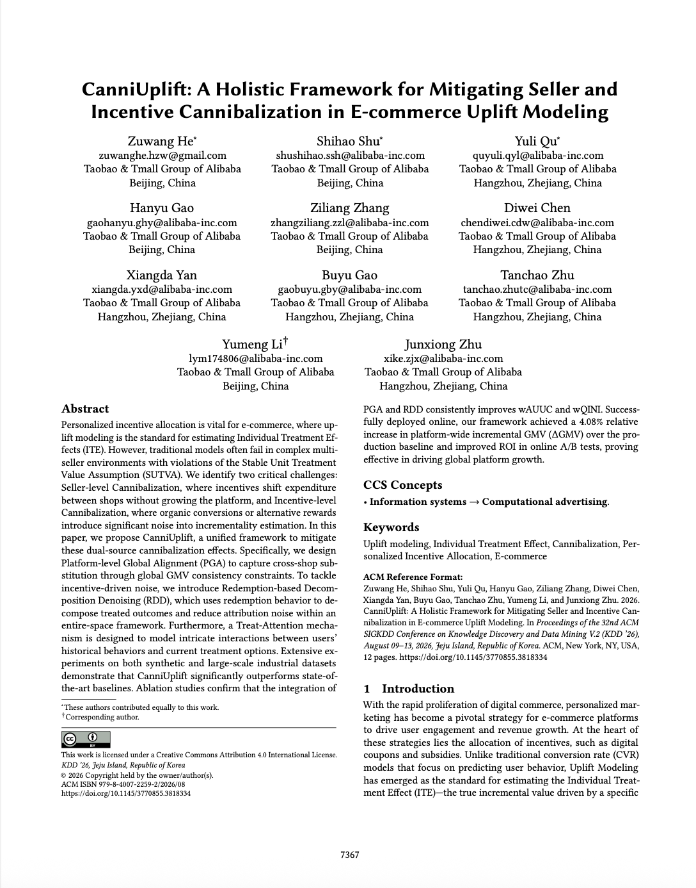

## 01 论文信息
**标题**：CanniUplift: A Holistic Framework for Mitigating Seller and Incentive Cannibalization in E-commerce Uplift Modeling / CanniUplift：一种缓解电商 Uplift Modeling 中商家与激励蚕食问题的整体框架

**作者**：Zuwang He、Shihao Shu 等

**期刊/会议**：KDD

**发表时间**：2026年8月

**链接**：https://doi.org/10.1145/3770855.3818334

## 02 核心问题
在复杂多商家电商平台中，传统 Uplift Modeling 无法准确衡量优惠券真实增量价值，主要体现在两个不同层面的问题：1）商家之间的消费替代问题 2）当前优惠券与其他购买动机之间的归因问题

## 03 核心要点
**从商家局部增量转向平台整体增量**。引入 Platform-level Global Alignment（PGA），通过将用户在多个候选商家的 GMV 预测进行聚合，并与用户真实的平台 GMV 对齐，使模型能够在训练过程中学习商家之间的替代关系。

**将优惠券核销作为处理后行为进行建模**。论文提出 Redemption-based Decomposition Denoising（RDD），将 Treatment 组的 GMV 拆分为核销购买和未核销购买两条路径，分别学习其增量贡献，再通过核销概率进行加权融合。

**通过 Treat-Attention 建模用户与候选优惠券的交互**。用户对优惠券的响应不仅取决于用户画像，还与当前候选商家、优惠券面额、使用门槛、有效期等因素密切相关。论文采用候选对象作为 Query、用户多源行为序列作为 Key/Value 的注意力机制，为不同候选商家和优惠券生成独立的交互表示。

## 04 研究动机
**传统 Uplift Modeling 依赖 SUTVA，无法处理商家间的替代效应**。传统 Uplift Modeling 基于潜在结果框架，分别估计用户接受 Treatment 和不接受 Treatment 时的结果，并将二者差值作为个体处理效应。但在多商家电商平台中，用户的消费预算和购买需求是有限的，不同商家之间存在竞争关系。给一个商家发放优惠券，可能改变用户原本的购买选择。单纯优化各个商家的局部增量，会导致优惠券资源被分配给那些，能够争夺其他商家既有需求、却无法创造平台新增需求的用户。

**Treatment Assignment 不等于实际核销，导致增量归因噪声**。在真实电商环境中，用户可能同时持有多张优惠券，包括历史优惠券、平台级优惠券和当前测试优惠券。如果直接将 Treatment 组所有购买都用于学习优惠券增量效果，就会把自然购买需求或者其他优惠券产生的效果错误地归因于当前 Treatment。

**现有方法仍然缺乏平台整体视角**。已有方法主要关注用户级或商家级 Treatment Effect 的估计，还有一些方法通过多任务学习同时建模转化、核销等行为，但通常仍然将各个商家的增量视为独立目标。即使模型能够预测用户在每个商家的 Treatment Effect，也不意味着这些预测的加总，能够准确反映平台整体增量。

## 05 方法思路
### 问题定义和理论基础
**数据定义**。定义用户集合 $U$ 和商家集合 $S$，对于一次营销活动，观测数据集定义为：
$$
\mathcal D=
\{(x_i,t_{i,s},r_{i,s},y_{i,s})\}_{i=1}^{N}
$$

其中：
- $x_i$：用户 $i$ 的特征向量，包括历史行为和上下文信息。
- $t_{i,s}$：用户是否获得商家 $s$ 的优惠券，取值为 0 或 1。
- $r_{i,s}$：优惠券核销标记，取值为 0 或 1。
- $y_{i,s}$：用户在商家 $s$ 产生的 GMV。

**潜在结果框架与 ITE**。基于 Neyman-Rubin Potential Outcome Framework 定义个体处理效应：
$$
\tau_{i,s}(x_i)
=
\mathbb E[
y_{i,s}(1)-y_{i,s}(0)
\mid X=x_i
]
$$

其中：
- $y_{i,s}(1)$：用户接受优惠券时的潜在 GMV。
- $y_{i,s}(0)$：用户不接受优惠券时的潜在 GMV。
- $\tau_{i,s}$：用户在商家 $s$ 上的处理效应。

由于同一个用户在同一个实验中只能观察到一种处理状态，因此实际观测结果为：
$$
y_{i,s}
=
t_{i,s}y_{i,s}(1)
+
(1-t_{i,s})y_{i,s}(0)
$$

**SUTVA 与平台整体 GMV**。传统 Uplift Modeling 通常依赖 SUTVA，主要包含两个方面：
1. No Interference：一个实验单元的处理不影响其他实验单元的潜在结果。
2. No Hidden Versions of Treatment：Treatment 定义明确，不存在未区分的处理版本。

但是，在多商家环境下，向商家 A 发放优惠券可能改变用户在商家 B 的消费，因此商家之间存在干扰。为此，论文将用户的平台整体GMV和平台整体增量定义如下，研究目标不再局限于某一个商家的 GMV，而是用户在整个平台产生的 GMV。
$$
Y_i=\sum_{s\in S}y_{i,s}
$$

$$
\Delta Y_i
=
\mathbb E[Y_i\mid Treat]
-
\mathbb E[Y_i\mid Control]
$$

**Treatment 组的结果混合问题**。Teatment 组的结果分布可以表示为：
$$
\begin{aligned}
p(y\mid t=1)
={}&p(r=1\mid t=1)
p(y\mid t=1,r=1)\\
&+p(r=0\mid t=1)
p(y\mid t=1,r=0)
\end{aligned}
$$

Treatment 组中的购买行为实际上由两类不同机制构成：
- 核销购买：用户使用了当前分配的优惠券。
- 非核销购买：用户没有使用当前优惠券，但仍然完成了购买。即公式中的第二项，这一部分如果不识别出来可能会污染增益评估。

**平台净增量的分解**。对于用户 $i$，当向商家 $s_j$ 分配优惠券时，平台整体 GMV 的变化定义为：
$$
\begin{aligned}
\Delta Y_i(s_j)
={}&
\mathbb E[Y_i\mid t_{i,s_j}=1]
-
\mathbb E[Y_i\mid t_{i,s_j}=0]\\
={}&
\sum_{s_k\in S}
\left(
\mathbb E[y_{i,s_k}\mid t_{i,s_j}=1]
-
\mathbb E[y_{i,s_k}\mid t_{i,s_j}=0]
\right)
\\
={}&
\underbrace{
\mathbb E[y_{i,s_j}\mid t_{i,s_j}=1]
-
\mathbb E[y_{i,s_j}\mid t_{i,s_j}=0]
}_{\text{Apparent Increment (Local Lift)}}
\\
&+
\underbrace{
\sum_{s_k\ne s_j}
\left(
\mathbb E[y_{i,s_k}\mid t_{i,s_j}=1]
-
\mathbb E[y_{i,s_k}\mid t_{i,s_j}=0]
\right)
}_{\text{Cross Effect}}
\end{aligned}
$$

公式将平台整体增量分成两个部分。第一部分：Apparent Increment（表观增量），即当前商家自身的 GMV 增量。第二部分：Cross Effect（跨商家效应）。即当前商家 Treatment 对其他商家 GMV 产生的影响。

Cross Effect 可能为正，也可能为负：
- 正值：优惠券带来正向外溢效应。
- 负值：优惠券使用户从其他商家转移消费，产生商家级蚕食。

### 整体框架和训练流程
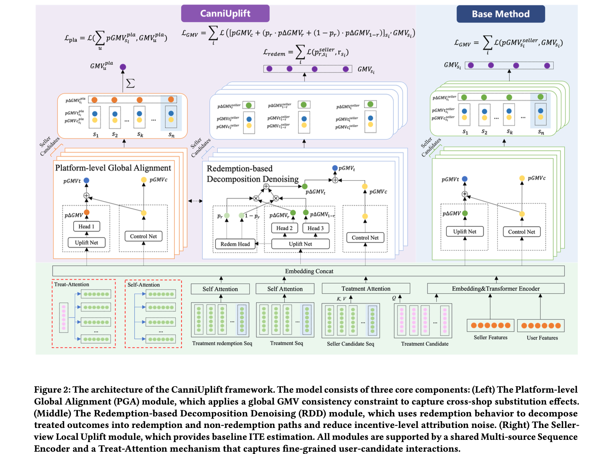

CanniUplift 框架由三个核心组件构成：（左）**平台级全局对齐 PGA 模块**，通过施加全局 GMV 一致性约束来捕捉跨店铺替代效应；（中）**基于核销的分解去噪 RDD 模块**，利用核销行为将干预后的结果分解为核销路径与非核销路径，从而降低激励级别的归因噪声；（右）**商家视角局部增益模块**，用于提供基准的个体处理效应（ITE）估计。

所有模块均由共享的**多源行为序列编码器**和**干预注意力机制**（Treat-Attention）提供支撑，以捕捉细粒度的用户-候选对象交互。

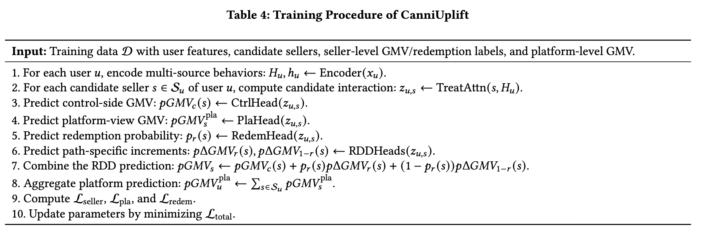

结合论文 Appendix B 的 Algorithm（Table 4），整个训练流程如下。
1. 输入训练数据，包括用户特征、候选商家、商家 GMV 标签、核销标签和平台整体 GMV。
2. 使用 Multi-source Sequence Encoder 编码用户多源行为，得到 $H_u$ 和 $h_u$。
3. 对每个用户的候选商家，使用 Treat-Attention 计算候选交互表示 $z_{u,s}$。
4. 使用 Control Head 预测无优惠券情况下的基础 GMV。
5. 使用 Platform Head 预测平台视角的候选 GMV。
6. 使用 Redemption Head 预测优惠券核销概率。
7. 使用 RDD Heads 分别预测核销和非核销两条路径的 GMV 增量。
8. 根据核销概率对两条路径的增量进行加权，获得 RDD GMV 预测。
9. 聚合用户所有候选商家的平台视角 GMV 预测。
10. 计算 Seller-level GMV Loss、Platform-level Aggregation Loss 和 Redemption Classification Loss。
11. 根据最终联合损失更新模型参数。

### 多源行为序列与候选交互建模
论文采用两阶段表示学习结构：
1. Multi-source Sequence Encoding：多源序列编码。
2. Treat-Attention：候选级注意力交互。

**Multi-source Sequence Encoding 部分**。论文构建三类输入信息：Treatment Candidates、Seller Candidates和用户历史行为与统计特征。经过 Embedding 和 Transformer 编码后，得到：
$$
H_u=
Transformer[
E^{beh},E^{ben},E^{oth}
]
$$

$$
h_u=Pool(H_u)
$$

其中：
- $E^{beh}$：用户行为序列的嵌入表示。
- $E^{ben}$：历史激励行为序列的嵌入表示。
- $E^{oth}$：其他统计和上下文特征的嵌入表示。
- $H_u$：Transformer 输出的序列表示。
- $h_u$：通过 Pool 操作获得的用户整体表示。

**Treat-Attention 部分**。对于每一个用户 $u$，系统会提供多个候选对象，例如不同商家、不同优惠券或者商家与优惠券的组合。将每个候选对象记为 $c$，其特征向量 $E_c$ 由商家 Embedding 和优惠券属性拼接而成。随后使用候选对象作为 Query，用户历史行为序列作为 Key 和 Value：
$$
z_{u,c}
=
Attn
\left(
q(E_c),K(H_u),V(H_u)
\right)
$$

具体含义：
- Query：当前候选商家或优惠券的表示。
- Key：用户历史行为序列经过映射后的表示。
- Value：用户历史行为序列的内容表示。
- $z_{u,c}$：用户与当前候选对象之间的交互表示。

这一机制的核心是：不同候选对象会关注用户历史行为中的不同部分。例如：
- 对于价格敏感用户，模型可能更关注历史优惠券领取和核销行为。
- 对于品牌忠诚用户，模型可能更关注其与当前商家或相似商家的交互。
- 对于商品可替代性较强的用户，模型可能更关注其近期在同品类不同商家之间的浏览行为。

最终，每个用户与候选商家都会产生独立的交互表示 $z_{u,c}$，并输入后续不同任务的预测 Head。

### 商家视角局部增益模块
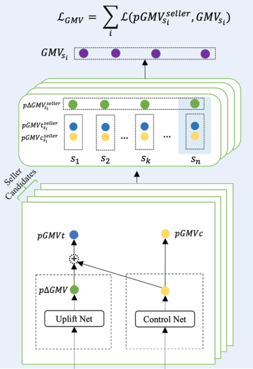

论文首先构建一个基础的商家视角 Uplift 模型，作为后续改进的基线。该结构包括两个主要预测网络：Control Net 预测用户在没有优惠券时的 GMV。Uplift Net 预测用户在获得优惠券时的 GMV。最终计算局部 uplift：

$$
Uplift=\widehat{Y}_1-\widehat{Y}_0
$$

模型使用每个商家实际观测到的 GMV 监督相应预测结果，这一结构本质上是传统的商家级 ITE 估计方法。

### 平台级全局对齐 PGA 模块
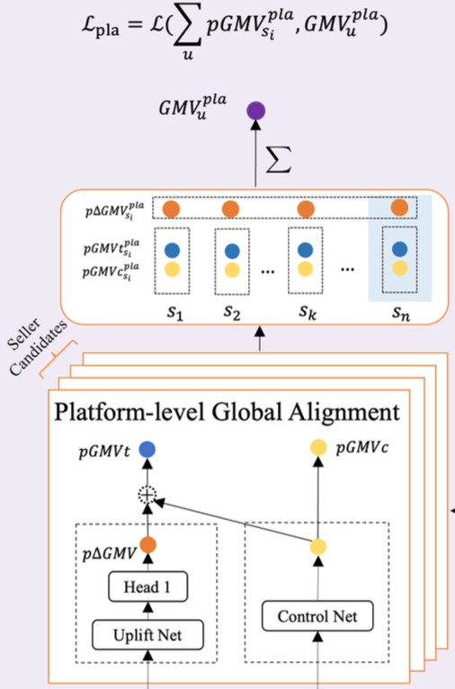

**引入 Platform Head**。论文在共享表示和候选交互表示上增加 Platform Head，对于用户 $u$ 的候选商家集合 $S_u$，Platform Head 为每个商家输出平台视角的 GMV 预测：
$$
\widehat{GMV}^{pla}_{u}
=
\sum_{s_i\in S_u}
\widehat{GMV}^{pla}_{s_i}
$$

其中：
- $S_u$：用户对应的候选商家集合。
- $\widehat{GMV}^{pla}_{s_i}$：Platform Head 针对候选商家 $s_i$ 输出的 GMV 预测。
- $\widehat{GMV}^{pla}_{u}$：聚合后的用户平台整体 GMV 预测。

**构建全局 GMV 一致性损失**。论文利用日志中可以获得的用户整体平台 GMV，构建平台级监督损失：
$$
\mathcal L_{pla}
=
\sum_u
\mathcal L
\left(
\widehat{GMV}^{pla}_{u},
GMV^{pla}_{u}
\right)
$$

其中：
- $\widehat{GMV}^{pla}_{u}$：模型预测的用户平台 GMV。
- $GMV^{pla}_{u}$：日志中观测到的用户实际平台 GMV。
- $\mathcal L$：GMV 预测损失。

这一约束会带来一个重要效果。假设模型预测用户在多个商家都有较高的 GMV 增长，那么这些预测聚合后可能超过用户实际的平台 GMV，模型就会受到惩罚。反过来，如果某个商家的 GMV 增长主要来自其他商家的消费转移，那么平台整体 GMV 并没有同步增长，模型也会受到全局损失的约束。

因此，PGA 通过平台级监督信号，让模型在训练时学习商家之间的替代关系，而不需要显式构建所有商家之间的两两交互模型，同时限制商家局部增量预测中的虚假增长。

**PGA工程落地实践 Practical Approximation for Marginal Scoring**。在工程落地时的核心矛盾为，如何在训练时利用全局大盘约束来惩罚“零和博弈”，又能在线上推理时做到单商家独立打分，从而避免组合爆炸。

训练阶段 PGA 强迫网络去学习宏观大盘的加性约束，让模型在看到单店大涨时，必须结合其他店的表现来判断这究竟是“做大蛋糕”还是“零和抢客”。但在线上服务时，系统不可能为了评估某个商家 $s_j$ 而去重新模拟或全量计算所有其他商家的联动变化。对于用户 $u$ 和目标商家 $s_j$，论文定义理论上的平台级边际增量：
$$
\begin{aligned}
\Delta_{Platform}(u,s_j)
={}&
\mathbb E[Y_u\mid t_j=1]
-
\mathbb E[Y_u\mid t_j=0]\\
={}&
\sum_{s\in S_u}
\mathbb E[y_{u,s}\mid t_j=1]\\
&-
\sum_{s\in S_u}
\mathbb E[y_{u,s}\mid t_j=0]
\end{aligned}
$$

如果严格按照因果推断，去穷举计算所有商家在各种组合状态下的反事实结果，线上 serving 的计算延迟和资源开销将完全无法承受。因此，文中提出一种近似替代方案，针对目标商家 $s_j$，只需向前传导两次，分别计算出在 $s_j$ 处于干预状态和对照状态下的平台视角预测值，计算两者的差值，即为该商家的平台级边际增益。

$$
p^{treat}
=
pGMV^{pla}_{s_j}
(u,s_j,t_j=1)
$$

$$
p^{control}
=
pGMV^{pla}_{s_j}
(u,s_j,t_j=0)
$$

$$
\boxed{
\Delta^{pla}(u,s_j)
\approx
p^{treat}-p^{control}
=
\delta^{platform}(u,s_j)
}
$$

工程破局巧妙的点在于，将全局因果关系“蒸馏”进单点输出。依靠训练阶段施加的强约束，网络在训练时已经被迫学会了：“给 $s_j$ 发券虽然在 $s_j$ 账面上涨了 100 块，但会吸走其他店 70 块，所以平台头对 $s_j$ 的输出直接按净增量 30 块来拟合。” 这样一来，线上推理时直接调用平台头对单个候选商家 $s_j$ 的输出，就已经隐式扣除了对其他商家的蚕食损耗，实现了 $O(1)$ 级别的极速精准打分。

### 基于核销的分解去噪 RDD 模块
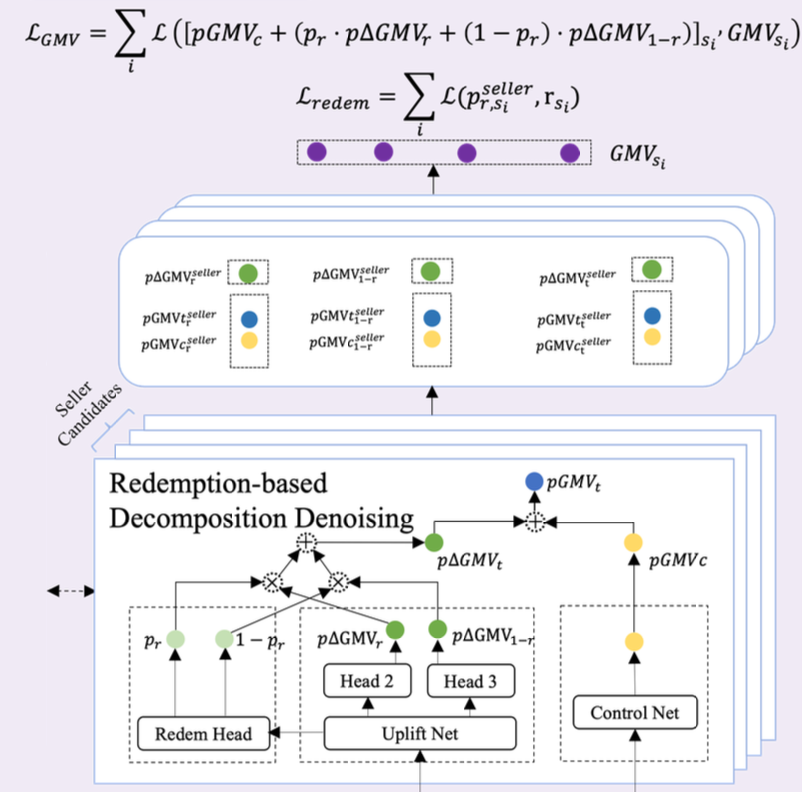

RDD 的核心思想是：不再将 Treatment 组的结果视为一种同质的购买结果，而是根据优惠券是否核销，将其拆分为核销购买和未核销购买两条路径，分别建模，再根据核销概率进行加权融合。

RDD 并不是简单地增加一个优惠券核销预测任务，而是将核销行为直接引入 GMV 预测主路径。对于每一个用户与候选商家组合，模型首先通过共享的 Multi-source Sequence Encoder 和 Treat-Attention 得到候选交互表示：
$$
z_{u,s_i}
$$

这个表示包含用户历史行为、历史激励行为以及当前候选商家和优惠券之间的交互信息。随后，RDD 主要涉及三个预测部分：
- Redem Net：预测用户核销当前优惠券的概率。
- Treatment-side GMV Head：分别预测核销路径和未核销路径对应的 GMV 增量。
- Control-side GMV Head：预测没有当前 Treatment 时的基础 GMV。

根据核销概率融合两条路径：
$$
\widehat{GMV}_{u,s_i}
=
\widehat{GMV}_{c}^{s_i}
+
p_{r}^{s_i}\cdot
\widehat{\Delta GMV}_{r}^{s_i}
+
(1-p_{r}^{s_i})\cdot
\widehat{\Delta GMV}_{1-r}^{s_i}
$$

### Loss Function：联合损失优化
电商 GMV 通常具有零膨胀长尾分布的特点。因此，论文采用 Tweedie Loss 作为 GMV 预测损失：
$$
\mathcal L_{GMV}^{Tw}
=
\sum
\mathcal L_{Tw}(y,\widehat y)
$$

Tweedie 负对数似然损失函数（不含常数项）的一般形式可以写为：
$$L(y, \hat{y}) = - y \frac{\hat{y}^{1-p}}{1-p} + \frac{\hat{y}^{2-p}}{2-p}$$
其中：
- $y$ 是真实的 GMV（$y \ge 0$）。
- $\hat{y}$ 是模型的预测 GMV。
- $p$ 是 Tweedie 分布的方差参数。

在电商 GMV 预测中，$p$ 通常调优在 $1.1$ 到 $1.9$ 之间，具体取决于平台的客单价稀疏程度。$p$ 越接近 1，对零值的容忍度越高；$p$ 越接近 2，对大额长尾金额的敏感度越高。

CanniUplift 最终通过三个损失函数联合训练。

Seller-level GMV Loss，该损失负责监督每个用户与候选商家的 GMV 预测结果。
$$
\mathcal L_{seller}
=
\sum_u
\sum_{s_i\in S_u}
\mathcal L_{Tw}
\left(
GMV_{u,s_i},
\widehat{GMV}_{u,s_i}
\right)
$$

Platform-level Aggregation Loss，该损失负责约束平台级 GMV 聚合预测与真实平台 GMV 的一致性。
$$
\mathcal L_{pla}
=
\sum_u
\mathcal L_{Tw}
\left(
GMV^{pla}_{u},
\widehat{GMV}^{pla}_{u}
\right)
$$

Redemption Classification Loss，该损失负责监督 Redemption Net 的核销概率预测。
$$
\mathcal L_{redem}
=
\sum_u
\sum_{s_i\in S_u}
CE(r_{u,s_i},\widehat r_{u,s_i})
$$

其中：
- $r_{u,s_i}$：真实优惠券核销标签。
- $\widehat r_{u,s_i}$：预测核销概率。
- $CE$：交叉熵损失。

将三个损失结合，得到最终目标函数：
$$
\boxed{
\mathcal L_{total}
=
\mathcal L_{seller}
+
\lambda_{pla}\mathcal L_{pla}
+
\lambda_{redem}\mathcal L_{redem}
}
$$

其中：
- $\mathcal L_{seller}$：商家级 GMV 预测损失。
- $\mathcal L_{pla}$：平台级 GMV 聚合损失。
- $\mathcal L_{redem}$：优惠券核销分类损失。
- $\lambda_{pla}$、$\lambda_{redem}$：损失权重。论文实验中，两个权重默认设置为 1。

## 06 结果分析
### 数据集
**工业数据集**。数据来自大型电商系统的真实线上日志，论文披露了两个非常重要的业务现象：第一，传统模型存在明显的平台增量高估。将单个用户关联的所有商家 ITE 进行聚合后，传统基线模型估计的总增量，相比实际线上观测效果高估约 35%。第二，存在大量未核销购买。在发放优惠券且发生购买的行为中，约 25% 最终没有核销对应优惠券。

**合成数据集**。论文构建了一个专门用于模拟商家级蚕食的合成数据集，主要用于验证 PGA 对商家级蚕食的建模能力。附录A详细介绍了合成数据集的构建方式与数据生成逻辑，主要设置有：
- 用户数量：20,000。
- 商家数量：500,000。
- 每个用户随机分配 50 个商家，允许重复抽样。
- 用户特征维度：106。
- 商家特征维度：107。
- Treatment：二元处理，按用户级 RCT 方式分配，处理概率为 0.5。
- 商家类别：300 个原始类别，进一步映射为 10 个语义类别。

### Baseline和评价指标
论文选择 DragonNet、CFRNet、TARNet、TLearner、EUEN、X-net、M3TN、UMLC 和 HUM 作为对比模型。

论文使用 AUUC 和 QINI 评价 Uplift 模型。由于工业数据中存在不同优惠券类型和优惠力度，Treatment 并非单一的二元变量。因此，论文将连续 Treatment 值离散为不同区间，分别计算每个区间的 AUUC/QINI，再按照样本量进行加权，得到 wAUUC 和 wQINI。

为了全面检验 CanniUplift 框架在“局部精细化投放”与“宏观大盘优化”两个维度的表现，论文提出了两种不同粒度的评估指标：
- 商家级指标：评估模型对每一个“用户-商家”候选对（User-Seller Pair）的增量排序能力。
- 用户级指标：先将同一用户在所有候选商家的预测增量进行聚合加总，然后在大盘用户层面上评估排序效果。

### 主实验结果
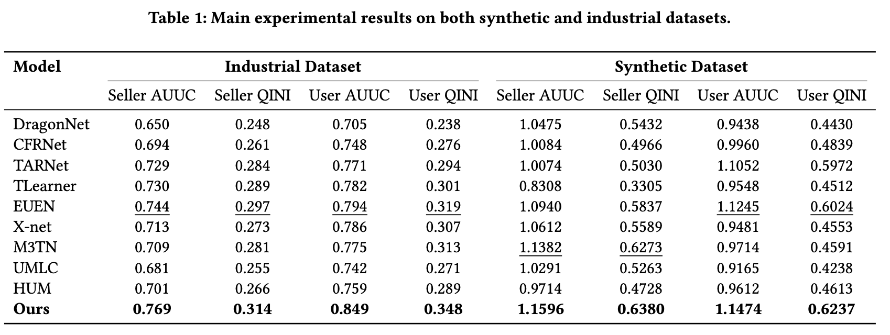

CanniUplift 在两个数据集、两个粒度的四项指标上均取得最优结果。

工业数据集的提升方面，相比 EUEN 各项指标都有提升，其中 User-level 指标提升更加明显，尤其是 User QINI。这与 PGA 的设计目标相吻合，它不仅改善商家级增量排序，还能够更好地识别具有平台整体增量潜力的用户。

合成数据集的提升方面，进一步验证了 PGA 在存在商家级替代效应时的有效性。另外论文并没有将合成数据上的结果作为 RDD 有效性的主要证据，而是将 RDD 的验证放在真实工业数据消融实验中。

### 消融实验
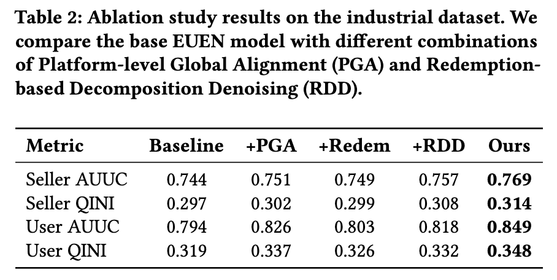

论文在工业数据上进行了消融实验，这里的baseline 是 EUEN，因为 EUEN 在工业数据集上表现最好。可以得到以下结论：

**PGA 对 User-level 指标的改善尤其明显**。EUEN 加入 PGA 后，User AUUC：0.794 → 0.826。
User QINI：0.319 → 0.337。这说明全局 GMV 一致性约束有助于识别真正具有平台级增量潜力的用户。

**RDD 优于单纯增加核销预测任务**。+Redem 只是增加核销分类任务，而 RDD 会将核销状态直接引入 GMV 预测路径。RDD 在四项指标上均优于 +Redem，说明显式拆分核销和非核销路径具有额外价值。

**PGA 和 RDD 具有互补性**。两者解决的问题不同：PGA 解决跨商家 GMV 替代问题。RDD 解决 Treatment 组内部的增量归因噪声。同时使用两者时，四项指标均达到最优。

### 商家级蚕食分析
由于无法直接获得每个用户真实的商家蚕食率，论文构造了一个预测蚕食率：
$$
g=
\frac{
p^{seller}-p^{platform}
}{
p^{seller}
}
$$

其中：
- $p^{seller}$：预测的商家级增量 GMV。
- $p^{platform}$：预测的平台级增量 GMV。
- $g$：模型估计的商家级蚕食率。

其含义是：商家级预测增量中，有多少比例没有转化为平台级增量。当商家级增量明显高于平台级增量时，模型估计的蚕食率就会更高

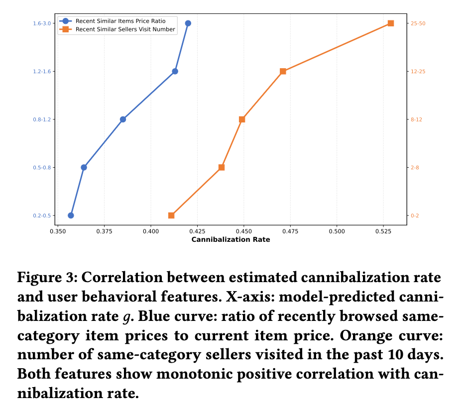

论文选择两个用户行为特征进行分析：
1. 最近 10 天浏览的同品类商品价格与当前商品价格的比值（图中蓝线）。
2. 最近 10 天访问过的同品类商家数量（图中黄线）。

实验发现，两个特征都与预测蚕食率呈明显正相关。具体来说：
- 用户近期浏览的同品类商品价格越高，相比当前商品的价格差异越大，预测蚕食率越高。这意味着当前低价商家的优惠券可能吸引用户从更高价值的替代商品转移过来。
- 用户近期访问的同品类商家越多，预测蚕食率越高。这说明跨商家浏览行为能够反映更强的自然购买意愿和替代关系。

### 激励级蚕食分析
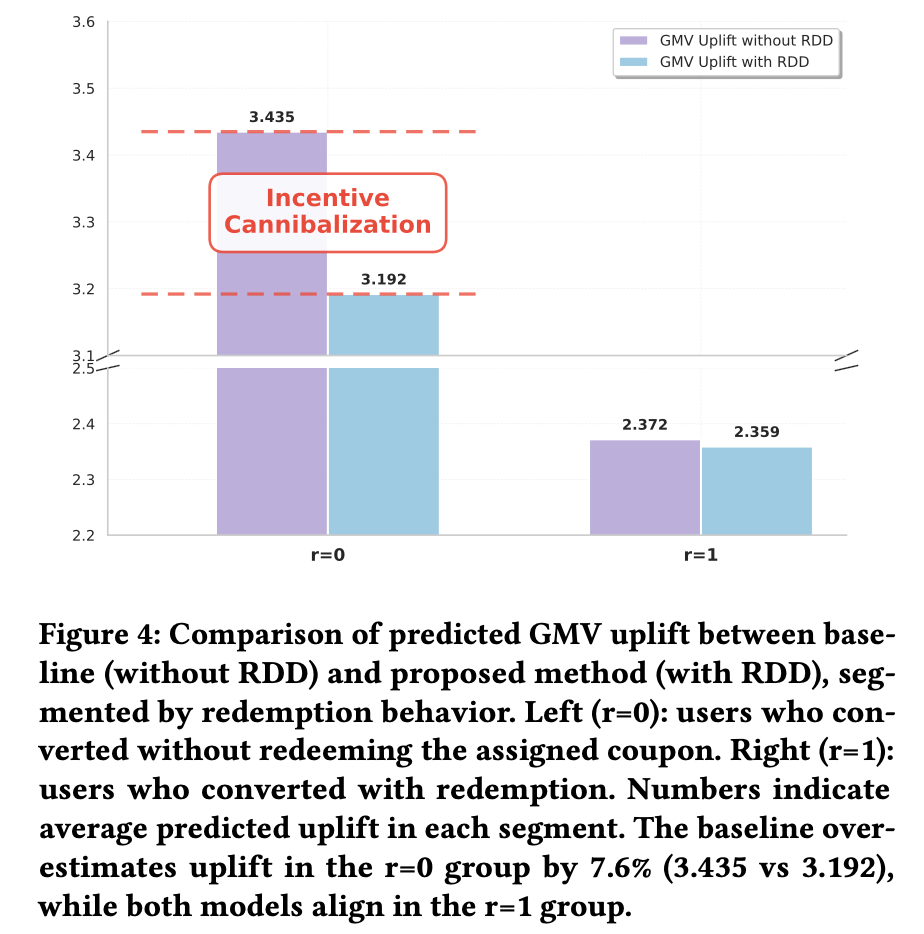

论文通过比较加入 RDD 前后的预测结果，分析核销和非核销两类用户的 uplift。重点观察两类人群：
- $r=0$：购买但没有核销当前优惠券。
- $r=1$：购买且核销了当前优惠券。

实验结果显示：对于**核销用户**（r=1），Baseline 和 RDD 模型的 uplift 预测基本一致。原因是用户实际核销了当前优惠券，说明该优惠券参与了购买路径，当前优惠券的归因具有较直接的行为依据。对于**非核销用户**（r=0），相较于 Baseline，RDD 将非核销用户的预测 uplift 降低约 7%。这说明传统模型可能将自然购买需求或者其他优惠券产生的转化，错误地归因于当前测试优惠券，而 RDD 通过拆分购买路径降低了这种过度归因。

### 线上A/B测试
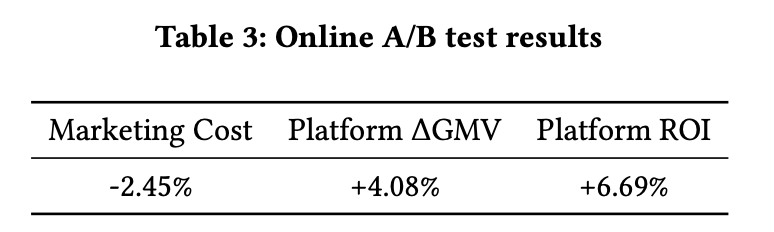

论文最终将 CanniUplift 部署到实际电商系统中，进行线上 A/B 测试。实验时间为2025年10月5日—2025年10月12日。相较于生产基线，平台增量 GMV 提升 4.08%，平台增量 ROI 提升 6.69%。

## 07 局限与展望
**没有有解决时间维度的蚕食问题 Temporal Cannibalization**。促销活动可能将用户未来的购买提前到当前时间发生。例如，用户原本计划下周购买商品，但由于本周获得优惠券，提前完成购买。此时短期 GMV 看起来有所增长，但长期来看，平台可能只是提前获得了原本就会发生的收入，并没有真正创造新增需求。

**对实时替代行为的捕获存在延迟**。模型主要依赖历史用户行为估计商家之间的替代关系，但用户的购买偏好和商家选择可能快速变化，历史行为不一定能够及时反映最新的替代关系。因此，模型在捕获实时消费替代方面仍然存在一定滞后。

## 论文摘要
个性化激励分配对于电子商务至关重要，其中 Uplift Modeling 已成为估计个体处理效应（Individual Treatment Effects，ITE）的标准方法。然而，传统模型在复杂的多商家环境中往往表现不佳，因为这类环境可能违反稳定单元处理值假设（Stable Unit Treatment Value Assumption，SUTVA）。

论文识别出两个关键挑战：**商家级蚕食**（Seller-level Cannibalization）：激励措施在不同商家之间转移消费支出，却没有为平台创造新增价值。**激励级蚕食**（Incentive-level Cannibalization）：自然转化或其他替代奖励会引入显著噪声，影响增量效果估计。

论文提出 CanniUplift，一个用于缓解这两类来源不同的蚕食效应的统一框架。具体而言，设计平台级全局对齐（Platform-level Global Alignment，PGA），通过全局 GMV 一致性约束捕获跨商家的替代效应。为了解决激励驱动的噪声，提出基于核销的分解去噪（Redemption-based Decomposition Denoising，RDD），利用优惠券核销行为对 Treatment 组结果进行分解，并在全空间建模框架下减少归因噪声。此外，设计Treat-Attention 机制，用于建模用户历史行为与当前 Treatment 候选之间复杂的交互关系。

在合成数据集和大规模工业数据集上的大量实验表明，CanniUplift 显著优于当前先进基线模型。消融实验进一步证实，PGA 和 RDD 的结合能够持续改善 wAUUC 和 wQINI。在实际业务中成功部署后，该框架相较于生产基线实现了平台整体增量 GMV（ΔGMV）4.08% 的相对提升，并在线上 A/B 测试中改善了 ROI，证明了该框架在推动平台整体增长方面的有效性。