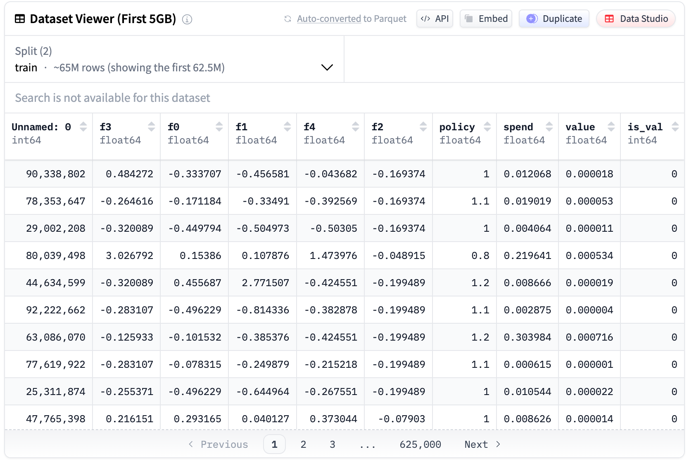

**速览**：UVET-benchmark 是 Criteo 在2026年发布的大规模在线广告随机实验数据集，包含约 8,670 万条竞价成功的广告 Impression、5 个连续特征、5 档竞价倍率 Treatment，以及广告价值和成本两个 Outcome。数据适用于多档 Uplift Modeling、异质性处理效应估计、Policy Learning 和预算约束下的策略优化。

## 01 基本信息
- 数据集名称：UVET-benchmark
- 发布机构：Criteo
- 数据规模：约 8,670 万条广告 Impression
- 数据来源：在线广告平台随机 A/B 实验
- 发布时间：2026 年
- License：CC BY-NC-SA 4.0

## 02 任务与应用场景
面向在线广告竞价场景，研究如何根据用户特征，为每次广告 Impression 分配不同的竞价倍率，在总成本不超过基准预算的前提下，最大化广告价值。

主要支持：
- 多档 Treatment 下的异质性处理效应估计。
- Uplift Modeling 与 Policy Learning。
- 预算约束下的 Treatment Assignment。
- Predict-then-Optimize 策略优化。

## 03 数据结构
- f0–f4：5个连续特征，来源于在线交互信号，经过扰动和标准化。
- policy：Treatment，表示广告竞价倍率。
- spend：广告成本。
- value：广告价值。
- is_val：验证集标记，仅训练文件包含。

其中，policy 为核心 Treatment 变量，包含 5 个档位，其中 1.0 为基准竞价策略。
$$
T\in\{0.8,0.9,1.0,1.1,1.2\}
$$

## 04 数据样例

## 05 数据集划分
Train 和 Validation 存储在同一个 CSV 文件中，通过 is_val 区分。Train、Validation、Test数据占比分别为50%、25%、25%。

## 06 数据特点与注意事项
- 随机实验数据：Treatment 通过随机 A/B 实验分配，支持较可靠的离线策略评估。
- 多档 Treatment：提供 5 个有序干预档位，适合研究多档 Uplift 和连续 Treatment 建模。
- 双目标 Outcome：同时提供 value 和 spend，可研究价值最大化与成本约束下的策略优化。
- 特征匿名化：5 个特征经过扰动和标准化，没有实际业务语义。
- 指标不可货币化：Value 和 Spend 均经过缩放及扰动，不能直接解释为真实货币收益或 ROI。
- Treatment 分布不均衡：基准档位 1.0 占约 60.2%，其他四档分别约占 8.5%、9.2%、10.7% 和 11.3%。
- 流量归一化缩放：把基准档位 1.0组里每一行的原始 value 和 cost 除以了流量倍数（约 6），使得基准组的总价值和总成本刚好等效于一个 10% 流量实验组的量级。

## 07 数据集地址
- Hugging Face：https://huggingface.co/datasets/criteo/uvet-benchmark
- 论文：《UVET: A Partitioning Approach for Continuous Treatment Assignment At Scale》
- 论文会议：NeurIPS 2026
