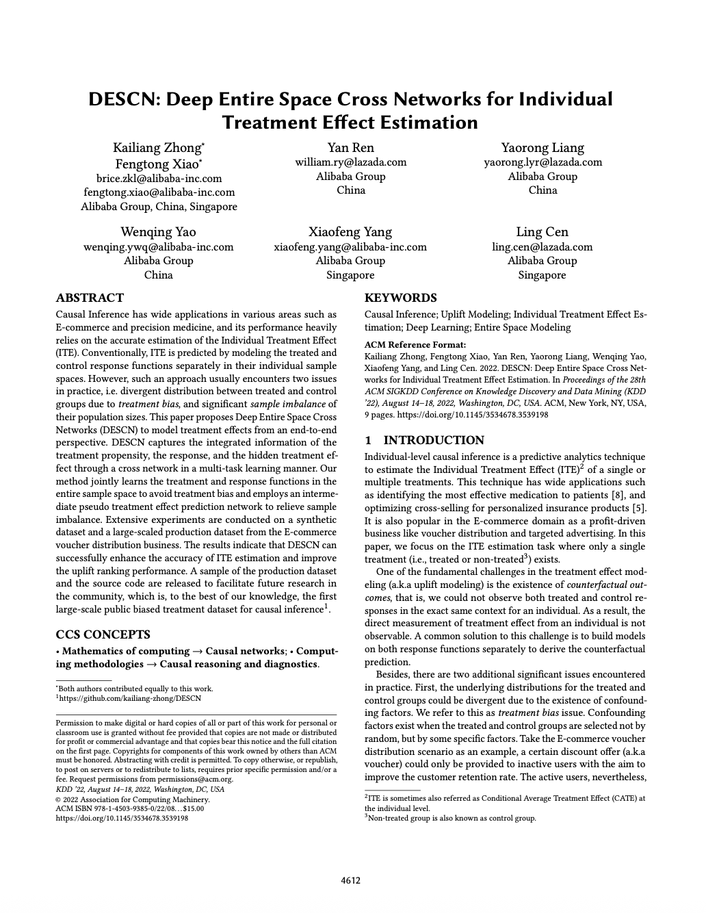
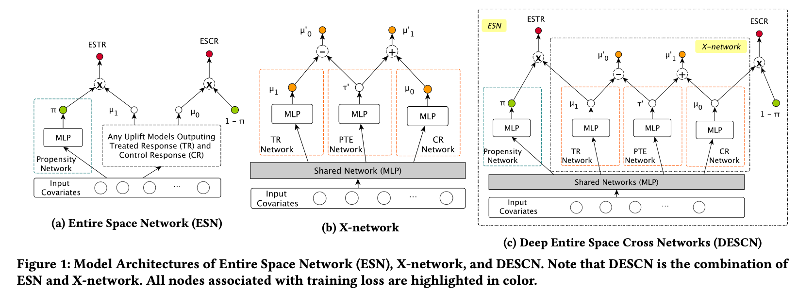
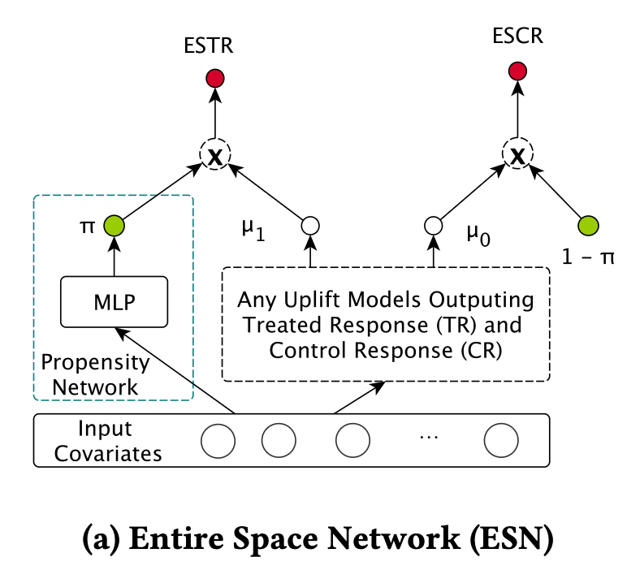
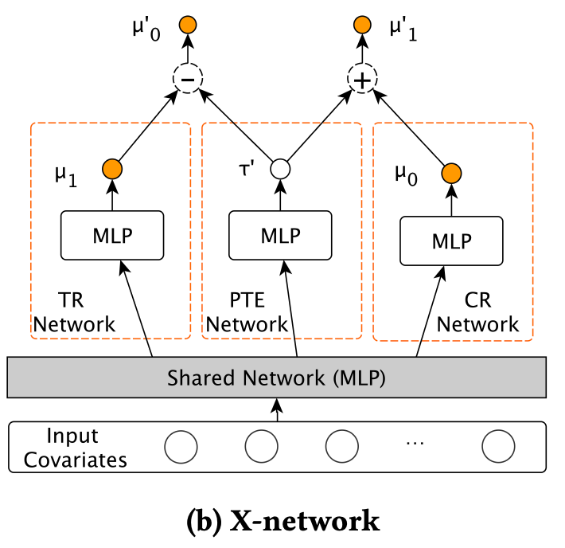
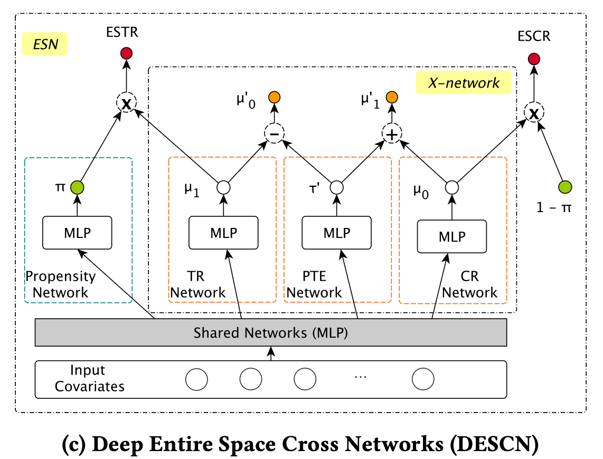
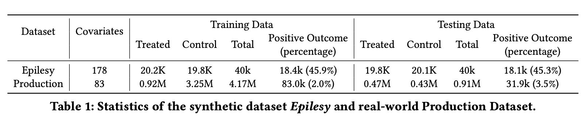
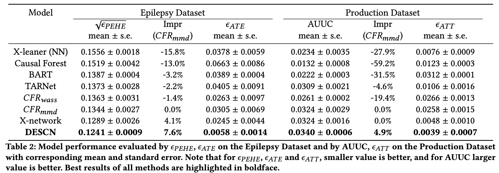
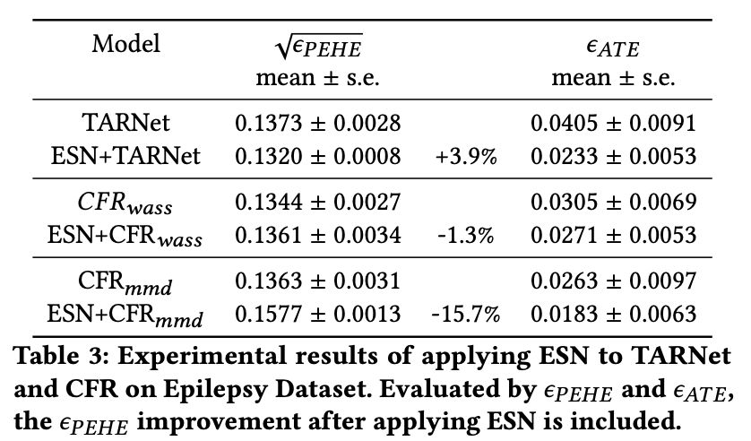

**速览1**：阿里巴巴团队提出 DESCN，通过 Entire Space Network 和 X-network 两个核心结构，将 Treatment Propensity、Treatment Response、Control Response 和 Pseudo Treatment Effect 纳入统一的多任务学习框架，实现更准确的个体处理效应估计。

**速览2**：在 Lazada 大规模优惠券分发业务数据上，DESCN 相比 CFR-MMD 的 AUUC 提升约 4.9%；在合成数据上，个体处理效应估计误差降低约 7.6%，验证了模型在处理偏差和样本不平衡场景下的有效性。论文提供代码和数据可供复现。https://github.com/kailiang-zhong/DESCN

## 01 论文信息
**标题**：DESCN: Deep Entire Space Cross Networks for Individual Treatment Effect Estimation / DESCN：用于个体处理效应估计的深度全空间交叉网络

**作者**：Kailiang Zhong、Fengtong Xiao 等

**期刊/会议**：KDD

**发表时间**：2022年8月

**链接**：https://doi.org/10.1145/3534678.3539198

## 02 核心问题
论文研究的是观测数据场景下的个体处理效应估计问题，即如何根据用户的历史特征，预测某个用户接受营销干预与不接受营销干预时的潜在结果差异。

## 03 核心要点
**Entire Space Network 全空间建模**。ESN 利用条件概率的结构关系构建 Entire Space Treated Response 和 Entire Space Control Response，使两个响应函数都能够利用全部样本进行训练，从而缓解 Treatment Bias。

**X-network 通过伪处理效应连接两组响应**。两个响应网络不再完全独立学习，而是通过中间处理效应建立联系，帮助样本量较少的一侧获得来自另一侧的辅助信息，缓解 Sample Imbalance。

## 04 研究动机
**传统双模型方法存在 Treatment Bias 问题**。在真实业务中，Treatment 的分配通常不是随机的，而是由用户特征和业务策略等决定。例如，电商平台可能只向低活跃用户发放优惠券，这会使处理组和对照组具有不同的用户分布，两个模型学习到的响应函数容易受到各自样本分布的影响，进而影响反事实预测的准确性。

**处理组与对照组样本量不均衡**。实际营销业务中，优惠券往往只发放给部分目标用户，处理组组的样本量可能远小于对照组。也可能存在大规模促销活动，使处理组组样本量远大于对照组。

**借鉴 ESMM 的全空间建模思想**。在推荐系统中，ESMM 通过联合建模点击与购买行为，在整个曝光样本空间中学习转化概率，以缓解样本选择偏差。论文将全空间建模机制引入因果推断，通过处理倾向与响应函数的结构关系，使处理组和对照组的样本能够共同参与两个响应函数的训练。

## 05 方法思路
### 问题定义
论文采用 Neyman-Rubin Potential Outcome Framework，即潜在结果框架。

假设观测数据为：
$$
D=\{(y_i,x_i,w_i)\}_{i=1}^{n}
$$

其中：
- $y_i$：用户实际观测到的结果，论文中为二元结果。
- $x_i$：用户的特征向量。
- $w_i$：Treatment 指示变量，取值为 0 或 1。
- $y_i(1)$：用户接受 Treatment 时的潜在结果。
- $y_i(0)$：用户不接受 Treatment 时的潜在结果。

这里需要注意，论文所称的 ITE 实际上是给定用户特征条件下的期望处理效应，即个体层面的 CATE，而不是能够直接观测到的单个用户真实潜在结果差值。在论文采用的一致性、可忽略性和重叠性三个假设下，可以利用这两个响应函数估计 ITE：
$$
\begin{aligned}
\mu_1(x)&=E_P(Y|W=1,X=x)\\
\mu_0(x)&=E_P(Y|W=0,X=x)
\end{aligned}
$$
$$
\tau(x)=\mu_1(x)-\mu_0(x)
$$

其中：
- $\mu_1(x)$：表示用户接受 Treatment 时的条件响应期望。
- $\mu_0(x)$：表示用户不接受 Treatment 时的条件响应期望。

### 整体架构

ESCN 的核心是将传统 ITE 估计中相对独立的 Treatment Response 和 Control Response 建模过程，改造为一个联合学习的多任务网络。整体模型由两个核心模块构成：
- Entire Space Network（ESN）： 通过处理倾向与响应函数的联合建模，在全样本空间中学习 Treatment 和 Control 的响应概率，主要解决 Treatment Bias。
- X-network： 引入 Pseudo Treatment Effect（PTE）作为中间变量，连接 Treatment Response 和 Control Response，主要解决 Sample Imbalance。

### ESN 模块

ESN 主要解决 Treatment Bias。

Treatment Bias 指的是：由于 Treatment 根据 Propensity Score 分配，Treatment 组与 Control 组的特征分布存在系统性差异。如果分别在两个子样本空间训练 Treatment 和 Control 的响应概率，那么在预测阶段，两个模型可能受到各自训练样本分布差异的影响，导致预测不准确。

因此，ESN本质上是在解决：**两个响应函数在不同样本分布下独立学习所带来的估计偏差**。

ESN的设计主要借鉴：推荐系统模型 ESMM 的“条件概率分解 + 全样本空间联合建模”思想。传统的转化率模型通常只在点击用户中训练，ESMM 不再仅仅在点击样本中训练 CVR，而是构造全曝光空间中的联合转化概率 CTCVR=CTR*CVR，并使用全部曝光样本进行训练。

所以 ESN 的核心思想是：不再直接在 Treatment 和 Control 两个独立样本空间中训练响应函数，而是利用条件概率的分解关系，将两个响应函数转换为全空间响应概率，在全部样本空间中进行训练。

**建立全空间响应概率**。论文先将倾向得分定义如下，表示给定用户特征 $X=x$ 时，用户接受 Treatment 的概率。
$$
\pi(x)=P(W=1\mid X=x)
$$

前述已经定义两个响应函数$\mu_1(x)$和$\mu_0(x)$，再借鉴 ESMM 的设计，显式引入倾向得分，定义两个全空间联合概率：
- ESTR（Entire Space Treated Response）：全空间 Treatment 响应。
- ESCR（Entire Space Control Response）：全空间 Control 响应。

$$
\begin{aligned}
P(Y,W=1|X)
&=P(Y|W=1,X)P(W=1|X)\\
&=\mu_1\cdot\pi
\end{aligned}
$$

$$
\begin{aligned}
P(Y,W=0|X)
&=P(Y|W=0,X)P(W=0|X)\\
&=\mu_0\cdot(1-\pi)
\end{aligned}
$$

其中：
- $\pi$：Treatment Propensity。
- $\mu_1$：Treatment Response。
- $\mu_0$：Control Response。
- $\mu_1\pi$：ESTR。
- $\mu_0(1-\pi)$：ESCR。

对于上述公式的理解，以 ESTR 为例，它不是单纯预测接受 Treatment 后的响应概率，而是预测一个用户既接受 Treatment、又产生目标响应的联合概率。由于该联合概率可以通过 Treatment Response 和 Treatment Propensity 相乘得到，因此模型可以同时利用全部用户的特征和实际观测标签进行学习。

**ESN 的训练损失**。论文定义了三个损失分别约束 Treatment 分配概率、全空间 Treatment 响应概率和全空间 Control 响应概率，最终通过加权求和得到ESN的总损失。
$$
L_{\pi}=
\frac{1}{n}\sum_i
l(t_i,\hat{\pi}(x_i))
$$
$$
L_{ESTR}=
\frac{1}{n}\sum_i
l(y_i\&w_i,\hat{\mu}_1(x_i)\cdot\hat{\pi}(x_i))
$$
$$
L_{ESCR}=
\frac{1}{n}\sum_i
l(y_i\&(1-w_i),
\hat{\mu}_0(x_i)\cdot(1-\hat{\pi}(x_i)))
$$
$$
L_{ESN}=
\alpha L_{\pi}
+\beta_1 L_{ESTR}
+\beta_0 L_{ESCR}
$$

其中：
- $t_i$ 是 Treatment 标签。
- $l(\cdot)$ 是损失函数，论文采用交叉熵作为损失函数。
- $y_i\&w_i$ 表示两个二元标签的逻辑 AND，只有用户接受 Treatment 且产生正向结果时，该标签才为 1。
- $\alpha$：Propensity Loss 的权重。
- $\beta_1$：ESTR Loss 的权重。
- $\beta_0$：ESCR Loss 的权重。

**响应函数还原**。训练完成后，利用模型预测的 ESTR、ESCR 和 Propensity，可以还原两个响应函数，进而得到 ITE 估计。
$$
\hat{\mu}_1(x)=
\frac{\widehat{ESTR}}{\hat{\pi}(x)}
$$

$$
\hat{\mu}_0(x)=
\frac{\widehat{ESCR}}{1-\hat{\pi}(x)}
$$

这种除法操作也意味着模型依赖 Overlap 假设，如果某些用户的倾向得分非常接近 0 或 1，除法可能放大估计误差。因此，ESN 并没有消除因果推断中的重叠性要求。

### X-network 模块

X-network 主要解决 Sample Imbalance。

X-network 的设计受到 X-learner 启发，两者都尝试直接学习反事实处理效应，但二者的实现方式有所不同。
- X-learner：先训练基础响应模型，再利用基础模型构造伪处理效应标签，进一步训练处理效应模型。
- X-network：通过 PTE Network 在神经网络内部学习伪处理效应，并与 TR、CR 一起进行端到端联合训练。

**引入 Pseudo Treatment Effect**。论文增加一个 PTE Network，用于预测 Pseudo Treatment Effect，记为：
$$
\hat{\tau}'(x)
$$

它表示模型学习到的中间伪处理效应。PTE 并不是真实可观测的个体处理效应，也不是直接通过真实反事实结果计算得到的标签，而是网络内部学习的辅助变量，它的核心作用是连接两个响应分支。

**构建交叉响应**。在原有 TR 和 CR 的基础上，增加两个交叉响应预测结果。

Cross Treated Response，以 CR 为基础，加上 PTE，构造 Control 用户接受 Treatment 后的反事实响应。
$$
\hat{\mu}_1'(x)=\hat{\mu}_0(x)+\hat{\tau}'(x)
$$

Cross Control Response，以 TR 为基础，减去 PTE，构造 Treatment 用户未接受 Treatment 时的反事实响应。
$$
\hat{\mu}_0'(x)=\hat{\mu}_1(x)-\hat{\tau}'(x)
$$

**损失函数**。论文在此处定义四个损失函数。
$$
L_{TR}=
\frac{1}{|T|}
\sum_{i\in T}
l(y_i,\hat{\mu}_1(x_i))
$$
$$
L_{CR}=
\frac{1}{|C|}
\sum_{i\in C}
l(y_i,\hat{\mu}_0(x_i))
$$
$$
L_{CrossTR}=
\frac{1}{|T|}
\sum_{i\in T}
l(y_i,\hat{\mu}_1'(x_i))
$$
$$
L_{CrossCR}=
\frac{1}{|C|}
\sum_{i\in C}
l(y_i,\hat{\mu}_0'(x_i))
$$

由于响应函数的输出是概率，直接相加或相减可能超出概率的合法范围 $[0,1]$。因此，论文没有直接在概率空间中对两个响应函数进行加减，而是在 Logit 空间中转换成实数后再进行加减，最后再通过 Sigmoid 函数转换回概率空间。论文指出，实验中这种 Logit 空间转换，优于直接输出真实响应概率后进行加减的方式。

$$
\hat\mu_1'
=
\sigma\left(
\sigma^{-1}(\hat\mu_0)
+
\sigma^{-1}(\hat\tau')
\right)
$$
$$
\hat\mu_0'
=
\sigma\left(
\sigma^{-1}(\hat\mu_1)
-
\sigma^{-1}(\hat\tau')
\right)
$$

其中：
- $\sigma$：Sigmoid 函数。
- $\sigma^{-1}$：Sigmoid 的反函数，即 Logit 转换。
- $\hat{\tau}'(x)$：PTE Network 的输出。

### DESCN 整体训练

DESCN 最终训练损失构造如下。在单独的 X-network 中，论文使用 TR、CR、Cross TR 和 Cross CR 四个损失。但在最终 DESCN 中，TR 和 CR 已经通过 ESN 转换为 ESTR 和 ESCR，并且在全空间中进行训练。因此，最终模型不再保留原始的 $L_{TR}$ 和 $L_{CR}$，而是保留两个交叉响应损失。

$$
\begin{aligned}
L_{DESCN}
=&L_{ESN}
+\gamma_1L_{CrossTR}\\
&+\gamma_0L_{CrossCR}
\end{aligned}
$$

展开为：
$$
\begin{aligned}
L_{DESCN}
=&\alpha L_{\pi}
+\beta_1L_{ESTR}
+\beta_0L_{ESCR}\\
&+\gamma_1L_{CrossTR}
+\gamma_0L_{CrossCR}
\end{aligned}
$$

整体训练逻辑：
1. 输入用户特征，提取共享特征表示。
2. 通过 Propensity Network 得到用户接受 Treatment 的概率。
3. 通过 TR、CR 两个网络得到两个潜在响应预测。
4. 通过 PTE Network 得到中间伪处理效应。
5. 利用 Propensity 与 TR、CR 构建 ESTR 和 ESCR。
6. 利用 PTE 与 TR、CR 构建 Cross TR 和 Cross CR。
7. 计算总损失，联合更新网络参数。
8. 模型训练完成后，利用 ESTR、ESCR 和 Propensity 还原两个响应函数，计算最终 ITE。

## 06 结果分析
### 数据集

论文使用两个数据集进行实验，分别验证 ITE 估计精度和 Uplift 排序能力。

**Epilepsy合成数据集**。该数据集基于公开的 2019 American Causal Inference Conference（ACIC）数据挑战生成，使用 Epileptic Seizure Recognition Dataset 的高维特征，通过 Data Generator Processor 生成观测样本。其主要优势是数据生成过程已知，可用于评估模型对ITE估计的准确性。

**Production生产数据集**。该数据集来自阿里巴巴旗下东南亚电商平台 Lazada 的真实电商优惠券分发业务。训练集采用真实业务中的定向投放策略，Treatment 分配具有明显偏差。测试集采用随机 Treatment 分配，即 RCT 数据。

### Baseline和评价指标
论文选择了六类基线模型：
1. X-learner (NN)：以神经网络为基学习器的元学习器，独立训练响应、处理效应及倾向得分模型并融合输出 ITE。
2. BART：基于贝叶斯加性回归树的非深度学习模型，用于对比传统非深度方法的效应估计效果。
3. Causal Forest：基于随机森林的非参数树模型，可直接估计处理效应，是树类 Uplift 基线代表。
4. TARNet：通过共享底层网络参数缓解样本不平衡的经典深度 Uplift 模型。
5. CFR：在 TARNet 上加入分布对齐损失拉近两组表征，分别用 Wasserstein（CFR_wass）和 MMD（CFR_mmd）度量。
6. X-network：DESCN 去除 ESN 模块后的版本。

论文根据数据集是否具有真实个体处理效应，采用不同的评价指标。在合成数据集，评测PEHE、ATE Error和相对提升率；在工业数据集，评测AUUC、相对提升率和ATT Error。

PEHE：个体处理效应估计误差
$$
\epsilon_{PEHE}=
\frac{1}{n}\sum_i
\left[
(\hat{\mu}_1(x_i)-\hat{\mu}_0(x_i))
-\tau(x_i)
\right]^2
$$

ATE Error：平均处理效应估计误差
$$
\epsilon_{ATE}=
\left|
\frac{1}{n}\sum_i
(\hat{\mu}_1(x_i)-\hat{\mu}_0(x_i))
-
\frac{1}{n}\sum_i\tau(x_i)
\right|
$$

ATT Error：处理组平均处理效应误差
$$
ATT=
\frac{1}{|T|}\sum_{i\in T}y_i
-
\frac{1}{|C|}\sum_{i\in C}y_i
$$
$$
\epsilon_{ATT}=
\left|
\frac{1}{|T|}
\sum_{i\in T}
(\hat{\mu}_1(x_i)-\hat{\mu}_0(x_i))
-ATT
\right|
$$

相对提升率
$$
Impr(BaselineModel)=
\frac{
E(Model)-E(BaselineModel)
}{
E(BaselineModel)
}\times100\%
$$

### 整体评估

**合成数据集上的效果**。DESCN 在 PEHE 和 ATE Error 两个指标上均取得最优表现。其中，PEHE 为 0.1241，相比 CFR-MMD 改善 7.6%。ATE Error 从 CFR-MMD 的 0.0305 降低至 0.0058，改善幅度达到 81.0%。DESCN 不仅提升了个体层面的处理效应估计准确性，也显著改善了平均处理效应的估计能力。

**生产数据集上的效果**。DESCN 的 AUUC 达到 0.0340，相比 CFR-MMD 提升 4.9%，ATT Error 降低至 0.0039，优于所有对比模型。

**ESN 消融实验效果**。论文通过去掉 DESCN 中的 ESN 部分，得到 X-network 来进行消融实验。合成数据集上，PEHE 从 0.1289 降低至 0.1241，改善约 3.7%。生产数据集上，AUUC 从 0.0324 提升至 0.0340，改善 4.9%。在 X-network 已经引入 PTE 机制的基础上，ESN 进一步利用 Treatment Propensity 与 Response 的结构关系，在整个样本空间中联合学习两个响应函数，能够继续提升模型表现。

**X-network 消融实验效果**。论文将 X-network 与 TARNet 进行比较，X-network 额外增加 PTE Network。合成数据集上，PEHE 从0.1373降低至0.1289，改善约6.1%。生产数据集上，AUUC 从0.0309提升至0.0324，改善约4.9%。X-network 在 ATE Error 和 ATT Error 上也取得了改善。说明 PTE Network 能够在TR和CR之间建立联系，帮助模型更加平衡地学习两个响应函数，并模拟隐藏的处理效应。

### ESN 的可迁移性评估

论文还将 ESN 单独应用到 TARNet 和 CFR 上。在生产数据集上，TARNet 和 CFR 的 AUUC 均有改善。

但是在合成数据集上，ESN 对不同模型的改善并不完全一致，例如，ESN+CFR-MMD 在合成数据集上的 PEHE 明显变差。作者认为，CFR 本身已经通过 Wasserstein 或 MMD 约束两个样本空间的表示分布，可能与 ESN 引入的倾向信息产生一定冲突。ESN 是一种具有扩展价值的全空间建模结构，但并不意味着将其应用于任何已有模型都必然带来提升。

## 07 局限与展望
**扩展到多 Treatment 场景**。论文主要研究二元 Treatment，即用户接受或不接受某一种干预。但在实际电商营销中，用户可能同时接受多个 Treatment，例如不同类型的优惠券、不同折扣力度或多个营销活动。论文认为，可以通过扩展 X-network，使其能够支持多个响应函数，从而将 DESCN 应用到 Multi-treatment 场景。

**扩展到连续 Treatment 场景**。论文的 Treatment 是离散二元变量，但实际业务中的干预强度可能是连续的，例如优惠券折扣金额、折扣比例等。X-network 的 AUUC 与 CFR-MMD 相同，但 ATT Error 明显更低。这说明 PTE 机制对于改善平均处理效应估计具有积极作用，但单独引入 X-network 并不一定能够改善全体用户的 Uplift 排序表现。

## 论文摘要
因果推断在电子商务和精准医疗等多个领域具有广泛的应用，其性能在很大程度上依赖于个体处理效应ITE的准确估计。传统上，ITE 通过在 Treatment 组和 Control 组各自的样本空间中，分别建模响应函数进行预测。然而，这种方法在实际应用中通常会遇到两个问题：一是由于 Treatment Bias 导致 Treatment 组与 Control 组的分布存在差异；二是两个群体的样本量存在明显不平衡。

论文提出 Deep Entire Space Cross Networks（DESCN），从端到端的角度对处理效应进行建模。DESCN 通过多任务学习方式，利用交叉网络捕获 Treatment Propensity、Response 以及隐藏处理效应之间的综合信息。该方法在整个样本空间中联合学习 Treatment 和 Response 函数，以避免 Treatment Bias，并引入一个中间伪处理效应预测网络，以缓解样本不平衡问题。

论文在合成数据集和来自电商优惠券分发业务的大规模生产数据集上，开展了大量实验。实验结果表明，DESCN 能够有效提高 ITE 估计准确性，并改善 Uplift 排序表现。此外，论文还发布了部分生产数据集和源代码，以促进未来相关研究。据文中所述，这是首个面向因果推断的大规模公开有偏 Treatment 数据集。
