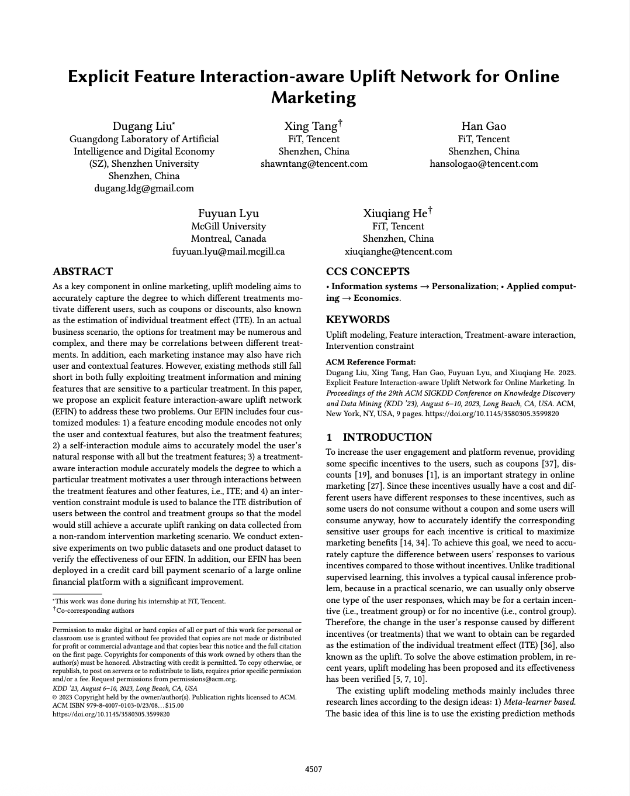
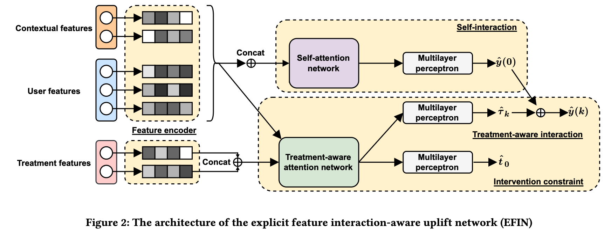
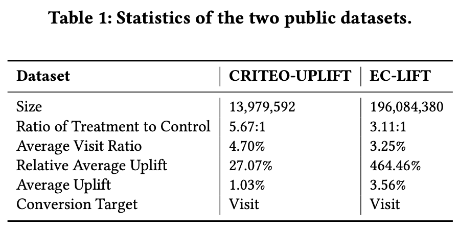
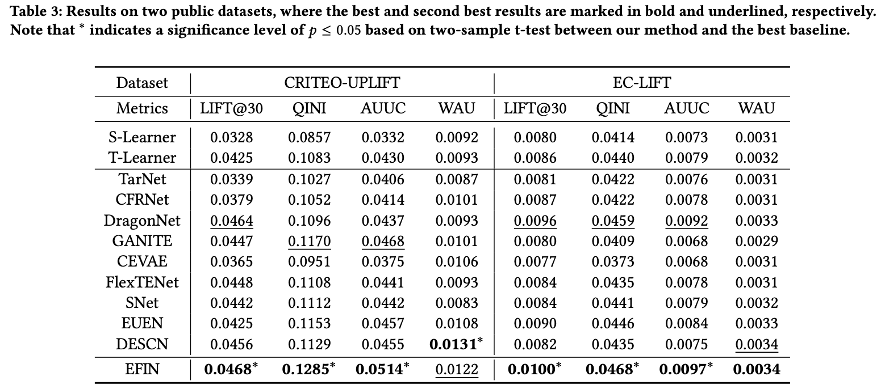
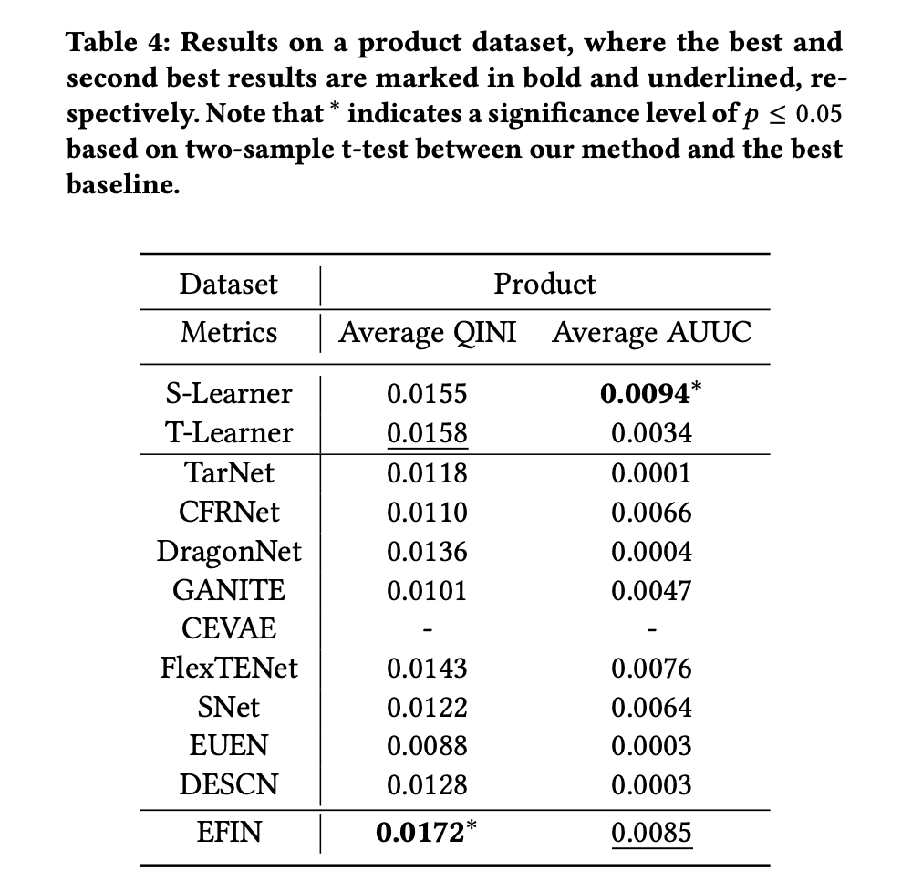
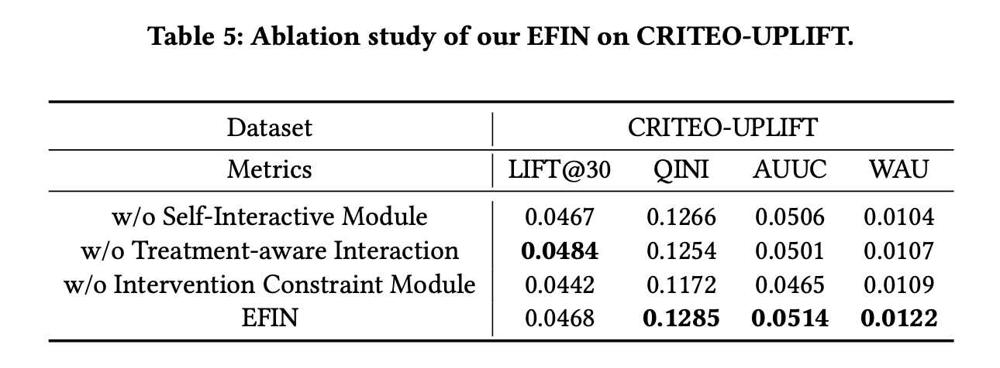
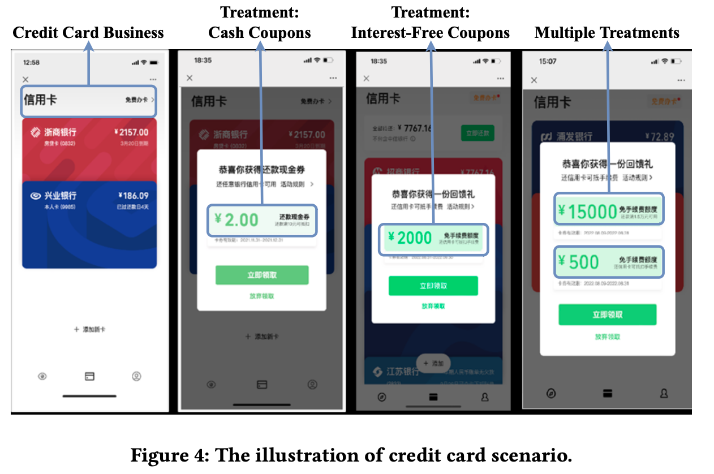
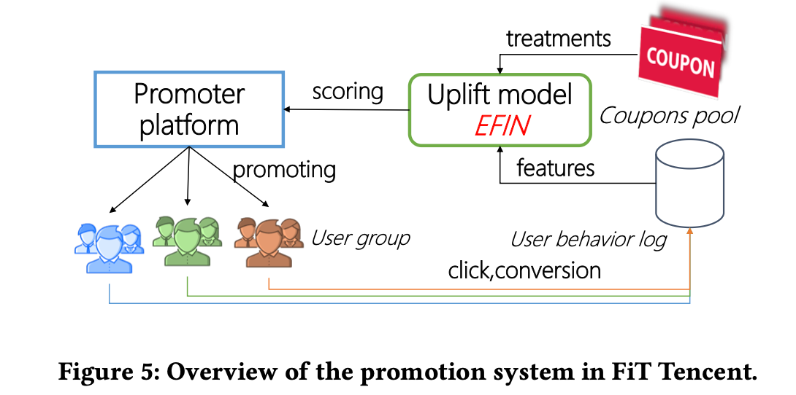
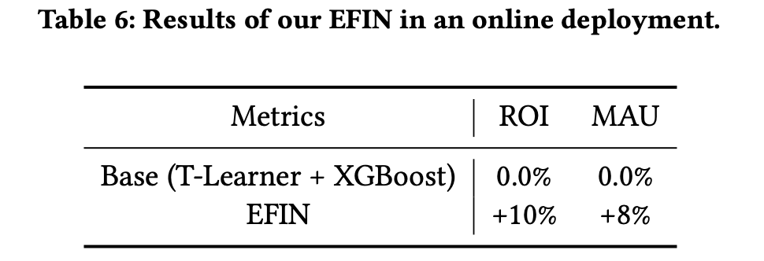

**速览1**：腾讯团队提出 EFIN，一种显式特征交互感知的 Uplift 模型，通过分别建模用户自然响应和 Treatment-Aware 特征交互，挖掘不同优惠券对不同用户的异质性激励效果，并利用 Intervention Constraint 缓解非随机干预带来的组间分布差异。

**速览2**：EFIN 在 CRITEO-UPLIFT、EC-LIFT 和腾讯信用卡还款优惠券业务数据集上取得较好的离线效果，并在腾讯线上业务中实现 ROI 提升 10%、MAU 提升 8%。代码仓库：https://github.com/dgliu/KDD23_EFIN

## 01 论文信息
**标题**：Explicit Feature Interaction-aware Uplift Network for Online Marketing / 面向在线营销的显式特征交互感知 Uplift 网络

**作者**：Dugang Liu、Xing Tang 等

**期刊/会议**：KDD

**发表时间**：2023年8月

**链接**：https://doi.org/10.1145/3580305.3599820

## 02 核心问题
论文研究的是复杂在线营销场景下的**多 Treatment Uplift 建模问题**。

## 03 核心要点
**显式利用 Treatment 特征，而不是仅使用 Treatment ID**。使模型能够利用优惠券面额、最低消费门槛等信息，学习不同 Treatment 之间的关联。

**显式建模 Treatment 与用户特征之间的交互**。不同用户特征对不同 Treatment 的响应具有不同的敏感程度。例如，用户的历史消费能力可能影响其对高面额优惠券的响应，而用户的消费频率可能影响其对低门槛优惠券的响应。

**利用 Intervention Constraint 缓解非随机干预造成的分布差异**。利用与 ITE 密切相关的特征表示预测用户所属组，并使用反向组标签进行训练，以增加模型根据 ITE 相关表示识别原始分组的难度，从而调整不同组之间的 ITE 分布。

**支持多种 Treatment 形式，并在真实营销业务中验证**。在两个公开数据集上开展二元 Treatment 实验，并在腾讯信用卡还款优惠券业务中处理七种 Treatment，验证了模型对复杂优惠券场景的适应能力。

## 04 研究动机
**现有 Uplift 模型对 Treatment 信息利用不足**。在实际营销业务中，Treatment 往往包含多个属性。例如，一张优惠券可能包含优惠金额、最低消费金额等信息。这些属性能够反映不同优惠券之间的关联关系。

**现有模型缺乏对 Treatment 与用户特征交互的显式建模**。用户对某种 Treatment 的响应不仅取决于用户自身特征，也取决于这些特征与具体 Treatment 的匹配程度。例如，同一用户的历史消费金额、消费频率等特征，可能对不同面额的优惠券产生不同影响。

**非随机 Treatment 分配导致处理组与对照组存在分布差异**。模型可能学习到不同的 ITE 分布，进而影响 Uplift 排序的准确性。

## 05 方法思路
### 问题定义
整个训练数据集表示为：

$$
\{z_i\}_{i=1}^{n}
=
\{(\boldsymbol{x}_i,\boldsymbol{t}_i,y_i)\}_{i=1}^{n}
\in
\mathcal{X}\times\mathcal{T}\times\mathcal{Y}
$$

其中：
- $n$：训练样本总数。
- $\mathcal{X}$：非 Treatment 特征空间。
- $\mathcal{T}$：Treatment 特征空间。
- $\mathcal{Y}$：响应标签空间。
- $z_i$：第 $i$ 条营销样本。
- $\boldsymbol{x}_i$：用户特征和上下文特征组成的特征向量。
- $\boldsymbol{t}_i$：Treatment 特征向量。
- $y_i$：用户的实际响应标签。

具体而言，非 Treatment 特征向量定义为如下。包含用户特征和上下文特征，共涉及 $d_x$ 这一维度参数。
$$
\boldsymbol{x}_i=
(x_{i0},x_{i1},\ldots,x_{i,d_x-1},x_{i,d_x})
$$

treatment 特征向量定义如下。包含 $d_t$ 这一维度参数对应的 Treatment 特征。
$$
\boldsymbol{t}_i=
(t_{i0},t_{i1},\ldots,t_{i,d_t-1},t_{i,d_t})
$$

假设每条样本的第一个 Treatment 特征 $t_{i0}$ 表示 Treatment 的索引 ID，所有 Treatment 的总数为 $K$，因此：
$$
t_{i0}\in\{0,1,\ldots,K\}
$$

其中：
- $t_{i0}=0$：表示用户没有接受任何 Treatment，即 Control。
- $t_{i0}=k$：表示用户接受了第 $k$ 种 Treatment，其中 $k\in\{1,\ldots,K\}$。

响应标签定义如下。表示第 $i$ 条样本是否发生目标响应。例如，在信用卡还款优惠券场景中，可以表示用户是否完成信用卡还款。
$$
y_i\in\{0,1\}
$$

倾向得分的定义：

$$
\pi_k(\boldsymbol{x}_i)
=
P(t_{i0}=k\mid \boldsymbol{x}_i)
$$

其中：
- $\pi_k(\boldsymbol{x}_i)$：给定用户特征和上下文特征后，用户被分配到第 $k$ 种 Treatment 的概率。
- $t_{i0}=k$：用户实际接受第 $k$ 种 Treatment。
- $\boldsymbol{x}_i$：用户及上下文特征。

ITE的定义：
$$
\begin{aligned}
\tau_k(\boldsymbol{x}_i)
&=
\mathbb{E}
\left(
y_i(k)-y_i(0)\mid\boldsymbol{x}_i
\right)\\
&=
\mathbb{E}
\left(
y_i(k)\mid t_{i0}=k,\boldsymbol{x}_i
\right)\\
&\quad-
\mathbb{E}
\left(
y_i(0)\mid t_{i0}=0,\boldsymbol{x}_i
\right)
\end{aligned}
$$

### 整体框架

EFIN 的整体架构包含四个模块：特征编码模块、自然响应建模模块、Treatment 感知交互模块和干预约束模块。

整体优化目标定义为：

$$
\min_{\theta}
L_{EFIN}
=
L_S+L_T+L_C+\lambda\|\theta\|
$$

其中：
- $L_S$：Self-interaction 模块的自然响应预测损失。
- $L_T$：Treatment-aware Interaction 模块的 Treatment 响应预测损失。
- $L_C$：Intervention Constraint 模块的分组约束损失。
- $\lambda$：正则化权重。
- $\|\theta\|$：模型参数的正则化项。

### 训练和推理流程
**训练流程**：
- Feature Encoder 分别编码用户、上下文和 Treatment 特征。
- Self-interaction 模块使用非 Treatment 特征学习自然响应，并通过对照组样本进行监督训练。
- treatment-aware Interaction 模块使用 Treatment 特征与非 Treatment 特征进行交互，获得 Treatment 感知的用户表示，并通过处理组样本学习 Treatment 响应。
- Intervention Constraint 模块利用 Treatment-Aware 特征表示预测用户所属组，并通过反向组标签构建约束损失。三个损失与正则化项共同组成最终优化目标，进行联合训练。

**推理流程**。只需要使用 Treatment-aware Interaction 模块直接计算 ITE，再进行排序和决策。

### 特征编码模块
该模块负责将非 Treatment 特征和 Treatment 特征分别转换为 Embedding 表示。得到：
- $\boldsymbol{e}_i^x$：非 Treatment 特征的 Embedding。
- $\boldsymbol{e}_i^t$：Treatment 特征的 Embedding。

对于 Treatment 中的连续特征，使用共享全连接网络进行编码，这里的共享是指：对于同一个连续型特征，不同样本的该特征使用同一套 $W_j$ 和 $b_j$ 参数进行编码，而不是为每一个样本单独学习一套映射参数。对于 Treatment 中的稀疏特征，为每个特征建立独立的 Embedding Table，通过 Lookup 操作获得对应的 Embedding。具体编码方式如下。
$$
e_{ij}^{t}=
\begin{cases}
W_j*t_{ij}+b_j,
& t_{ij}\text{ is a continuous feature}\\
lookup(E_j,e_{ij}),
& t_{ij}\text{ is a sparse feature}
\end{cases}
$$

其中：
- $t_{ij}$：第 $i$ 个样本的第 $j$ 个 Treatment 特征。
- $W_j$：对应连续特征的权重矩阵。
- $b_j$：对应连续特征的偏置向量。
- $E_j$：稀疏特征对应的 Embedding Table。
- $lookup$：根据特征取值从 Embedding Table 中获取向量。

### 自然响应建模模块
该模块的目标是建模用户在没有接受任何营销干预时的自然响应。

第一步：使用 Self-Attention 建模非 Treatment 特征之间的交互。
$$
Q=K=V=
\left(
e_{i0}^{x};
e_{i1}^{x};
\ldots;
e_{id_x}^{x}
\right)
$$

$$\tilde{e}_{x_i} = \text{softmax}\left(\frac{Q K^T}{\sqrt{K_d}}\right) V$$

经过加权聚合后，每个特征槽位都融合了与其他相关特征的交互信息，得到更新后的特征表示 $\tilde{e}_{x_i} = \{\tilde{e}_{x_{i0}}, \tilde{e}_{x_{i1}}, \dots, \tilde{e}_{x_{id_x}}\}$。

第二步：通过 MLP 预测自然响应。
$$\hat{y}_i^{(0)} = W_s \cdot \text{concat}(\tilde{e}_{x_i}) + b_s$$

$$
L_S=L(\hat y_i(0),y_i(0))
$$

### Treatment 感知交互模块
这是 EFIN 最核心的模块，通过 Treatment-Aware Attention 学习不同用户特征对特定 Treatment 的敏感程度。其核心思想是：不同 Treatment 应该关注不同的用户特征，而不是对所有 Treatment 使用完全相同的特征表示。

第一步：计算 Treatment-Aware Attention 权重。计算每个非 Treatment 特征在当前 Treatment 条件下的重要性。

$$
\alpha_{ij}
=
Softmax\left(
W_{t0}^{\top}
Relu\left(
W_{t1}e_i^t+
W_{t2}e_{ij}^x+
b_{t2}
\right)
\right)
$$

其中：
- $\alpha_{ij}$：第 $i$ 个样本中，第 $j$ 个非 Treatment 特征对应的注意力权重。
- $e_i^t$：Treatment 特征 Embedding。
- $e_{ij}^x$：第 $j$ 个非 Treatment 特征 Embedding。
- $W_{t0}$、$W_{t1}$、$W_{t2}$：网络中的权重矩阵。
- $b_{t2}$：偏置向量。
- $Relu$：非线性激活函数。
- $Softmax$：将注意力分数归一化。

第二步：加权聚合用户敏感特征。该公式将不同用户特征按照其对当前 Treatment 的敏感程度进行加权聚合，最终得到的 $e_i^{xt}$ 不再只是用户的一般性特征表示，而是包含了当前 Treatment 与用户特征交互信息的表示。

$$
e_i^{xt}
=
\sum_{j=1}^{d_x}
\alpha_{ij}e_{ij}^{x}
$$

其中：
- $e_i^{xt}$：经过 Treatment-Aware Attention 聚合后的特征表示。
- $\alpha_{ij}$：非 Treatment 特征对应的注意力权重。
- $e_{ij}^{x}$：对应的非 Treatment 特征 Embedding。

第三步：估计用户的 ITE。

$$
\hat\tau_k(x_i)
=
W_{t3}*e_i^{xt}+b_{s3}
$$

其中：
- $\hat\tau_k(x_i)$：模型预测的用户对 Treatment $k$ 的 ITE。
- $W_{t3}$：预测网络的权重矩阵。
- $b_{s3}$：论文公式中标注的偏置项。

第四步：组合自然响应与 ITE，得到 Treatment 响应。

$$
\hat y_i(k)
=
\hat y_i(0)+\hat\tau_k(x_i)
$$

其中：
- $\hat y_i(0)$：用户不接受 Treatment 时的预测响应。
- $\hat\tau_k(x_i)$：用户接受 Treatment $k$ 后产生的增量响应。
- $\hat y_i(k)$：用户接受 Treatment $k$ 时的预测响应。

第五步：Treatment 响应监督训练。学习不同 Treatment 下的用户响应。

$$
L_T=L(\hat y_i(k),y_i(k))
$$

### 干预约束模块
该模块主要解决，非随机 Treatment 分配导致的处理组和对照组分布差异问题。其核心思想是：模型希望降低 ITE 相关表示中 能够区分处理组和对照组的信息，使两个组的 ITE 分布更加相似。

第一步：预测用户所属组。使用 Treatment-Aware Attention 网络输出的交互特征表示 $e_i^{xt}$，通过一个 MLP 预测用户所属的组。

$$
\hat t_{i0}
=
W_c*e_i^{xt}+b_c
$$

其中：
- $\hat t_{i0}$：模型预测的 Treatment 分组结果。
- $e_i^{xt}$：Treatment-Aware Attention 模块输出的特征表示。
- $W_c$：预测网络的权重矩阵。
- $b_c$：偏置向量。

第二步：使用反向组标签进行训练。对于二元 Treatment，直接将原始组标签取反即可；对于多值 Treatment，则先根据原始标签进行独热编码，再逐元素取反。

$$
L_C=L(\hat t_{i0},\bar t_{i0})
$$

其中，$\bar t_{i0}$ 表示经过反向处理后的组标签。

## 06 结果分析
### 数据集

论文使用两个公开数据集和一个腾讯内部业务数据集。两个公开数据集按照 8:2 的比例随机划分训练集和测试集，论文在公开数据集实验中按照既有研究设置，将 Treatment 作为二元特征处理。业务数据集按照 9:1的比例随机划分训练集和测试集，使用七种 Treatment，能够进一步验证 EFIN 在多值 Treatment 场景下的表现。

**CRITEO-UPLIFT**。由 Criteo AI Labs 开源，是一个大规模广告场景下的 Uplift 数据集。样本数量：13,979,592。特征：12 个连续特征。Treatment：二元 Treatment。

**EC-LIFT**。由阿里妈妈开源，面向大规模广告场景下不同品牌的 Uplift 建模。原始数据规模：数十亿级。实验使用数据：从原始数据中抽取约 40%。特征：25 个离散特征和 9 个多值特征。Treatment：二元 Treatment。目前数据源链接已失效。

**腾讯信用卡还款优惠券业务数据集**。来自腾讯 FiT 的信用卡还款优惠券营销场景。数据采集周期：两周。用户数量：200 万。样本数量：200 万。特征数量：200 多个。Treatment 数量：7 种。

### Baseline和评价指标
Baseline包括：S-Learner、T-Learner、TarNet、CFRNet、DragonNet、GANITE、CEVAE、SNet、FlexTENet、EUEN 和 DESCN。

评价指标包括：
- LIFT@30：考察模型排序前 30% 用户群体的 Uplift 表现。
- AUUC：Uplift 曲线下面积，用于评价模型整体的增量响应排序能力。
- QINI：Qini 曲线下面积，用于衡量模型相对于随机策略的增量收益识别能力。
- WAU：Weighted Average Uplift，用于评价加权平均 Uplift 表现。

### 整体效果

**CRITEO-UPLIFT 实验结果**：EFIN 在 LIFT@30、QINI 和 AUUC 上取得最优结果，并且与最佳基线模型的差异达到统计显著水平。但 WAU 指标上 EFIN 并不是最优模型。DESCN 的 WAU 为 0.0131，高于 EFIN 的 0.0122。从 QINI 指标来看，EFIN 达到 0.1285，明显高于第二名 GANITE 的 0.1170。

**EC-LIFT 实验结果**：EFIN 在 LIFT@30、QINI 和 AUUC 上均取得最优结果，且前三项指标均达到论文标注的统计显著水平。WAU 为 0.0034，与 DESCN 持平。EC-LIFT 包含大量高维稀疏特征，传统模型在该数据集上的性能优势有所下降，而 EFIN 仍然能够保持领先。

**业务数据集实验结果**：由于该数据集包含七种 Treatment，论文将原本主要面向二元 Treatment 的基线模型扩展为多头结构，CEVAE 因其分布估计结构难以直接扩展到多头架构，因此没有报告其结果。评价时，将多值 Treatment 分别视为多个二元 Treatment，计算各个 Treatment 对应的指标，最后对指标取平均。EFIN 的 Average QINI 在所有对比模型中排名第一，高于 T-Learner 的 0.0158。但是，Average AUUC 并非第一，S-Learner 达到 0.0094，高于 EFIN 的 0.0085。

### 消融实验

论文在 CRITEO-UPLIFT 数据集上开展消融实验，分别移除三个核心模块，观察模型性能变化。

**移除 Self-interaction 模块**：相比完整 EFIN，QINI、AUUC 和 WAU 均出现下降。说明单独建模用户的自然响应，有助于区分用户本身的消费倾向与 Treatment 带来的增量响应。

**移除 Treatment-aware Interaction 模块**：其中，LIFT@30 反而略有提升，但 QINI、AUUC 和 WAU 均下降。说明该模块对整体 Uplift 排序效果具有积极作用，但其收益并不意味着所有评价指标都必然同步提升。

**移除 Intervention Constraint 模块**：相比完整 EFIN，四项指标均出现下降。尤其是 QINI 从 0.1285 降低至 0.1172，下降幅度较为明显。这说明在存在非随机 Treatment 分配的业务数据中，Intervention Constraint 对模型的 Uplift 排序表现具有重要作用。

### 线上业务部署
论文将 EFIN 部署到腾讯 FiT 的信用卡还款业务中。

业务场景如上图所示，该业务的目标是通过不同类型的优惠券激励用户在平台内完成信用卡还款。

上图展示了整体营销系统架构，线上系统流程可以概括为：从用户行为日志等数据源获取用户行为数据，并使用 Apache Spark 进行特征处理。构建包含不同优惠金额的优惠券候选池。使用 EFIN 对每个用户在每一种优惠券下的 Uplift 进行评分。由 Promoter Platform 根据业务资源约束，向目标用户群体发放对应优惠券。

论文进行线上 A/B 实验，涉及数亿用户。对比基线为：T-Learner + XGBoost。基线模型和 EFIN 分别部署在独立流量中，实验持续一个月。评价指标包括：ROI 营销投资回报率，MAU 月活跃用户数量。实验结果表明，相较于基线模型，ROI +10%， MAU +8%。说明 EFIN 不仅在离线 Uplift 排序指标上表现较好，在真实线上营销场景中也能够带来业务收益提升。

## 07 局限与展望
**探索更多特征交互架构**。希望进一步研究不同特征交互架构在 Uplift 建模中的有效性，分析不同交互机制对 Treatment 效应估计的影响。

**进一步挖掘 Treatment 特征的价值**。如何更充分地利用 Treatment 特征，以及 Treatment 特征与非 Treatment 特征之间的交互关系，仍然是值得研究的问题。

**扩展到更复杂的 Uplift 场景**。例如，带业务约束（如净利润）的决策建模，以及动态视角下的用户响应变化建模

## 论文摘要
Uplift 建模是在线营销中的一个重要组成部分，其目标是准确捕捉不同 Treatment 对不同用户的激励程度，例如优惠券或折扣，也称为个体处理效应（ITE）估计。在实际业务场景中，Treatment 的选择可能非常多且复杂，不同 Treatment 之间还可能存在关联。每个营销样本也可能包含丰富的用户特征和上下文特征。然而，现有方法没有充分利用干预信息，以及在非干预特征对特定干预的敏感程度方面挖掘不足。论文提出了一种显式特征交互感知的 Uplift 网络，即 EFIN。包含四个定制化模块：特征编码模块：不仅对用户特征和上下文特征进行编码，同时也对 Treatment 特征进行编码。自交互模块：通过使用除 Treatment 特征之外的所有特征，准确建模用户的自然响应。Treatment 感知交互模块：通过 Treatment 特征与其他特征之间的交互，准确建模特定 Treatment 对用户产生的激励程度，即 ITE。干预约束模块：用于平衡处理组与对照组用户的 ITE 分布，使模型在非随机干预营销场景下采集的数据上，仍然能够获得准确的 Uplift 排序结果。论文在两个公开数据集和一个产品业务数据集上进行了大量实验，以验证 EFIN 的有效性。此外，EFIN 已经部署在Tencent Fit的信用卡账单支付业务场景中，并取得了显著的业务提升。
