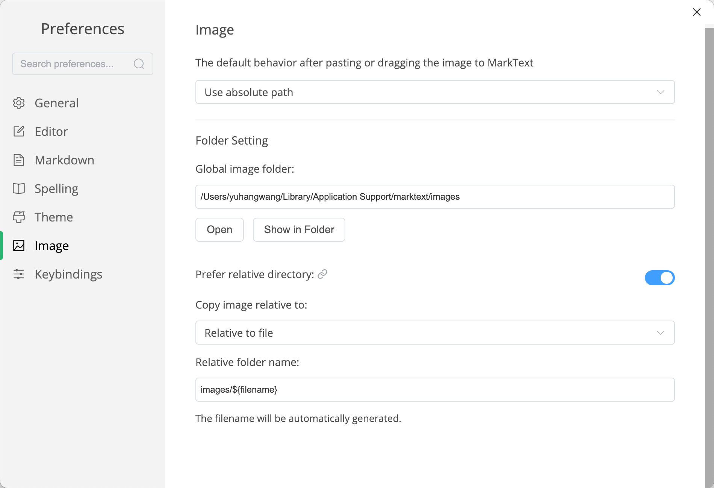

icloud同步blog文件夹，保存markdown文件和图片，多设备可同步修改。

新建markdown文件时，同步在images文件夹中新建同名文件夹，后续此文章中图片存放于此，文章中插入图片时，使用相对路径。

写博文可选MarkText或VS Code

- MarkText在Preferences → Image中设置，注意软件升级到最新版本

- VS Code中安装Markdown Paste插件，Preferences → Settings中找到Markdown Paste配置，修改path参数`${fileDirname}/images/${fileBasenameNoExtension}"`,配置完成后使用command+option+v粘贴图片。

